<h1 align="center">Mantel</h1>

Home Assistant dashboards inspired by Apple’s Home app, as their own server. 
Real accounts and roles, wall tablets that sign themselves in, and an audit log of every command.

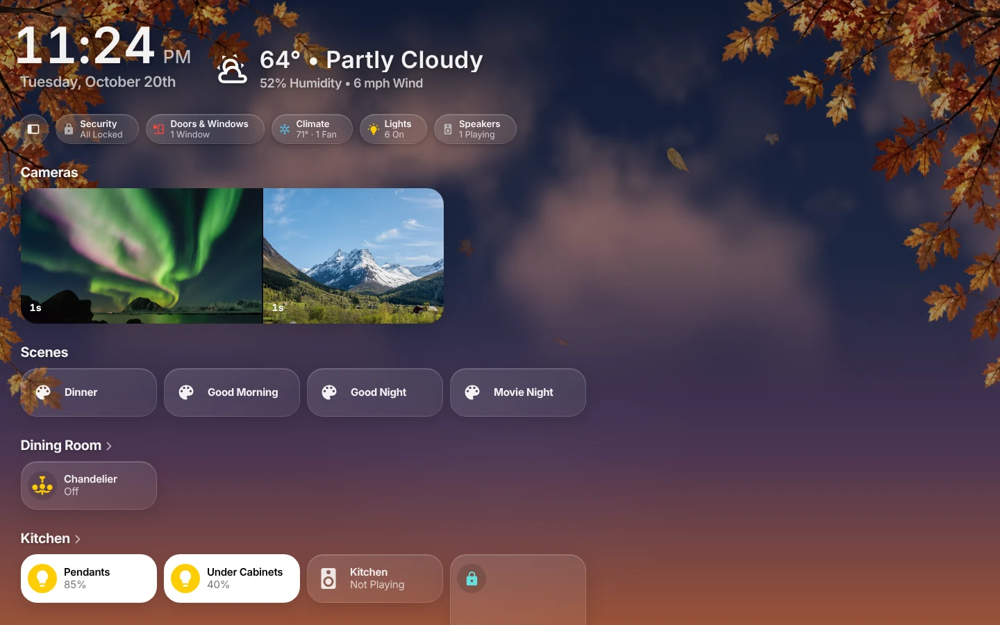

<b><a href="docs/guide/Install.md">Install</a></b> ·
<b><a href="docs/guide/Home.md">Documentation</a></b> ·
<b><a href="docs/guide/Security-Model.md">Security</a></b> ·
<b><a href="CHANGELOG.md">What’s new</a></b>

## What Mantel is

[HK Frontend](https://github.com/jazzphone/hk-frontend) turns Home Assistant into screens like Apple’s Home app, built from your own rooms and devices. **Mantel** serves those same screens from a server of its own. It talks to Home Assistant and Music Assistant over their APIs, so nobody needs a Home Assistant account to use the screens, and it adds what Home Assistant can’t do:

- **People and roles.** Owner, Admin, Adult, Child and Guest, each with what they may see and control, room by room. A child’s tablet shows their room; a guest can turn on the lights but not unlock the door. ([People and Roles](docs/guide/People-and-Roles.md))
- **Sign in your way.** Passwords, passkeys, authenticator codes, or sign in with Home Assistant. ([Signing In](docs/guide/Signing-In.md))
- **Wall tablets that look after themselves.** Enroll a tablet once and it keeps its own credential and role, whoever walks up to it. ([Wall Tablets](docs/guide/Wall-Tablets.md))
- **Every command checked and written down.** Each command is checked against the person’s and the tablet’s role and written to the audit log before it reaches the house. Commands stay off until you turn them on. ([Commands and Audit](docs/guide/Commands-and-Audit.md))
- **Your settings, per person.** Favorites, the screen you open on, and HK’s settings, kept by Mantel with their history.
- **Music, cameras and photos.** Music Assistant and your cameras through Mantel, and a photo library for the screensaver. ([Music and Cameras](docs/guide/Music-and-Cameras.md), [Photos](docs/guide/Photos.md))

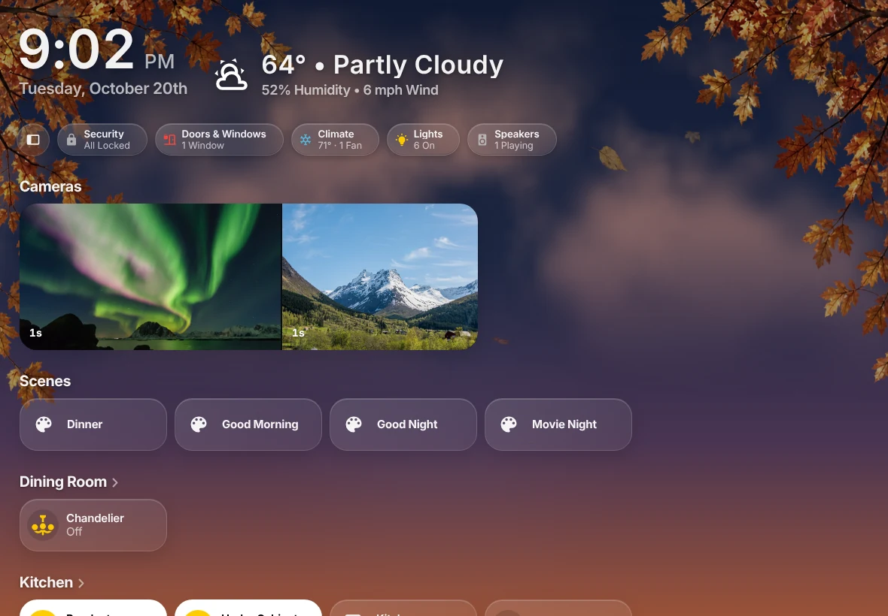
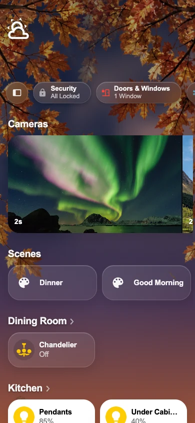

## The screens you know

Mantel draws HK Frontend’s pages with HK’s own code: Home, a page per room, Lights, Climate, Security, Cameras, Music, Energy and more, with the live sky behind them. See [HK Frontend’s gallery](https://github.com/jazzphone/hk-frontend/wiki/Gallery) for the whole tour.

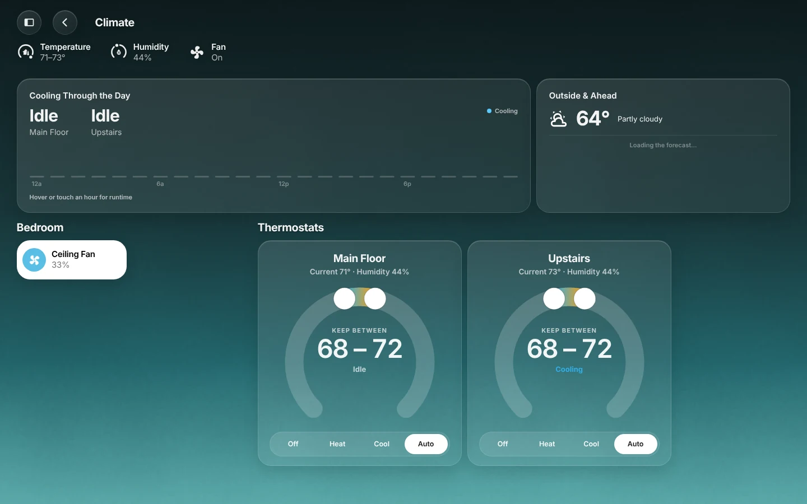
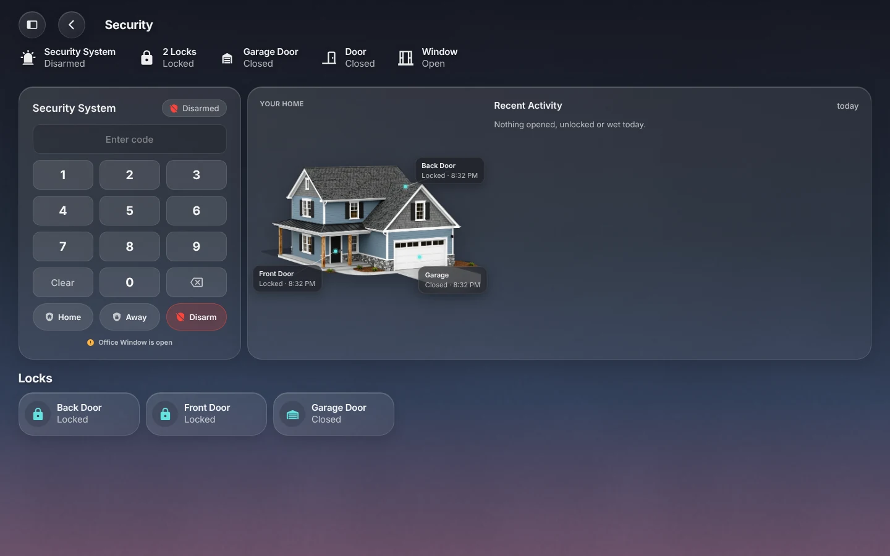

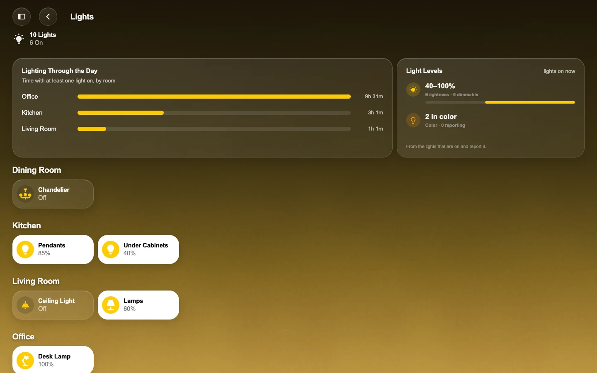
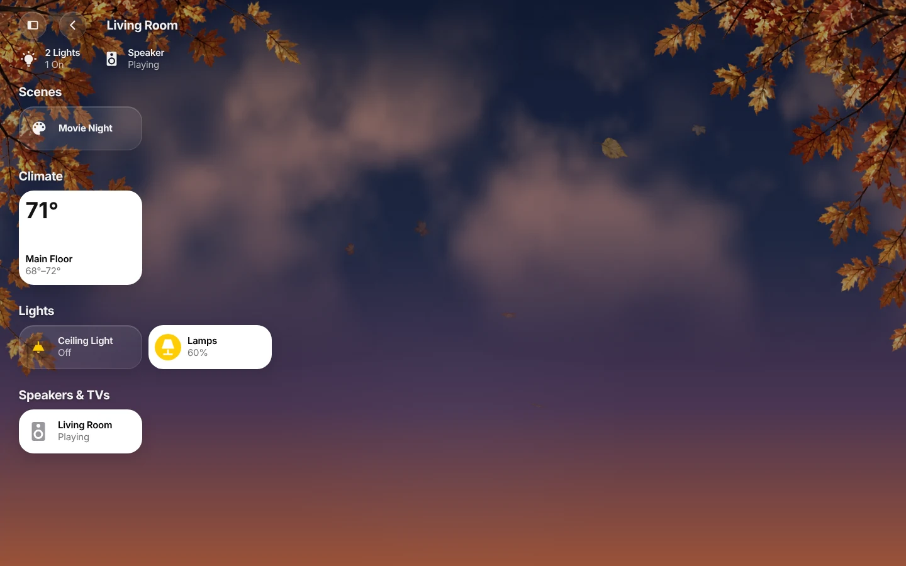

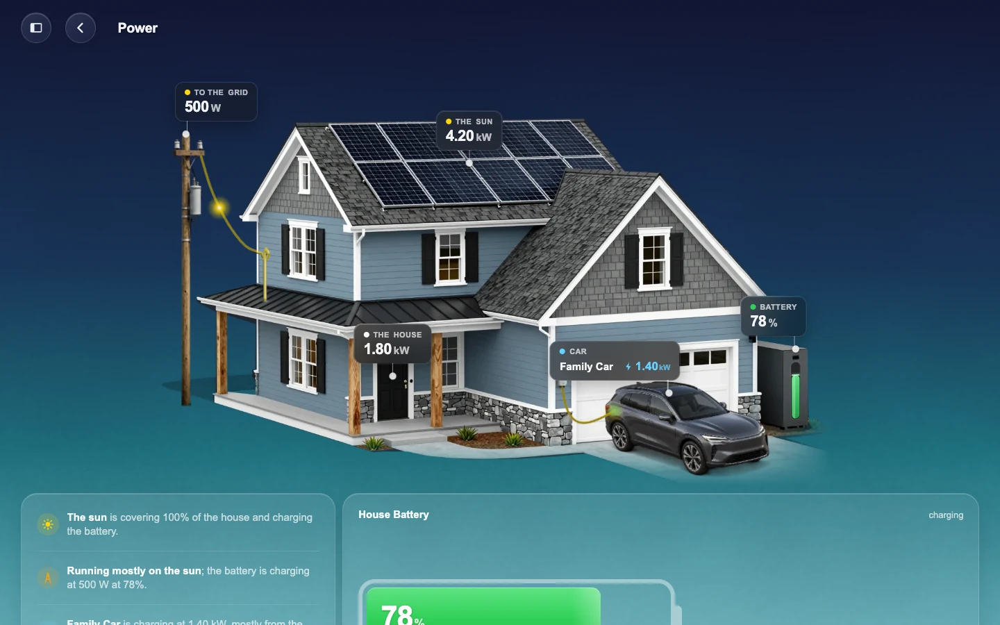
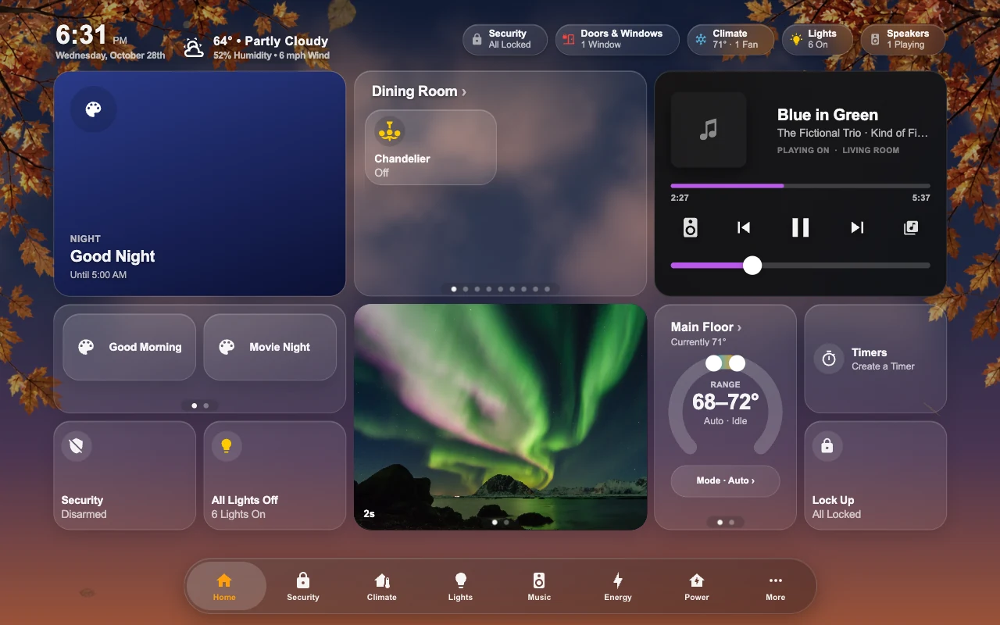

**[Home Grid](docs/guide/Home-Grid.md)** lays a tablet's Home page out in fixed blocks, arranged in a desktop editor; a Now Playing block turns over to choose speakers or browse the library. **[Edit mode](docs/guide/Arrange-a-Page.md)** arranges any page in place: drag tiles, make them tall, and reorder the menu, the tab bar and the rooms.

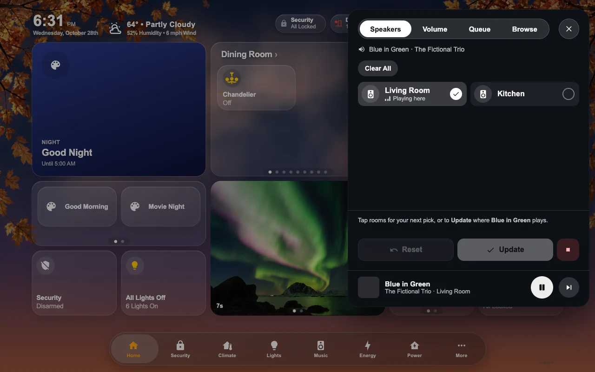
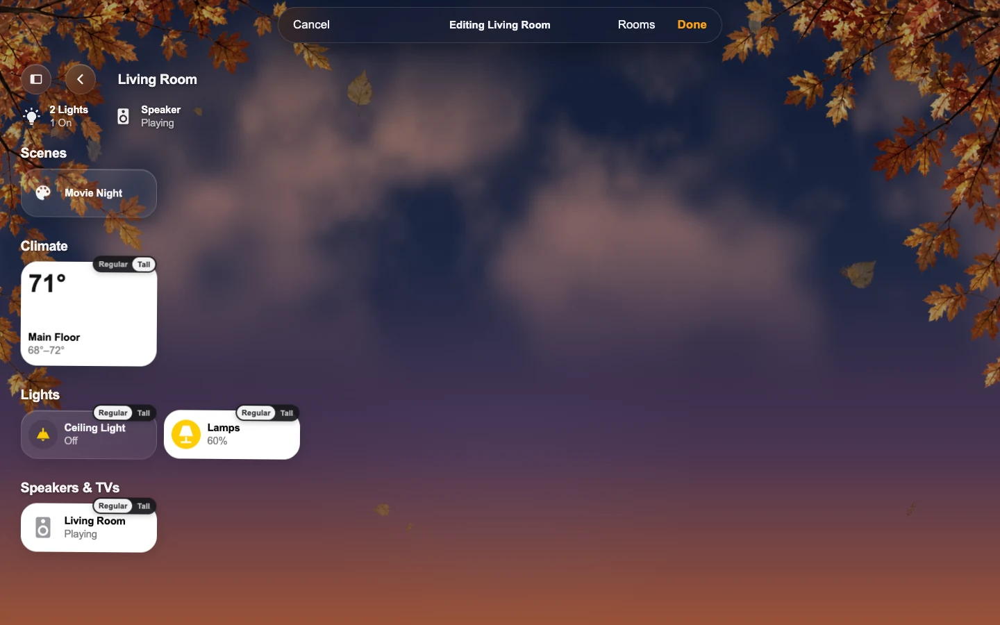

## Mantel Settings

One place for the house and the people in it: who can sign in and with what role, the wall tablets, the grants that add to or take from a role, the audit log, and HK’s own settings for every screen.

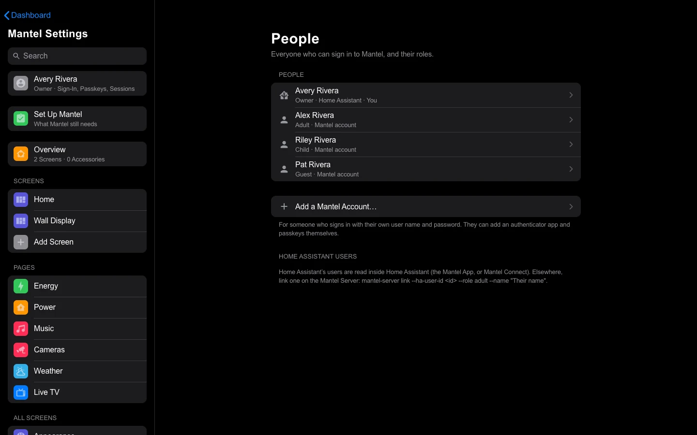
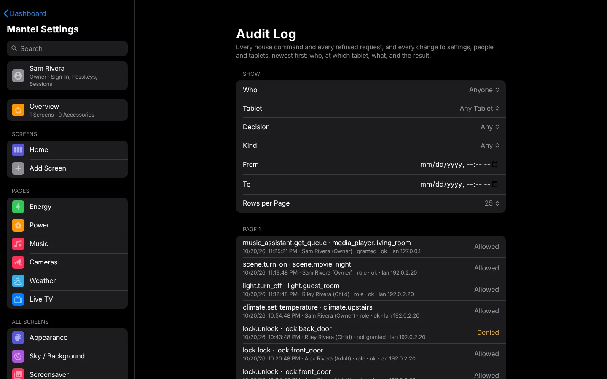

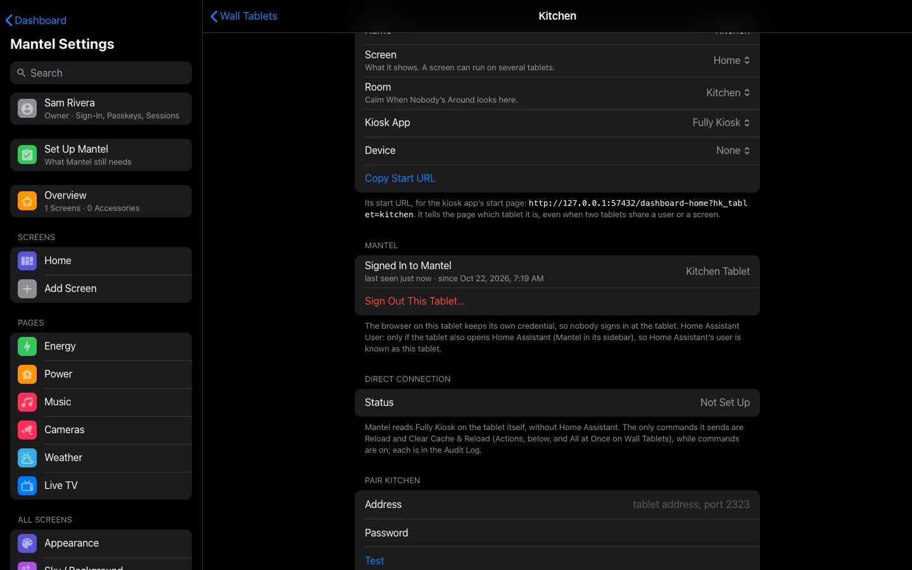
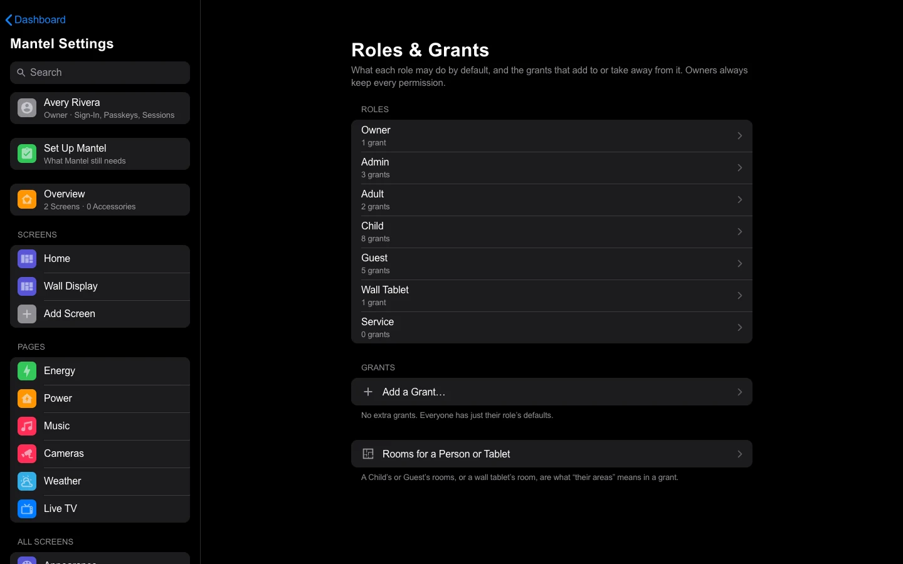

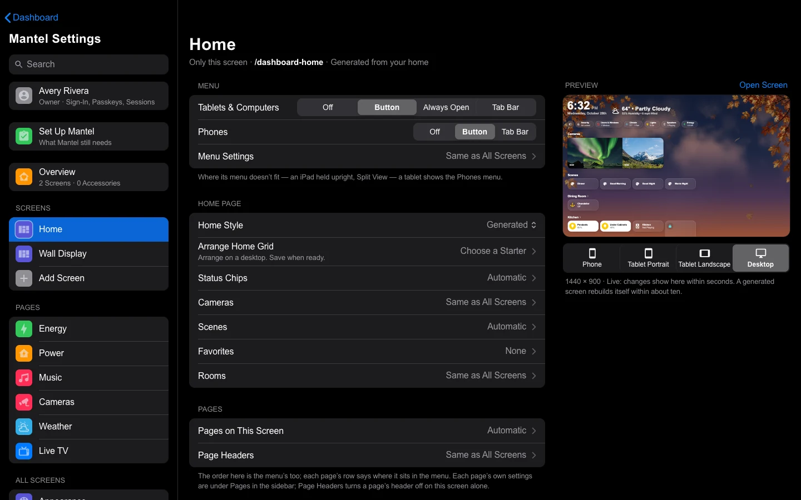
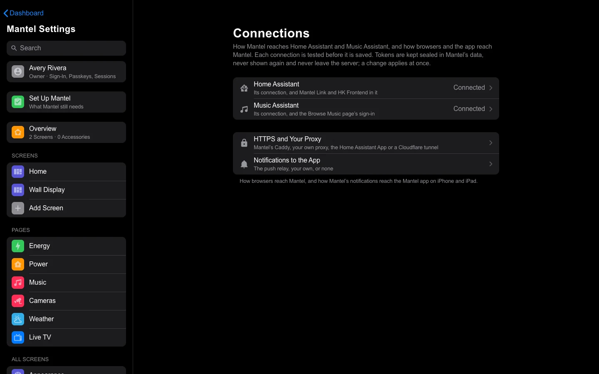

## Run it your way

All three run the same server; only the setup differs.

| | Best for | Guide |
|---|---|---|
| **Home Assistant App** | Home Assistant OS or Supervised. Mantel appears in Home Assistant’s sidebar. | [Install](docs/guide/Install.md) |
| **Docker Compose** | Any Docker host, with a reverse proxy for HTTPS. | [Install with Docker](docs/guide/Install-Docker.md) |
| **Proxmox LXC** | A Proxmox host, in its own container. | [Install on Proxmox](docs/guide/Install-Proxmox-LXC.md) |

**[Mantel Link](docs/guide/Mantel-Link.md)** ([its repository](https://github.com/jazzphone/mantel-link)) connects Home Assistant to Mantel, and **[Mantel Connect](docs/guide/Mantel-Connect.md)** puts Mantel in Home Assistant’s sidebar when it runs elsewhere.

## Mantel, HK Frontend and Mantel Link

**HK Frontend and Mantel are two products** from the same code: [HK Frontend](https://github.com/jazzphone/hk-frontend) is HK inside Home Assistant, Mantel is HK as its own server, and Mantel Link is Mantel's integration in Home Assistant. Use either product, or run both together: [HK Frontend and Mantel](docs/guide/HK-Frontend-and-Mantel.md). To move everything from HK Frontend to Mantel, see [Moving from HK Frontend](docs/guide/Moving-from-HK-Frontend.md).

<!-- products-table: copied from tools/products_table.md in Mantel by tools/products_table.py; edit it there -->
| | **Mantel App** (Home Assistant App) | **Mantel with Docker or the LXC** | **HK Frontend alone** | **HK Frontend linked to Mantel** | **Mantel Link** |
|---|---|---|---|---|---|
| **Use this when** | You run Home Assistant OS and want people, roles and wall tablets with nothing extra to look after | Mantel should run on its own machine, at its own address | You want HK on Home Assistant's own dashboards, for people who already use Home Assistant | You want both, with one copy of the settings | You run Mantel and want its tablets, actions and notifications in Home Assistant |
| **Where the screens are** | **Mantel** in Home Assistant's sidebar and the Companion app; its own address too, if you turn on direct access | Its own `https://` address; in Home Assistant's sidebar with Mantel Connect | Home Assistant's own dashboards | Mantel's pages, and HK Frontend's dashboards in Home Assistant | No screens of its own; puts a Mantel screen in Home Assistant's sidebar as a dashboard |
| **HK's cards on dashboards you build** | No | No | Yes | Yes, HK Frontend's | — |
| **Wall tablets (kiosk)** | Enrolled tablets with their own credential and role, in Fully Kiosk, Kiosk Satellite or any browser | The same | A full-screen look inside Home Assistant's page; tablets sign in as Home Assistant users | Each tablet is run by Mantel or by HK Frontend, never both | Each tablet's black screen, screensaver and Sleep Screen as entities |
| **Screensaver and Sleep Screen** | Yes | Yes | Yes | Yes, from whichever runs the tablet | Their switches, for automations |
| **People, roles, passkeys** | Mantel's roles; Home Assistant signs people in to the sidebar; passkeys and passwords at its own address | Mantel's own sign-in: passkeys, passwords, authenticator codes, or Home Assistant | Home Assistant's users | Mantel's people; a change made on HK Frontend's dashboards is saved as the person linked to your Home Assistant user | — |
| **Every command checked and in the audit log** | Yes | Yes | No | On Mantel's screens, and for saves from Home Assistant | — |
| **Remote access** | Home Assistant's own, for the sidebar; a Cloudflare Tunnel for its own address | A Cloudflare Tunnel or your own reverse proxy, with stricter rules away from home | Home Assistant's own | Each one's own | — |
| **Mantel Photos** (albums for the screensaver) | Yes | Yes | No; the screensaver shows a folder of Home Assistant's media | On Mantel's screens | — |
| **iPhone, iPad and Mac apps** | Yes, at its own `https://` address | Yes | No; Home Assistant's Companion app | Yes, with Mantel | Sends Mantel's notifications to Companion-app phones |
| **Music** | Music Assistant, through Mantel | The same | Music Assistant, as an HK Frontend feature | Mantel's; HK Frontend's music actions are run by Mantel | Music actions for your automations |
| **Settings** | **Mantel Settings**: HK's settings, plus people, tablets, connections and the audit log | The same | **HK Settings** in Home Assistant's sidebar | **Mantel Settings**; HK Settings steps aside while Mantel runs the house | None; set up in **Devices & services** |
| **Backups** | Inside Home Assistant's backups | Mantel's own nightly encrypted backups | Inside Home Assistant's backups | Each one's own | Inside Home Assistant's backups |
| **Who runs the house** (Seasonal Decorations, the Alarm PIN keypad, Live TV) | Mantel | Mantel | HK Frontend | Mantel or HK Frontend: **The House**, in Mantel Settings | Holds the house's entities when Mantel runs it |
| **Needs Home Assistant** | Yes: Home Assistant OS or Supervised, 2026.8 or newer | Yes: any Home Assistant 2026.8 or newer it can reach | Yes: 2026.8 or newer | Yes | Yes: any install type, 2026.9 or newer |
| **Installed from** | Home Assistant's App store, with Mantel's repository | Docker Compose, or a script that makes a Proxmox LXC | HACS (custom repository) | HACS, plus Mantel | HACS (custom repository) |

**Why you would use each.** **HK Frontend** is the simplest: install it from HACS and HK's screens appear on Home Assistant's own dashboards, for everyone who already signs in to Home Assistant. **Mantel** is for a household: people who shouldn't need a Home Assistant account, roles per room, wall tablets that sign themselves in, an audit log of every command, and screens that Home Assistant's updates can't disturb. Run it as the **Mantel App** if you have Home Assistant OS, or with **Docker or the LXC** to keep it on a machine of its own. **Mantel Link** goes with Mantel: it is how Home Assistant's automations, entities and Companion-app notifications reach Mantel. And you can **link HK Frontend to Mantel** to keep HK on Home Assistant's dashboards while Mantel runs the tablets and keeps one copy of the settings.

[Mantel](https://github.com/jazzphone/mantel) ([guide](https://github.com/jazzphone/mantel/wiki)) ·
[HK Frontend](https://github.com/jazzphone/hk-frontend) ([guide](https://github.com/jazzphone/hk-frontend/wiki)) ·
[Mantel Link](https://github.com/jazzphone/mantel-link) ·
[Running them together](https://github.com/jazzphone/mantel/wiki/HK-Frontend-and-Mantel)
<!-- /products-table -->

## Safe by default

- **Commands are off** until an Owner turns on **Allow Control of the House**, after confirming it is them with a fresh sign-in. Whoever runs the server can keep the house read-only whatever that switch says.
- **Secrets are files**, never environment variables: the Home Assistant and Music Assistant tokens, the key that encrypts Mantel’s own secrets, and tunnel tokens.
- **Passwords are hashed with Argon2id**; passkeys and authenticator codes are built in.
- **The alarm asks for its PIN**; everything else is decided by roles and grants, and every decision is in the audit log.

Read the [Security Model](docs/guide/Security-Model.md), and report problems privately through [SECURITY.md](SECURITY.md).

## Documentation

- **[User guide](docs/guide/Home.md)** (also [the wiki](https://github.com/jazzphone/mantel/wiki)): install, first run, people and roles, wall tablets, Edit mode, Home Grid, music, cameras, photos, backups, updating, troubleshooting.
- **[HK Frontend's wiki](https://github.com/jazzphone/hk-frontend/wiki)**: the screens themselves, their pages and HK Settings, which Mantel shares.
- **[Mantel Link](https://github.com/jazzphone/mantel-link)**: setup, actions and how the link works.
- **[Development](docs/development/README.md)**: the architecture, building and testing, the screenshots, and the project’s rules. Start with [CONTRIBUTING.md](CONTRIBUTING.md).
- **[Design notes](docs/development/Design-Notes.md)**: the records of how each part was designed and built.

## License

Mantel is released under the [MIT License](LICENSE). The landscape, sky and cloud artwork in `web/hk/` was generated for this project and is released under the same license. The Material Design Icons subset in `web/mdi/` is under its own [license](web/mdi/LICENSE). Apple’s SF Pro font and SF Symbols are not included and never ship; each home supplies its own through [Your Files](https://github.com/jazzphone/hk-frontend/wiki/Your-Files) if it wants them.

Mantel is not affiliated with Apple, Home Assistant or Music Assistant.
