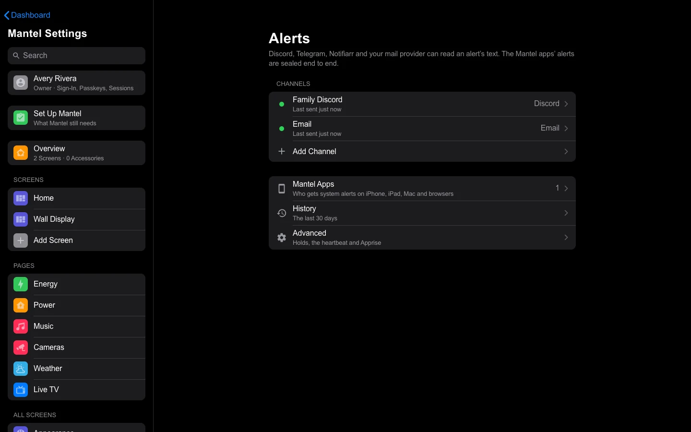
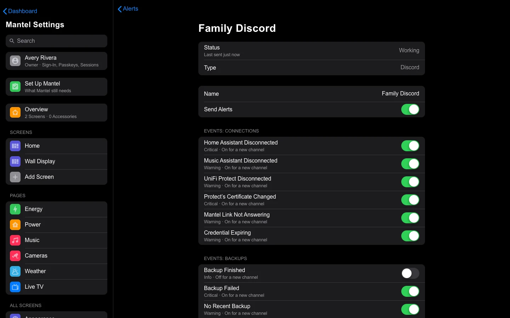
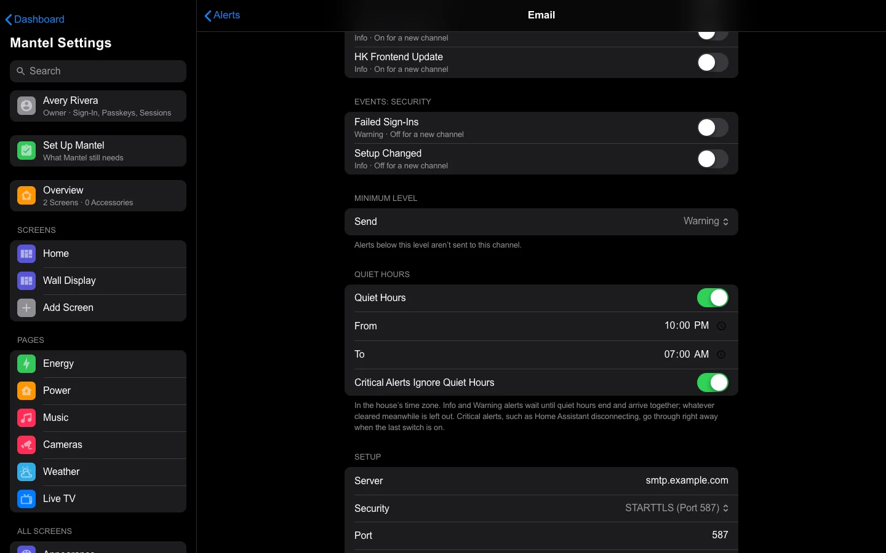
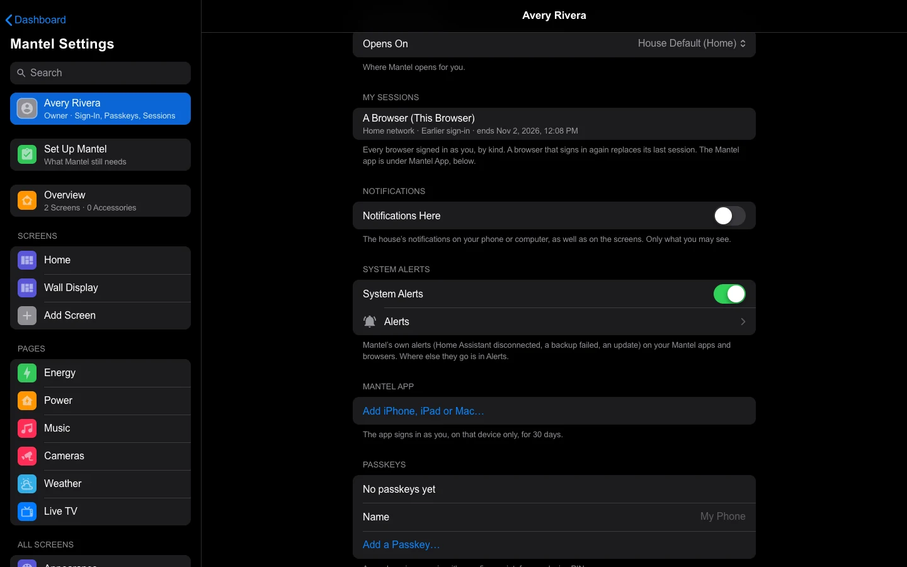
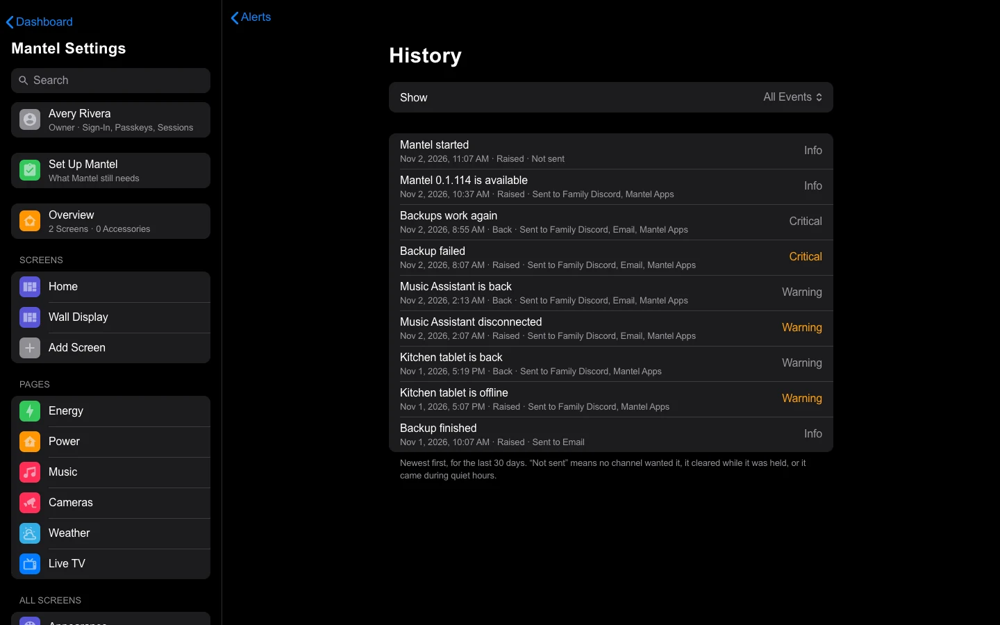

# Alerts

Mantel can tell you when something goes wrong: Home Assistant stops answering, a backup fails, a wall tablet goes dark, a new version is out. These are **system alerts**. They go where you say: a Discord channel, Telegram, Notifiarr, email, any of about a hundred services through Apprise, and the Mantel apps on your phone, iPad and browsers. This page covers what Mantel tells you, how it keeps from nagging, and how to set up each place to send to.

## What system alerts are

System alerts are about **Mantel and its connections**: Home Assistant, Music Assistant, UniFi Protect, [Mantel Link](Mantel-Link.md), your [backups](Backups.md), your wall tablets, the disk, and new releases.

They are not about the house itself. The doorbell, a door left open, a leak and the rules you made are **notifications**, with their own settings: see [Push Notifications](Push-Notifications.md).

They can't tell you **Mantel itself** is down. A server that is off sends nothing. For that, Mantel can call a web address every few minutes, and a service outside your house tells you when the calls stop. That is the [heartbeat](#the-heartbeat-for-mantel-itself).

## What Mantel tells you

Each event has a **level**: **Info** (news), **Warning** (something is wrong, and it can wait a little) or **Critical** (it needs you now). Most events wait out a short **hold** first: the problem has to last that long before anyone is told, so a blip that clears in time is never sent.

A new channel starts with the events marked **Yes** turned on. You choose the events for each channel yourself.

| Group | Event | Level | Told after | On for a new channel |
|---|---|---|---|---|
| Connections | **Home Assistant Disconnected** | Critical | 5 minutes | Yes |
| Connections | **Music Assistant Disconnected** | Warning | 5 minutes | Yes |
| Connections | **UniFi Protect Disconnected** | Warning | 5 minutes | Yes |
| Connections | **Protect’s Certificate Changed**: Mantel stopped talking to Protect until you trust the new certificate | Critical | Right away | Yes |
| Connections | **Mantel Link Not Answering**: Home Assistant is connected, but Mantel Link isn’t | Warning | 5 minutes | Yes |
| Connections | **Credential Expiring**: a saved connection’s credential runs out within 14 days | Warning | Right away | Yes |
| Backups | **Backup Finished**: the file’s name and size | Info | Right away | No |
| Backups | **Backup Failed**: and why | Critical | Right away | Yes |
| Backups | **No Recent Backup**: no good backup in 48 hours | Warning | Right away | Yes |
| Backups | **Backup Folder Not Usable**: missing or read-only | Critical | 10 minutes | Yes |
| Tablets | **Tablet Offline**: a wall tablet's kiosk app hasn't been heard from for 10 minutes | Warning | As described | Yes |
| Tablets | **Tablet Not Charging** | Warning | As described | Yes |
| Tablets | **Tablet Didn’t Come Back**: 3 minutes after its scheduled restart | Warning | As described | Yes |
| Mantel | **Mantel Started** | Info | Right away | No |
| Mantel | **Mantel Stopped Unexpectedly**: it started again after stopping without being asked to | Warning | Right away | Yes |
| Mantel | **Low Disk Space**: under 5% or 1 GB free in Mantel's data or backup folder | Warning | 10 minutes | Yes |
| Mantel | **App Notifications Failing**: the push service refused five in a row | Warning | Right away | Yes |
| Mantel | **Another Channel Failing**: Mantel gave up sending to another channel three times in a row | Warning | Right away | Yes |
| Updates | **Mantel Update**, **Mantel Link Update**, **HK Frontend Update**: a new release ([below](#the-update-alert)) | Info | Right away | Yes |
| Security | **Failed Sign-Ins**: 10 failed sign-ins in 10 minutes | Warning | Right away | No |
| Security | **Setup Changed**: a connection, a role or the Owner changed | Info | Right away | No |

A tablet's own alerts keep the holds they always had: the tablet is offline for 10 minutes, or 3 minutes after its restart. Most of the others come with a "back" message when the problem clears, such as **Home Assistant is back**.

## How Mantel keeps from nagging

- **Holds.** A problem has to last its hold before it is sent. If it clears first, nothing is sent. A "back" message is only sent for a problem that was sent. An Owner can change the holds ([Advanced](#advanced)).
- **One cause, one message.** When Home Assistant is down, the tablets and Mantel Link are down with it, because they go through Home Assistant. Mantel sends one message for Home Assistant, and holds the others. If they clear when Home Assistant comes back, they are never sent.
- **A quiet start.** For the first 3 minutes after Mantel starts, its connection alerts wait: connecting takes a moment. If a connection is still down after that, and its hold is up, you hear about it.
- **Keeps dropping.** One alert is sent at most three times an hour. The fourth time, Mantel says it **keeps dropping** (and how many times), then stays quiet until the problem has stayed away for 15 minutes.
- **Batching.** Alerts that come within 20 seconds of each other go to a channel as one message, such as **3 alerts**, with a line for each.
- **Retries.** If a channel can't be reached, Mantel tries again after 10 seconds, 1 minute and 5 minutes, then gives up on that message. A slow or broken channel never holds up the others. After three in a row, the other channels hear **Another Channel Failing**.

### Quiet hours

Each channel has its own quiet hours, in the house's time zone: **Quiet Hours** on, then **From** and **To**. During them:

- **Info** and **Warning** alerts wait, and arrive together as one message when quiet hours end. An alert that cleared in the meantime is left out.
- **Critical** alerts, such as Home Assistant disconnecting, go through right away when **Critical Alerts Ignore Quiet Hours** is on. It is on for a new channel. Turn it off to hold everything until morning.

## Mantel Settings → Alerts

**Mantel Settings** → **Alerts** is for Owners and Admins. It lists your **Channels**: a dot (green for working, red when the last try failed, gray when it is off or hasn't sent yet), the name, when it last sent or what went wrong, and its type. Below are **Mantel Apps**, **History** and **Advanced**.

A channel is one place to send to. You can have up to 20.

### Add a channel

1. **Mantel Settings** → **Alerts** → **Add Channel**.
2. Choose the **Type**, give it a **Name** (such as `Family Discord`), and fill in the **Setup** boxes for that type ([below](#set-up-each-channel)).
3. Select **Add Channel**. Mantel opens the new channel's page.
4. Select **Send Test**. A real message goes to the channel. If it doesn't arrive, Mantel shows what the service answered, for example `Discord said 401: the webhook was deleted`.
5. Choose its events, level and quiet hours.

### A channel's page

- **Status** says **Working**, **Not Working** (with the error and when) or **Not Used Yet**.
- **Name** and **Send Alerts**: the switch turns the whole channel on or off.
- **Events**, by group: a switch for each, with its level and whether a new channel starts with it.
- **Minimum Level** (**Send**): alerts below this level aren't sent to this channel. For example, **Warning** leaves out Info.
- **Quiet Hours**, with **Critical Alerts Ignore Quiet Hours**.
- **Setup**: the same boxes as when you added it. A secret is never shown again, only its last four characters. Leave a secret box blank to keep what is saved, and select **Save** to change the others.
- **Send Test** and **Delete Channel…**. Deleting stops the alerts and makes Mantel forget the saved secret. It changes nothing on the service itself.

## Set up each channel

### Discord

Discord needs a **webhook**: an address that lets Mantel post to one channel.

1. In Discord, open the channel's settings → **Integrations** → **Webhooks** → **New Webhook**.
2. Select **Copy Webhook URL**.
3. In Mantel, **Add Channel** → **Type** **Discord**, and paste it into **Webhook URL**.

The URL looks like `https://discord.com/api/webhooks/…`. Anyone who has it can post to that channel, so Mantel keeps it sealed. Alerts arrive as a colored card, red for Critical, amber for Warning and blue for Info, and they never ping anyone, even if a tablet is named `@everyone`.

### Telegram

Telegram needs a **bot** and a **chat** for it to write in.

1. In Telegram, message **@BotFather**, send `/newbot` and follow the steps. It gives you a bot token: digits, a colon, then letters and numbers.
2. In Mantel, **Add Channel** → **Type** **Telegram**, and paste the token into **Bot Token**.
3. In Telegram, open your new bot and send it `/start`. A bot only speaks when it has been spoken to first. For a group, add the bot to the group and send `/start` there.
4. In Mantel, select **Find My Chat**. Mantel asks Telegram which chats the bot has seen and lists them. Pick yours.
5. Select **Add Channel**.

If **Find My Chat** says Telegram sees no chats, repeat step 3 and select it again. Nothing is saved until you add the channel.

### Notifiarr

Notifiarr posts the alert to a Discord channel for you.

1. In your Notifiarr account, copy the **global API key**. An integration's key won't work.
2. In Discord, turn on **Developer Mode** (**User Settings** → **Advanced**), right-click the channel, and select **Copy Channel ID**. It is a long number.
3. In Mantel, **Add Channel** → **Type** **Notifiarr**. Paste the key into **API Key** and the number into **Discord Channel ID**.

If **Send Test** says Notifiarr refused it, check that you used the global key, and that your Notifiarr account has that Discord server.

### Email

Email works with any mail server that takes a login. Alerts are plain text.

| Box | What to put |
|---|---|
| **Server** | Your mail provider's outgoing (SMTP) server, such as `smtp.example.com` |
| **Security** | **STARTTLS (Port 587)** is the usual one. **TLS (Port 465)** is the other. Choosing one fills in **Port**. Port 25 and 2525 also work. |
| **User Name** | Usually your email address |
| **Password** | See below |
| **From** | The address the alerts come from |
| **To** | One or more addresses, separated by commas (up to 10) |

**Gmail and iCloud need an app password**, not your usual password. In your Google or Apple account's security settings, make an app password (two-step verification must be on) and paste that into **Password**. For Gmail the server is `smtp.gmail.com` and for iCloud it is `smtp.mail.me.com`, both with **STARTTLS (Port 587)**. Check your provider's help page if it has changed.

Mantel checks the server's certificate. A server with a self-signed one is refused, with the reason.

**None** (no encryption at all) sends the password and every alert in the clear. Mantel allows it only for a mail server on your home network, such as a `.local` or `.lan` name or a private address on your network. For any other server it asks you to use **STARTTLS** or **TLS**.

### Apprise

[Apprise](https://github.com/caronc/apprise/wiki) sends to about a hundred services (ntfy, Pushover, Gotify, Slack, Matrix and more) from one address for each. Only an Owner can add it, under **Advanced**, because an Apprise address can send anywhere.

1. **Mantel Settings** → **Alerts** → **Advanced** → **Add Apprise Channel**.
2. Paste one or more **Apprise URLs**, separated by spaces (up to 10). For example:

   | Service | URL |
   |---|---|
   | ntfy.sh | `ntfy://my-secret-topic` |
   | Your own ntfy server | `ntfys://ntfy.example.com/my-secret-topic` |
   | Pushover | `pover://USER_KEY@APP_TOKEN` |

3. Select **Add Channel**, then **Send Test**.

Each service's own page in Apprise's wiki shows how its address is written. A URL usually holds a token, so Mantel keeps it sealed and never shows it again. Apprise comes with Mantel in all three installs. If this Mantel was built without it, the Apprise section isn't shown.

## The Mantel apps

System alerts also go to the Mantel app on iPhone and iPad, and to web browsers set up for [notifications](Push-Notifications.md#in-a-web-browser). There is nothing to set up for them.

- **Who gets them.** Owners and Admins who turn on **System Alerts** in **Mantel Settings** → **Me**. It is on for the Owner until they turn it off, and off for an Admin until they turn it on. Everyone else never gets them.
- **Which alerts.** The events that are on for a new channel. Quiet hours and levels belong to channels, not to the apps: use the phone's own Focus and notification settings.
- **How they look.** On the phone, system alerts are grouped in their own **System** thread, apart from the doorbell and leaks. **Critical** alerts are time-sensitive: they can come through a Focus. **Warning** alerts arrive as an ordinary notification. **Info** alerts are passive: they go to the notification list without lighting the screen or making a sound. A "back" message replaces its "lost" one.
- **The list.** **Mantel Settings** → **Alerts** → **Mantel Apps** lists who gets them and how many devices that is.
- **Companion app phones** get them too, through Home Assistant, but they can't carry **Home Assistant Disconnected** or **Mantel Link Not Answering**: the message would go through the very thing that is down.
- **The Mac app** shows them too, in the same System group, once notifications are on in its ⋯ menu ([iPhone and Mac Apps](iPhone-and-Mac-Apps.md)).

## History

**Mantel Settings** → **Alerts** → **History** lists the last 30 days, newest first: what was raised or came back, its level, and which channels it went to. **Show** narrows it to one group. **Not sent** means no channel wanted it, it cleared while it was held, or it came during quiet hours.

## Advanced

**Mantel Settings** → **Alerts** → **Advanced**, for Owners to change and Admins to read.

- **Holds.** How long a problem must last before it is sent, for each group that has a hold (Connections, Backups and Mantel): **Right Away** up to **60 Minutes**. The usual is 5 minutes for connections and 10 for the rest. A longer hold means fewer alerts about blips. A shorter one means you hear sooner. Tablets keep their own.
- **Heartbeat.** See below.
- **Apprise.** Your Apprise channels, and **Add Apprise Channel**.

### The heartbeat, for Mantel itself

When Mantel is down it can't say so. The **heartbeat** fixes that from the other side: Mantel calls an address every few minutes, and a service outside the house raises an alarm when the calls stop.

1. Make a **check** with a service that has "push" or "heartbeat" monitors. [healthchecks.io](https://healthchecks.io) gives you a ping address such as `https://hc-ping.com/…`, and you tell it how often to expect a call. With [Uptime Kuma](https://github.com/louislam/uptime-kuma), add a **Push** monitor and copy its push address. Tell the service where to send its own alerts (email, your phone).
2. In Mantel, **Alerts** → **Advanced** → **Heartbeat**, paste the address into **Address**, choose how often under **Call** (every 1 to 60 minutes; give the service some room beyond that), and select **Turn On**.
3. **Heartbeat** says **On**, and when the last call went. If a call fails, it says why.

The address must be `https://`. It is kept sealed and never shown again; leave **Address** blank to keep the saved one. **Turn Off** stops the calls and forgets the address. Nothing is sent while it is off.

## The update check

Mantel can tell you when a new version is out, through these same alerts. How it checks, and how to update each kind of install, are in [Updating](Updating.md#the-update-check).

### The update alert

When a new release appears, Mantel raises one **Mantel Update** alert (or **Mantel Link Update**, or **HK Frontend Update**), once for each new version, not every day. It says which version and how to update this install. It goes to the channels that have the Updates events on, and it is **Info**. It clears when the new version is installed.

## What is sent, and who can read it

An alert is a title, one or two lines, the house's name and the time. When Mantel knows its own outside `https://` address, it adds a link to the right page in Mantel Settings.

- **Never sent:** passwords, tokens, API keys, IP addresses, or an accessory's attributes.
- **Sent:** the names of tablets and devices, the names of connections, a backup's file name and size, and the versions of Mantel, Mantel Link and HK Frontend.

Who can read the text on the way:

| Where | Who can read it |
|---|---|
| Discord, Telegram, Notifiarr | The service, and whoever can read that channel or chat |
| Email | Your mail provider, and every server on its way |
| Apprise | The service each URL points to |
| The Mantel app | Only your phone: [sealed end to end](Push-Notifications.md#the-mantel-app-on-iphone-and-ipad) |
| A web browser | Only that browser |
| The Companion app | As with any Home Assistant notification |

What a channel needs to send (a webhook, a token, a password) is saved sealed in Mantel's database, with the key that seals the other saved secrets. It is in every [backup](Backups.md). After a restore with a different at-rest key, the channel is still there, and says it needs its secret again: enter it again. A channel's address or token never appears in an alert, the audit log or Mantel's log.

## Who can change what

- **Owners and Admins** can open **Alerts**, see the channels, **History**, **Advanced** and **Mantel Apps**.
- **Only the Owner** adds, changes, tests and deletes a channel, and changes **Advanced**. An Admin sees the pages but not the buttons.
- **From outside the home network**, the Owner is asked to [confirm it is you](Signing-In.md#confirm-it-is-you) first.
- **Never from a wall tablet.**
- **Each person** turns **System Alerts** on or off for themselves, in **Me**.
- **The audit log** records every change before it applies: who added, changed, tested or deleted a channel, its type and its name, never its secret ([Commands and Audit](Commands-and-Audit.md)). If Mantel can't write the row, it changes nothing.

## If an alert doesn't arrive

| What you see | Do this |
|---|---|
| **Send Test** fails | The page shows what the service answered. Fix that and try again. A deleted Discord webhook, a revoked bot token or a wrong password are the usual ones. |
| The dot is red | The last try failed. Open the channel for the error. |
| **Needed**, or "Enter its secret again" | The channel came back from a restore with another key. Enter its secret again and **Save**. |
| Nothing for a problem you know about | Check the channel's events and **Minimum Level**, and its **Quiet Hours**. Then look in **History**: **Not sent** says it was held or nobody wanted it. A problem that lasted less than its hold is never sent. |
| Telegram: **Find My Chat** finds nothing | Send the bot `/start` in the chat, then try again. |
| Email says to use an app password | Gmail and iCloud need one. See [Email](#email). |
| Alerts go to the Mantel app but not the Mac | Turn on notifications in the Mac app's ⋯ menu. A build that says **Notifications Need the Signed Build** can't get them. |
