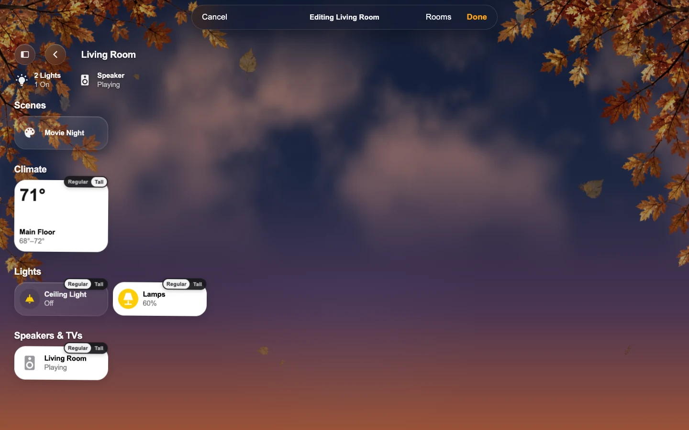

# Arrange a Page

**Edit mode** arranges a page in place. Owners and Admins can arrange a room page, Home (its room sections, Favorites and scenes row), or the Lights, Climate, Water, Security and Vacuums pages, away from a wall tablet:

1. Open the menu (or the tab bar’s **More**) and choose **Edit Page**. On a screen with its menu turned off, open any tile’s sheet, tap the gear, and choose **Edit This Page**.
2. The tiles wiggle and stop working as controls. Touch and hold a tile for a moment, then drag it to a new place in its group; a mouse just drags. Moving without the hold scrolls the page, and the page scrolls by itself near the top and bottom edges.
3. Tap a tile’s **Regular | Tall** badge to change its height.
4. Press **Done** to save, or **Cancel** (or Escape) to put everything back.

The order is the room’s own, so a room page and that room’s section on Home share it, on every screen. While you edit, tiles sit in plain reading order; after Done the page packs them as usual, so a Tall tile’s gap may fill. If someone else changes the same page meanwhile, Done says so and offers **Reload** or **Save Anyway**. Leaving the page with unsaved changes asks first. Home Grid screens keep their own [editor](Home-Grid.md).

What each page saves:

- **Lights, Climate and Water** list their tiles room by room, and each room’s section follows that room’s order. Reordering lights on the Lights page reorders them on that room’s page and on Home too; the bar says so.
- **Security and Vacuums** keep an order of their own (the same one as their Tile Order in HK Settings). Security’s tiles have no size badge, since that page ignores size; on Vacuums, whole vacuum cards move.
- **Doors & Windows** has no Edit Page: its order comes from Status & Chips.
- **Favorites** on Home are this screen’s own and always one height, so they have no size badge. A favorite whose accessory is gone keeps its place.
- **The scenes row** on Home drags sideways, including its pills that open a page; it is this screen’s Scenes list, the same one HK Settings shows. A room page’s scenes row is that room’s own Scenes list. While editing, a mouse no longer scrolls the row by dragging; carry a scene near either end and the row scrolls by itself. A finger that moves first still scrolls it.

## The menu, the tab bar and the room order

While a page is in Edit mode, the menu, the tab bar and its **More** sheet can be arranged too. All three show the same lists, so a change in one shows in the others straight away:

- **The menu:** drag a page by its handle (or touch and hold it) within the pages at the top or under **Categories**, or from one to the other. A page's switch takes it out of the menu; it is then listed under **Not in Menu**, where the switch brings it back. Drag a room by its handle to reorder **Rooms**.
- **The tab bar:** drag a tab along the bar (up and down on a side rail). Drop a tab on **More** to move it past the tabs that fit; open **More** and drag a page onto the bar to bring it forward. More's pages and rooms can be dragged too. How many tabs fit is still the screen's tab bar setting.
- **Rooms** in the Edit bar opens **Room Order**: every room on this screen with a handle, up and down arrows, and **A to Z**; **Done** closes it. A note says where the order is used: the menu's and the tab bar's rooms, Home's room sections when Home follows the room order, and the room sections on Lights, Climate and Water when they do. Closing the sheet shows the new order at once.

**Done** saves it with the rest of the page: the screen's page order, its top-of-menu pages and Categories, and the room order, with the menu's rooms switched to the room order (it starts from A to Z). A screen whose Rooms are **Same as All Screens** changes All Screens' room order, which every such screen follows.
