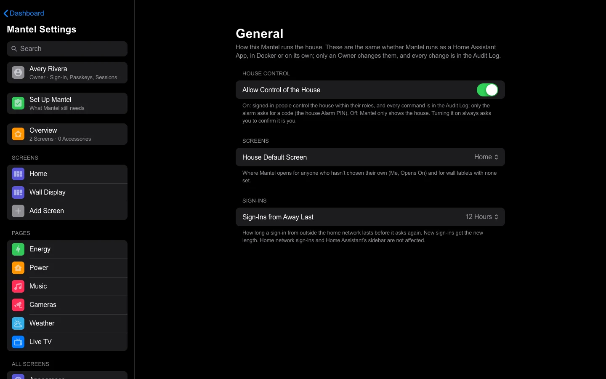
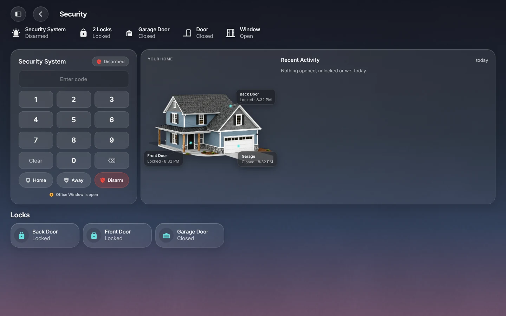
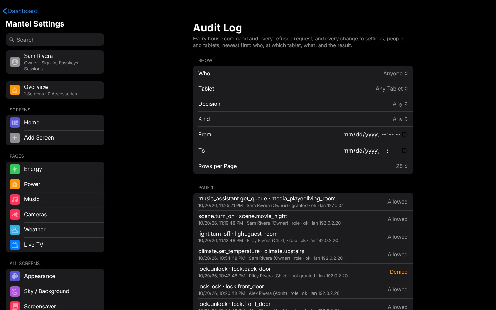

# Commands and Audit

Mantel starts **read-only**: the screens show your home, but nothing you tap is sent to Home Assistant until you turn commands on. Once they're on, every command is checked against the person's role and grants, written to the audit log, and only then sent. This page covers turning commands on, how a command is checked, the alarm's PIN, and reading the audit log.

## Commands are off at first

A new Mantel can't change anything in your home. Screens show live state, but a tap that would change something shows **Commands are disabled in Mantel (read-only)**, and nothing is sent or recorded.

**Mantel Settings** → **About** → **House Commands** says **Off** or **On**.

Saving settings works either way: Mantel keeps its own settings, so an Owner or Admin can set up screens before turning commands on.

## Turn commands on

Only the Owner can turn commands on. Open **Mantel Settings** → **General** and turn on **Allow Control of the House**. Mantel asks the Owner to confirm it is them, with a fresh sign-in, every time they turn it on. It applies at once, with no restart, and it works the same on the Mantel App, Docker and Proxmox LXC. To turn it off again, turn it off there. Every change is in the audit log.

### The read-only kill switch

Whoever runs the server can keep the house read-only whatever Mantel Settings says:

| Installation | How |
|---|---|
| Mantel App in Home Assistant | **Settings** → **Apps** → **Mantel** → **Configuration**: turn on **Read-only (kill switch)**, select **Save**, then restart the App. |
| Docker, Proxmox LXC | Set `MANTEL_READ_ONLY=1` (or add `--read-only` to the server's command), then restart the server. See [Install with Docker → Turn on house commands](Install-Docker.md#turn-on-house-commands). |

While it is on, **Allow Control of the House** can't change anything. The server's log says `COMMANDS ENABLED` or `read-only; commands disabled`.

Before you turn them on, check your people's roles ([People and Roles](People-and-Roles.md)) and your tablets' rooms ([Wall Tablets](Wall-Tablets.md)).

## How a command is checked

Each command goes through the same steps, in order. If any step refuses it, nothing is sent.

1. **Who.** The signed-in person, the wall tablet, or both. Mantel reads them again at every command, so a changed role, a disabled person or a revoked tablet counts at once.
2. **What.** The command is matched to the entities it acts on. Commands aimed at an area, a device, a floor, a label or "all" are refused: they could reach things nobody checked. A service that acts on no entity (restarting Home Assistant, for example) counts as changing the home's settings, which only Owners and Admins may do. Notifications and running a script are the exceptions.
3. **Roles and grants.** Every entity the command touches must be allowed. Nothing is allowed without a grant, a deny always wins, a grant with a time window counts only inside it, and at a wall tablet both the person and the tablet must allow it. See [People and Roles](People-and-Roles.md).
4. **The door.** From outside the home, wall tablets are refused, and each role's **From Outside the Home** switches decide sensitive actions, cameras and location history.
5. **The alarm.** Alarm commands also need the Alarm PIN ([below](#the-alarm-pin)).
6. **The audit row.** Mantel writes the command to the audit log **before** sending it. If it can't write the row, it refuses the command.
7. **Sent.** Mantel sends the command to Home Assistant (or Music Assistant) with its own credential, and records the result.

A command that's refused shows **Not allowed** on the screen, and is in the audit log as **Denied**, with the reason.

### No PIN, no extra confirmation

Apart from the alarm, **no command asks for a PIN or a second factor**: not unlocking a door, not opening the garage, not turning off an automation, at home, away or at a wall tablet. Who may do what is decided by roles and grants alone, and every command is recorded.

"Sensitive" still matters. Sensitive actions (unlocking, opening the garage, disarming, water valves, automations, camera live view) need their own permission (`control.sensitive`), follow the **Sensitive Actions from Outside** switch, and are marked in the audit log.

A few **account** changes do ask you to confirm it is you, such as removing a passkey. See [Signing In](Signing-In.md#confirm-it-is-you).

The **My PIN** row in **Me** is optional and isn't used for anything.

### Owners hear about remote unlocks

When someone unlocks a lock or disarms the alarm from outside the home, Mantel sends the Owners a Home Assistant notification, **Mantel: remote access**, saying who, what and when. Through Home Assistant's sidebar with the `trusted` rules, it doesn't ([Signing In](Signing-In.md#inside-home-assistant)).

## The alarm PIN

The alarm works as with HK Frontend's Alarm PIN: disarming always needs the code, and arming needs it while **PIN to Arm** is on. In Mantel, Mantel checks the code itself.

- **There is one Alarm PIN per keypad**, for the home, not one per person. An Owner or Admin sets it in Mantel Settings (search for **Alarm PIN**), typed twice, 4 to 10 digits.
- **Set it again in Mantel**, even if HK Frontend had one: Home Assistant never gives out its PIN. Until it's set, anything that needs the code is refused with **No Alarm PIN is set in Mantel yet**.
- **Roles first.** The person (or tablet) needs sensitive control of the alarm before the code is even looked at. A Child is refused whatever they type, and doesn't count toward a lockout.
- **Wrong codes lock.** Five wrong codes in a row lock that keypad, at that tablet or for that person, for 15 minutes. Each address may get 20 wrong in 15 minutes.
- **Wall tablets** can use the keypad by default.
- **The code is never stored or shown.** It's checked against an Argon2id hash, and it's not in the audit log, the server's log or anything sent to Home Assistant.
- **The alarm's own code.** If your alarm panel needs a code of its own, Mantel keeps it sealed with its at-rest key and adds it when it sends the command. The PIN typed on the keypad never goes to Home Assistant.

## The audit log

**Mantel Settings** → **Audit Log** (Owners and Admins) lists every house command and every refused one, and every change to Mantel's settings, people and wall tablets, newest first.

Use **Show** to narrow it:

| Filter | Shows |
|---|---|
| **Who** | One person |
| **Tablet** | One wall tablet |
| **Decision** | **Allowed** or **Denied** |
| **Kind** | See below |
| **Through** | **Anyone**, **An Assistant** or **No Assistant** ([Assistants](Assistants.md)) |
| **From**, **To** | A time range |
| **Rows per Page** | 25, 50 or 100 |

**Newer** and **Older** page through it.

Each entry shows the action and what it acted on, then the time, who (with their role then), the tablet, the reason, **confirmed by alarm_pin** when the Alarm PIN allowed it, the result (`ok`, `error:…` when Home Assistant refused, or `not_sent`), the door and the address it came from.

| Kind | What |
|---|---|
| **Service Calls** | Home Assistant actions: lights, locks, media players, scripts… |
| **Home Assistant Writes** | Other changes HK sends to Home Assistant, such as calendar events |
| **HTTP** | Home Assistant's REST writes, such as the doorbell talk-back clip |
| **Music** | Music Assistant commands |
| **Settings and Accounts** | Changes to people (adding someone, a new role or name, disabling or enabling them, a password changed or set by an Owner or Admin), wall tablets (enrolled, revoked, moved to another room), grants, roles and rooms, connections, the Alarm PIN's settings, and other Mantel settings. They name who did it and what changed, never a password, secret or code. |
| **Wall Tablets** | Reload and Clear Cache sent to a tablet's kiosk app |
| **System** | Mantel's own: Owner notifications, removing old entries |

What to look out for: a **Denied** entry for someone you didn't expect, wrong Alarm PINs at a keypad, unlocks from the away door, and `error:` results.

Entries made before an update may show **Confirm**: those are from an earlier version that asked for a confirmation. The **Decision** filter keeps **Needed Confirmation (Older Entries)** to find them; nothing new is recorded that way.

### What isn't recorded

The data sent with a command (it can carry an alarm code), passwords, PINs, codes and tokens are never in the audit log.

Sign-ins aren't recorded, successful or not. Entries can't be deleted for a year, and anyone who can reach the sign-in page can fail to sign in, so recording failures would let a stranger fill the log. Instead, **Me** → **My Sessions** shows each sign-in that is still active (browser, home or away, how, and from which address), and wrong passwords are limited and lock the account ([Signing In](Signing-In.md#passwords)).

A change that can't be recorded isn't made: Mantel answers **The audit log is unavailable, so nothing was changed**.

### Keeping it

- Entries are kept for **365 days**, then removed. Change it with the server setting `--audit-retention-days` (30 at least).
- Old entries are removed once an hour, and each removal is itself recorded (**System**, `audit.purge`).
- Nothing else can change or delete an entry: the database refuses it, and it refuses to delete anything newer than 30 days whatever it's told.
- That protection is inside the database file. Someone who can replace the whole file can replace the log too, so keep the server's data folder and your [backups](Backups.md) private.

### From the API

Owners and Admins can read the same log over the API: `GET /api/audit`, with `actor`, `device`, `decision`, `kind`, `since` and `until` (seconds since 1970), `limit` (1 to 500), `via` (`mcp` for any assistant, `mcp:<name>` for one, `-` for none) and `before` (the `next` value from the
last page).

## See also

- [People and Roles](People-and-Roles.md)
- [Wall Tablets](Wall-Tablets.md)
- [Security Model](Security-Model.md)
