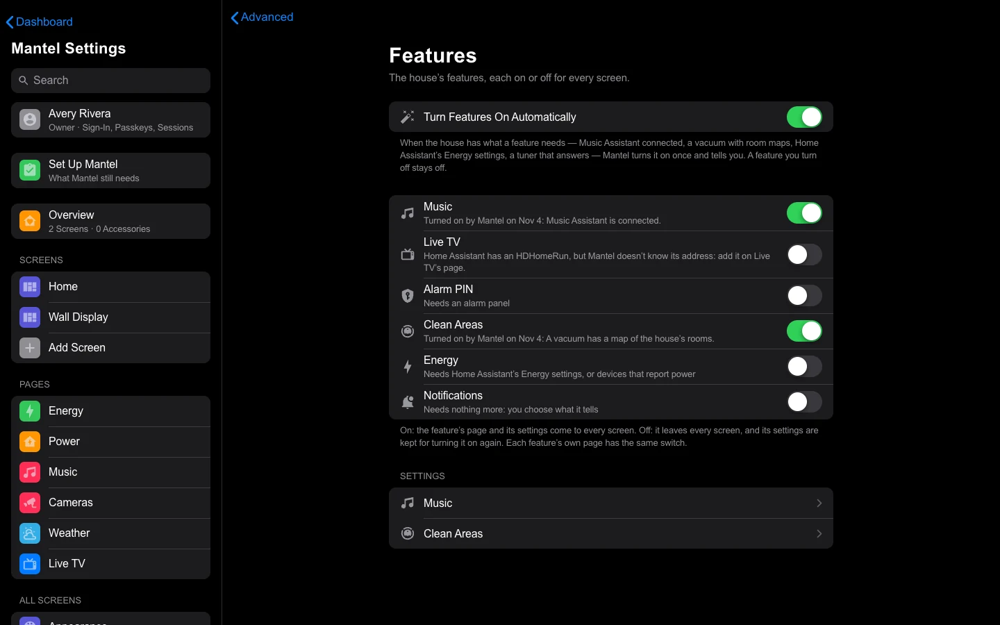

# Features

Mantel's features are the parts you can add to every screen: **Music**, **Clean Areas**, **Energy**, **Live TV**,
**Alarm PIN** and **Notifications**. Each one is off until it's turned on. You'll find them all in **Mantel Settings →
Advanced → Features**, each with a switch, what it needs and a link to its settings. Each feature's own page has the
same switch (**Add** and **Remove**).

## Features that turn on by themselves

When your house has what a feature needs, Mantel turns it on once and tells you. Four features can do this:

| Feature | Turns on when |
|---|---|
| **Music** | Mantel is connected to Music Assistant (Mantel Settings → Connections) |
| **Clean Areas** | A vacuum has a room map in Home Assistant, with at least one of its rooms one of your areas |
| **Energy** | Home Assistant's Energy settings have a grid meter or devices. Power sensors alone don't count. |
| **Live TV** | An HDHomeRun tuner answers on your home network, and Mantel can play it (below) |

How it works:

- **It waits to be sure.** Mantel looks when it starts, when Home Assistant's devices load or change, when you save a
  connection, and every 5 minutes. It has to see the need on two looks, 2 minutes apart. A restart, or a Home Assistant
  that's still loading, never turns anything on.
- **Once.** Mantel turns each feature on at most once. If you turn a feature off, Mantel never turns it back on, even
  after an update, a restart or a restored backup. A feature you turned off before this version came along stays off
  too: Mantel finds that in the settings history.
- **It never turns a feature off.** If the need goes away (you remove Music Assistant, say), the feature stays as it
  is. Off is your choice.
- **It changes only Mantel's settings.** Turning a feature on sends nothing to your house. What the feature then does
  is what it always does when you add it: Energy reads Home Assistant's Energy settings, and Live TV reads the tuner's
  channel list and the guide.
- **Your screens follow.** The pages Mantel built for you gain the feature's page, tile or picker on their own. A screen
  you edited, imported or made in Edit mode, and every Home Assistant dashboard, stays as it is: add the card yourself
  when you want it.

Alarm PIN, Notifications, the Sleep Screen, Wall Tablets' alerts and restarts, the linked backlight and Allow Control
of the House never turn on by themselves. They guard the house or act on it, or they're choices rather than needs.

### How you're told

- **Advanced → Features**: under a feature Mantel turned on, it says when and why, for example "Turned on by Mantel on
  Nov 4: Music Assistant is connected." Under a feature that's off but close, it says what's still missing.
- **An alert**, **Mantel Turned On Music** (or Clean Areas, Energy or Live TV), to the channels you chose in
  [Alerts](Alerts.md), with a link to Advanced → Features.
- **The history**: the settings history shows the change by "Mantel (mantel-auto)", and the Audit Log has a
  `features.auto_on` row.

### Live TV

Mantel finds the tuner only from what it already knows: the address on Live TV's page (yours, or the one brought over
from HK Frontend), or an HDHomeRun in Home Assistant's devices. It doesn't search your network. Before it uses an
address it checks that the address is on your home network (a private address or a home name such as `tuner.local`),
then reads the tuner's channel list once. Live TV turns on with the tuner's whole lineup; choose the channels on
Live TV's page.

Mantel also needs a way to play it:

- **Docker or the LXC**: Mantel's own go2rtc does it.
- **The Home Assistant App**: only through Mantel Link with Live TV, once Mantel runs the house, and not when Mantel was
  started read-only.
- **HK Frontend in Home Assistant still runs Live TV**: Mantel leaves it alone.

If Home Assistant has an HDHomeRun but its device has no address, Advanced → Features says so. Type the address on
Live TV's page once.

### Turning it off

**Turn Features On Automatically**, at the top of Advanced → Features, stops all of it. It's on to start with. Turning
it off changes nothing that's already on.

HK Frontend in Home Assistant doesn't turn features on by itself: its features are added in Home Assistant
(**Devices & Services → HK Frontend → Add feature**).
