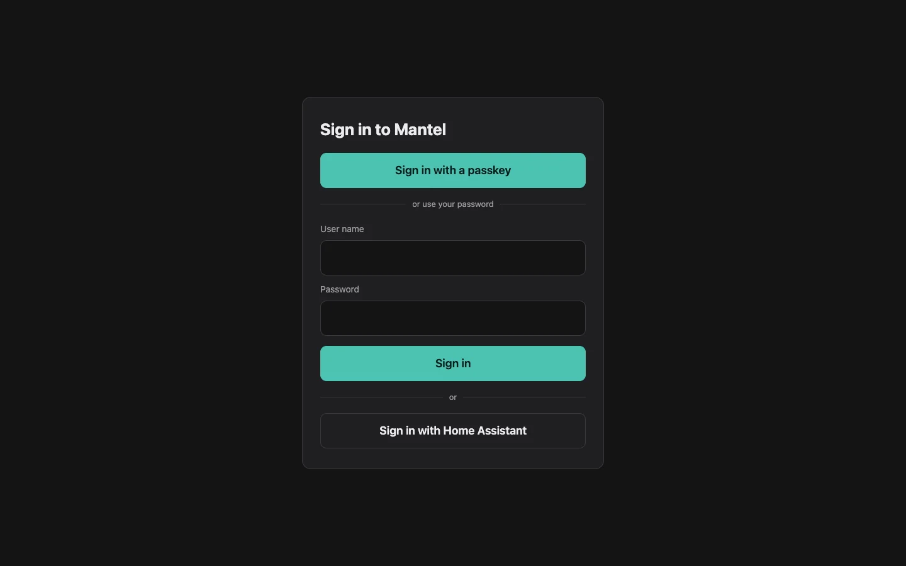
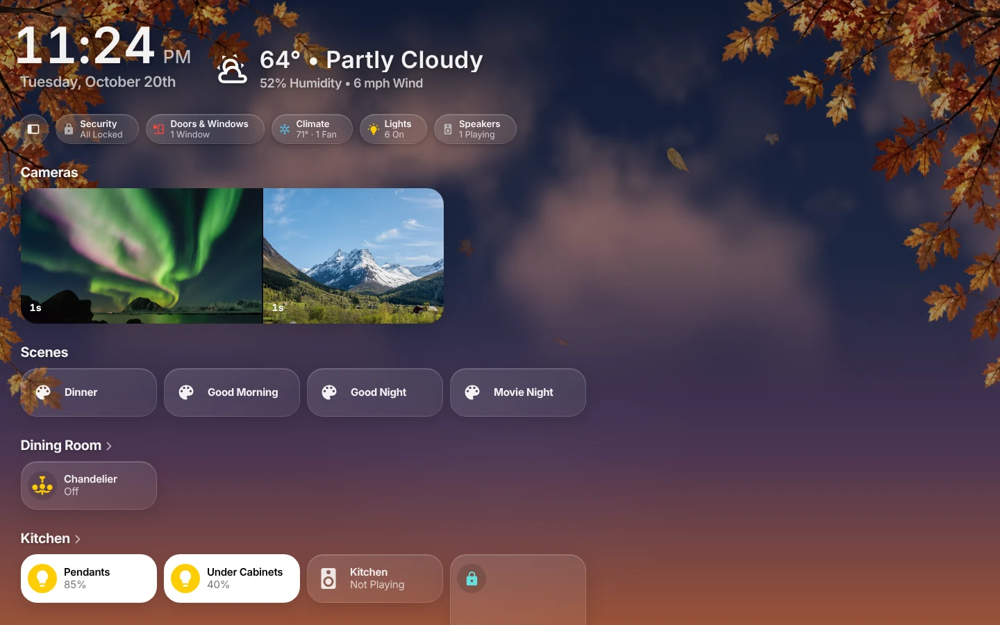
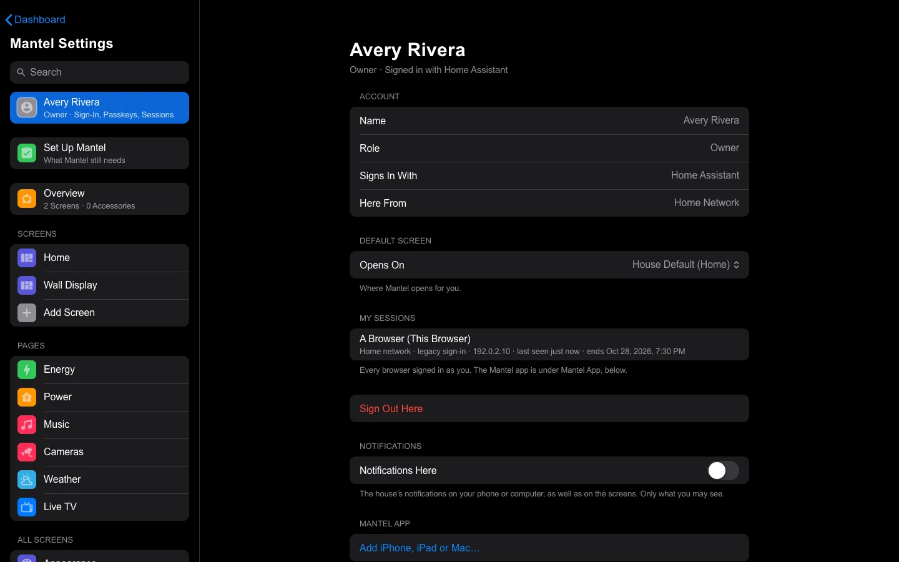

# First Run

A new Mantel has no people, no Owner and no screens. This page takes you from a freshly installed Mantel to your home screen: you become Mantel's **Owner**, connect Home Assistant, bring your screens in, and link the rest of the household. In the Home Assistant App it takes a few minutes; with Docker or the LXC, about ten. Install Mantel first: [Install](Install.md).

The **Owner** can do everything in Mantel: manage people, roles and tablets, read the audit log, and change the connections. Nothing creates an Owner for you: the first one is always an explicit step on the server or in Home Assistant, and only the first one is made this way. After that, the page that made it says it is closed.

## In the Home Assistant App

### Become the Owner

1. Open **Mantel** in Home Assistant's sidebar (or **Open Web UI** on the App's **Info** tab), signed in to Home Assistant as an **administrator**.
2. Mantel shows **Set up Mantel**, with your Home Assistant name. Select **Make me Mantel's Owner**. Nothing happens until you do.
3. You see **You are Mantel's Owner**, with two links: **Open Mantel** and **Link the rest of the household**.

If you aren't a Home Assistant administrator, Mantel says **Mantel is not set up yet**: an administrator needs to open it first. If it says it **could not ask Home Assistant** whether you are an administrator, see [Troubleshooting](Troubleshooting.md#the-app-says-it-could-not-ask-home-assistant).

There is nothing to connect: the App reaches Home Assistant with its own built-in credential. On **Mantel Settings** → **Connections**, Home Assistant shows as **Provided by Home Assistant (App)**.

### Bring your screens in

If you use HK Frontend in Home Assistant, Mantel can copy its settings once: your screens, rooms, tablets, pop-ups, chips and looks. It reads them from Home Assistant and writes nothing back.

1. Select **Link the rest of the household** (it opens **People**).
2. Select **Import HK's settings from Home Assistant (once)**.

Running it again changes nothing: Mantel says when it ran. Afterwards, changes you make in Mantel stay in Mantel; HK Frontend in Home Assistant keeps its own copy. Moving the rest of a home over, tablets included, is in [Moving from HK Frontend](Moving-from-HK-Frontend.md).

### Link the household

On **People** you see Home Assistant's users. For each person, choose **Link** and a role: **Admin**, **Adult**, **Child** or **Guest** (or **Owner**). An account you don't link sees only **Not linked yet** and nothing else. Roles, and what each may do, are in [People and Roles](People-and-Roles.md).

Wall tablets have their own Home Assistant users. On **People**, link each as a wall tablet with **Link as a wall tablet**: see [Wall Tablets](Wall-Tablets.md).

## With Docker or the LXC

### Become the Owner

1. On the server, make a one-time **setup code**. It is valid for one hour; making a new one replaces it.

   ```bash
   docker compose exec mantel-server mantel bootstrap
   ```

   Run it in `packaging/compose` (in the LXC, `/opt/mantel/packaging/compose`).
2. Open `https://mantel.example.com/login`. While Mantel has no Owner, the page shows **First start**.

   

3. Fill in the **Setup code**, a **User name**, **Your name** and a **Password** of at least 12 characters, then select **Create the Owner**.

Mantel signs you in and opens **Mantel Settings** → **Connections**.

### Connect Home Assistant

Mantel acts in Home Assistant as one Home Assistant user. Use a dedicated administrator for it, not a person's own account: in Home Assistant, **Settings** → **People** → **Add person**, for example `mantel-server`, with *Can log in* and *Administrator* on. Mantel needs an administrator to read HK's settings and Home Assistant's list of users.

1. On **Connections**, open **Home Assistant**.
2. Type Home Assistant's address as Mantel's server reaches it, for example `http://homeassistant.local:8123`.
3. Select **Connect to Home Assistant**. Home Assistant's sign-in page opens: sign in **as the user Mantel should act as** (`mantel-server`).
4. Back in Mantel you see which user Mantel would act as, Home Assistant's version and how many entities it has. Select **Save this connection**.

Mantel makes a long-lived token for that user (it shows as **Mantel Server (date)** in that user's Home Assistant profile) and keeps it sealed in its own data. You don't restart anything: Mantel connects at once.

Can't sign in from this browser? Your browser must reach Home Assistant's address for step 3. If it can't, make a long-lived token as `mantel-server` in Home Assistant (its profile → **Security** → **Long-lived access tokens**), paste it on the same page, select **Test**, then **Save**.

### Connect Music Assistant (optional)

On **Connections** → **Music Assistant**: its address (for example `http://music-assistant.local:8095`), then a Music Assistant user name and password (used once to make a token, never kept) or a pasted token. Select **Test**, then **Save**. See [Music and Cameras](Music-and-Cameras.md).

### Bring your screens in

If your Home Assistant runs HK Frontend, Mantel's screens come from its settings, copied once. As the Owner, on **Connections**, select **Import HK's Settings from Home Assistant** (under **Import from HK Frontend**). It uses the Home Assistant connection you just made, writes nothing to Home Assistant, and running it again changes nothing. You can also run `docker compose exec mantel-server mantel import-settings`. See [Moving from HK Frontend](Moving-from-HK-Frontend.md) for what comes across.

Without HK Frontend there is nothing to import: Mantel starts with a generated **Home** screen that builds itself from your Home Assistant areas and devices. If you import later, the import replaces that Home screen with HK Frontend's screens, as long as you haven't changed it.

### Add the household

On **Mantel Settings** → **People**, add a Mantel account for each person, with a role. People can also sign in with their Home Assistant account once it is linked to Mantel. See [People and Roles](People-and-Roles.md) and [Signing In](Signing-In.md).

### Protect the Owner

Your Owner account can do everything, so give it more than a password. On **Mantel Settings** → **Me**, add an **authenticator app** and a **passkey**. From away from home, Mantel never accepts a password on its own. See [Signing In](Signing-In.md). Passkeys work at the name in `MANTEL_PUBLIC_URL` (Docker and the LXC) or the App's own HTTPS name; not at an IP address ([Passkeys](Install-Docker.md#passkeys)).

## What you see first

Mantel opens on your **home screen**: the first screen it found, or the one set as the **Default screen**. Each person can pick their own, and each wall tablet opens on its own room's screen.



Things to know on your first visit:

- **Mantel is read-only.** Every state is live, but a tap on a light says **Commands are disabled in Mantel (read-only)** and nothing changes in Home Assistant. That's expected until you turn commands on: [Install → Turn on house commands](Install.md#turn-on-house-commands).
- **Mantel Settings** is in the screen's menu, for everyone. Everyone sees their own page (**Me**). Owners and Admins also see **People**, **Devices**, **Connections**, **Your Files** and the **Audit Log**; Owners also see **Roles & Grants**.
- **Setup Check** (in Mantel Settings, **Overview** → **Setup Check**) lists what is ready: Home Assistant, Music Assistant, Apple's font and glyphs, house commands, and how many screens Mantel has.
- **Fonts and icons** look plain until you add Apple's SF Pro and SF Symbols glyphs in **Mantel Settings** → **Your Files**. Mantel ships neither; each home supplies its own.



## Next steps

| To | Read |
|---|---|
| Give people the right roles and rooms | [People and Roles](People-and-Roles.md) |
| Move a wall tablet to Mantel | [Wall Tablets](Wall-Tablets.md) |
| Turn on house commands, and read the audit log | [Commands and Audit](Commands-and-Audit.md) |
| Put Mantel's tablets and actions in Home Assistant | [Mantel Link](Mantel-Link.md) |
| Set up backups | [Backups](Backups.md) |
