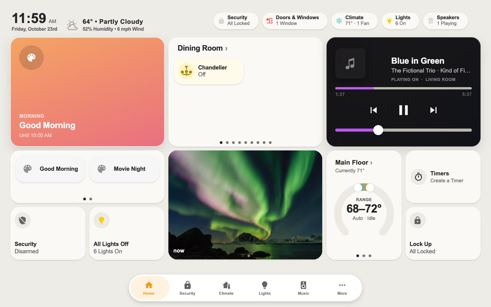
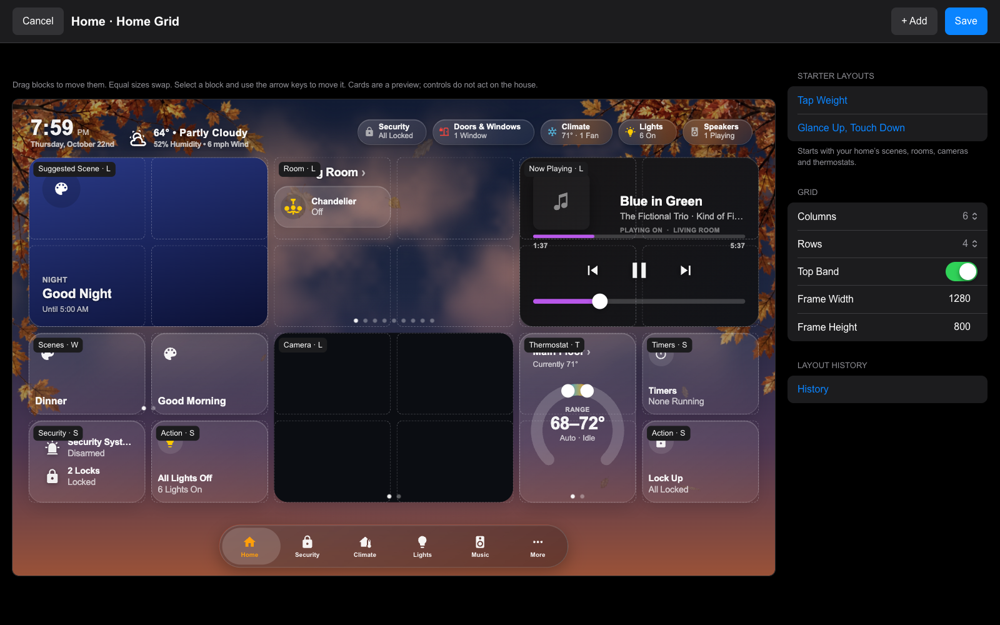
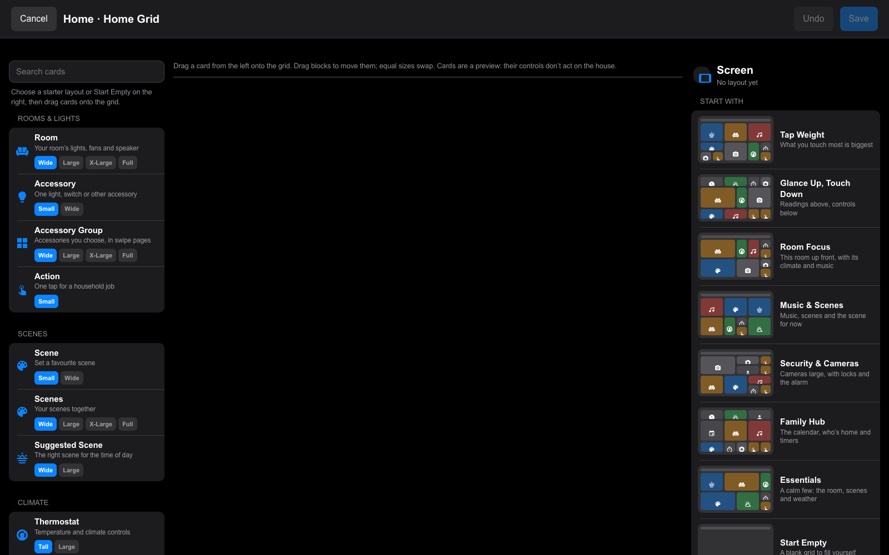
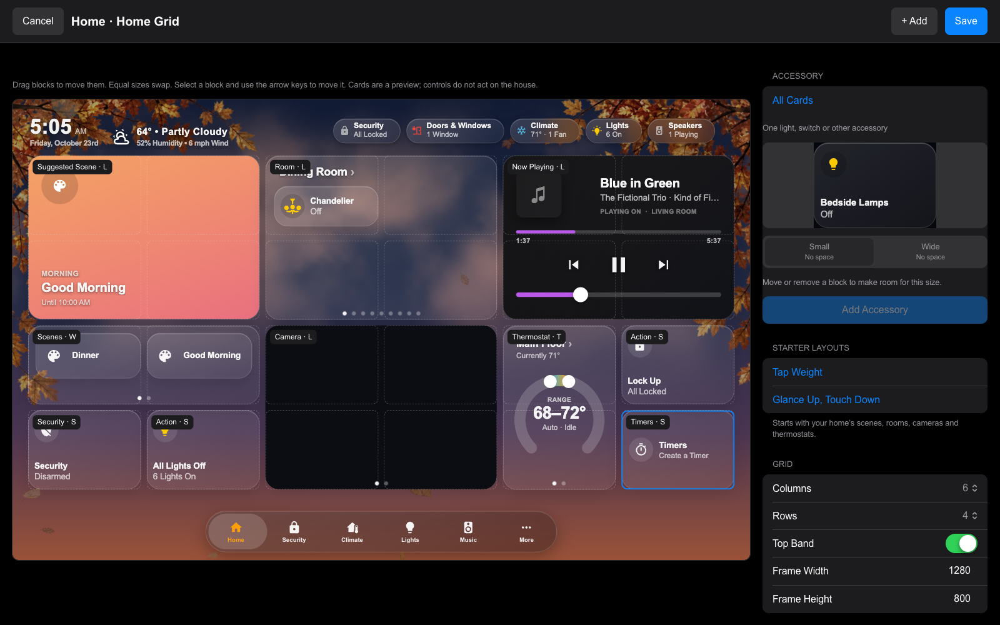
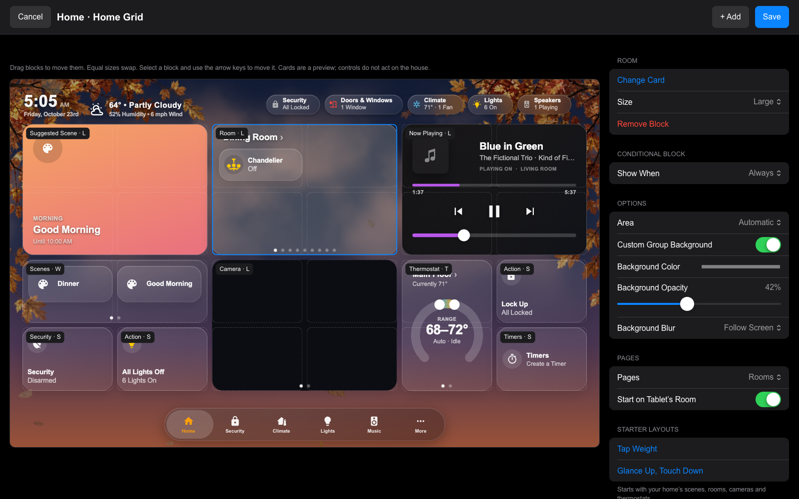

# Home Grid

Home Grid is a tablet Home page arranged in fixed blocks. It fits the screen without scrolling, keeping the same tile proportions at every resolution. Each screen keeps its own layout; the other pages and the menu keep working as usual.

In Mantel Settings, open **Screens → your screen → Arrange Home Grid** on a computer or an iPad. Owners and Admins can arrange a screen. The editor needs a wide window for its three panes; on a narrow one it says so and offers **Open Anyway**. A wall tablet displays the saved layout.

Home Grid is a mode on an existing generated dashboard. You do not need a new dashboard: open its editor, choose a starter, arrange the blocks, and Save. Create a separate screen first only if you want a separate layout. The tab bar keeps your navigation settings: **Rooms** can be its own button or a section inside **More**.

## The editor

The editor has three parts: the cards on the left, the screen in the middle, and settings on the right.

For a new layout, pick a starter. Each shows a small map of the blocks it would put on your screen, built from your home's scenes, rooms, cameras and thermostats:

- **Tap Weight:** what you touch most is biggest.
- **Glance Up, Touch Down:** readings above, controls below.
- **Room Focus:** this room up front, with its climate and music.
- **Music & Scenes:** music, scenes and the scene for the time of day.
- **Security & Cameras:** cameras large, with locks, the alarm and who's home.
- **Family Hub:** the calendar, who's home and timers.
- **Essentials:** a calm few: the room, scenes and weather.
- **Start Empty:** a blank grid to fill yourself.

Everything stays a draft until you press **Save**. Once a layout exists, the starters are under **Preview Size and Starters**; choosing one replaces the draft.

- **Add a card:** drag it from the left onto the grid. While you drag, its outline shows where it will land, red where there's no room. Each card shows its sizes (Small, Wide, Tall, Large, X-Large, Full); pick one before you drag. Click a card instead to see a live preview with sample readings, then **Add** places it in the first free space.
- **Move a block:** drag it. Blocks of the same size swap places. A move that overlaps another size or leaves the grid is refused. Or select a block and use the arrow keys.
- **Change a block:** select it. Its settings open on the right: **Size**, **Change Card…**, then **Content**, **Appearance** and **Show When**, and **Remove Block** at the bottom. **Done**, or a click on empty space, goes back to the screen's settings.
- **Undo** (⌘Z or Ctrl+Z) takes back the last change. Delete or Backspace removes the selected block; Escape lets it go.

The card controls inside the preview are disabled, so arranging a block can't toggle a light or run a scene.

## What a block shows

**Content → Show** chooses one thing or pages that swipe:

- **Room:** **One Room** shows the chosen **Room**. **Swipe Between Rooms** shows the screen's rooms and opens on its **Starting Room**, coming back there when the screen goes idle. **Tablet’s Room** follows the wall tablet's assigned room; an unassigned desktop shows the first room. A specific starting room takes priority over a previously saved tablet-room start.
- **Camera:** **One Camera** (choose it under **Camera**), **Swipe All Cameras**, or **Follow Motion or a Selector**. **Motion** turns to the camera in the room where a motion, occupancy or presence sensor last turned on (within 15 minutes). **A Selector** turns to the camera named by an input select's option, as the camera strip does. A block you've swiped stays put for a minute before it follows again.
- **Thermostat**, **Now Playing** and **Scenes** also have one-thing and swipe-all choices.
- **Choose Each Page**, on any card, repeats the card with different choices per page. A choice left on **Same as the Block** uses the block's. Pages can be moved up or removed, and **Add Page** adds another.

Room blocks have a surrounding tile containing accessories and the speaker, without status chips. Wide uses regular pills; Large uses a 2 × 2 arrangement of taller tiles, Extra Large has two rows of three, and Full Width has two rows of six. Empty cells stay reserved, so a lone accessory never stretches into another row. **Accessories → Scroll All**, where a new room block starts, scrolls vertically through the room's supported controls, including locks, covers and climate controls, at the same tile sizes. **Summary** shows a compact selection of lights, fans and one speaker instead, with **+N more** opening the room; room blocks saved before 0.1.66 stay on Summary until you change them. The room title and page dots stay outside the scroll area. Hidden entities and the room's visibility settings still apply; diagnostic sensors are not added automatically.

To combine accessories from different rooms, drag in an **Accessory Group** and use **Add Accessory** to build an ordered list. **Automatic Pages** fills each page in that order: Wide holds two, Large four, Extra Large six and Full twelve. For precise pages, choose **Choose Each Page**: the list splits into pages you can fill, name, move and remove. This groups controls on the dashboard; it does not create a Home Assistant group.

On an **Accessory**, or each accessory in a group, **Line Under Name** chooses Automatic, State, Brightness, An Attribute or Hidden. **An Attribute** shows a reported value such as battery level, with an optional unit. Missing values show a dash. Standalone accessories and scenes use the same saved glyphs and colors as their room-page pills.

The **Calendar** block shows what is still to come over its **Days** (Today Only up to 7 Days; Today and Tomorrow by default), each later day under its own heading. The events scroll inside the block, and tapping one opens its details.

Weather comes in Wide (conditions), Large (also readings, six hours and three days) and Extra Large (also five days). **Sky Background** adds Sky's clouds, sun or moon and precipitation inside the card; it is off by default and respects the screen's animation setting and reduced motion. Timers offer pause, resume and cancel; an empty block opens Create a Timer, and Wide also has quick starts. Security opens the shared alarm sheet, keeping its PIN flow. **Large and Extra Large Security** are the alarm keypad itself: the keys on the left, the alarm's state and the ways to arm on the right; the PIN is checked by the alarm, as on the Security page. **Large and Extra Large Vacuum** are the vacuum's controls, with **Clean Areas** below them when HK Clean Areas is added.

**Appearance → Custom Group Background** (Room, Scenes and Accessory Group blocks) chooses the group's color, opacity and blur (Follow Screen, None, Light, Medium or Heavy). Only the group's own background changes; its tiles keep the screen's look.

**Show When** switches a block's card in place. A block shows its own card by default; **Add Rule** adds up to four rules, each with up to three conditions (all must hold) and the card to show while they do. The first rule that holds wins, so **Move Rule Up** sets priority. Conditions: music playing, a timer running, the alarm armed or disarmed, someone at the door, after sunset, a time of day (a window from one time to another, which can run past midnight), or an accessory's state. For example: the calendar by default; Now Playing while music plays; the alarm keypad from 6:00 to 9:00 while the alarm is armed. Every card fills exactly the same space. **Preview** shows Live, the default or any rule's card without changing what is saved. Doorbell events hold their card for one minute. Blocks saved with the earlier **Otherwise Show** keep working and open as one rule.

## The screen's settings

With no block selected, the right side shows the screen's settings:

- **Grid:** 6, 3 or 2 **Columns** and 2–6 **Rows**. **Grid Scale** defaults to **Automatic Fit**: the grid uses the design's 196 × 150 tall-tile unit with 10-pixel gaps and scales uniformly to fit beside the navigation bar. Choose 50–90% of Fit for a smaller layout. The narrower column counts work, but their card designs haven't been polished for nightstand displays.
- **Header:** the **Top Band** keeps the clock, weather and status chips together; **Clock** and **Weather** can be turned off independently, keeping the chips.
- **Preview Size** sets only the size the editor previews the screen at. The tablet always fits the grid to its own display.

Mantel also offers **Layout History** and **Copy Layout To…**. History lists saved versions with who saved them and when; choosing one restores its layout into a draft for review. Copy Layout saves the draft to another screen after confirmation and keeps that screen's other settings. **Tablet’s Room** keeps its meaning in a copied layout.

**Save** applies the complete layout in one checked settings change. **Cancel** discards the draft. To return to the generated Home page, choose **Home Style → Generated**; the saved grid is kept.

## On the tablet

The optional top band shows a compact clock, weather and status chips. Chips line up with the right edge of the cards when they fit; longer rows scroll sideways. In a narrow thermostat block the dial fills the block: tap the thermostat's name for its full controls.

A block with more than one page swipes. Swipe anywhere on it, including on its page dots: a fifth of the way across, or a quick flick, turns the page. Tap a dot to jump to its page, or either side of the dots to move one page. On a computer, drag the card, scroll sideways on a trackpad, or use Shift + mouse wheel. Up-and-down scrolling and press-and-hold dimming inside a block still work. The page you choose stays until the normal return-to-home timer brings the block back to its first page.

People cards and person sheets use Home Assistant person portraits through Mantel's authenticated image route; if a picture is missing, initials appear instead. Person sheets size to their contents, and scroll inside the sheet on shorter phone screens.

In HK Frontend, Home Assistant admins use **HK Settings → your screen → Arrange Home Grid**. Its editor and settings checks are shared with Mantel; History and Copy Layout are Mantel features.

The screenshots use fictional devices and Arial. Camera pictures are illustrative landscapes.
