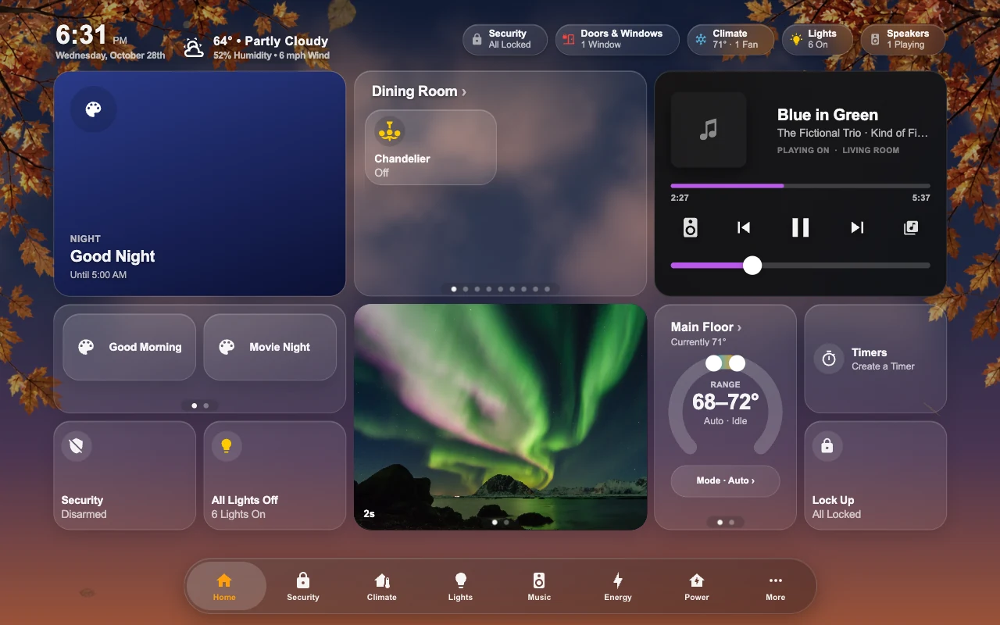
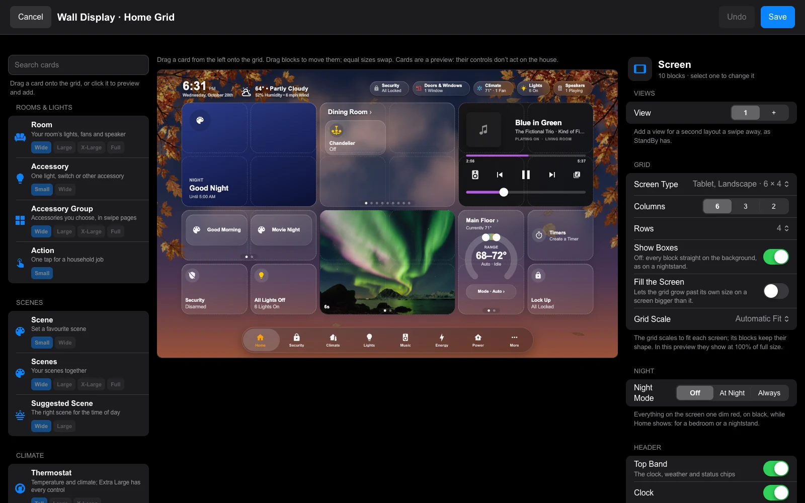
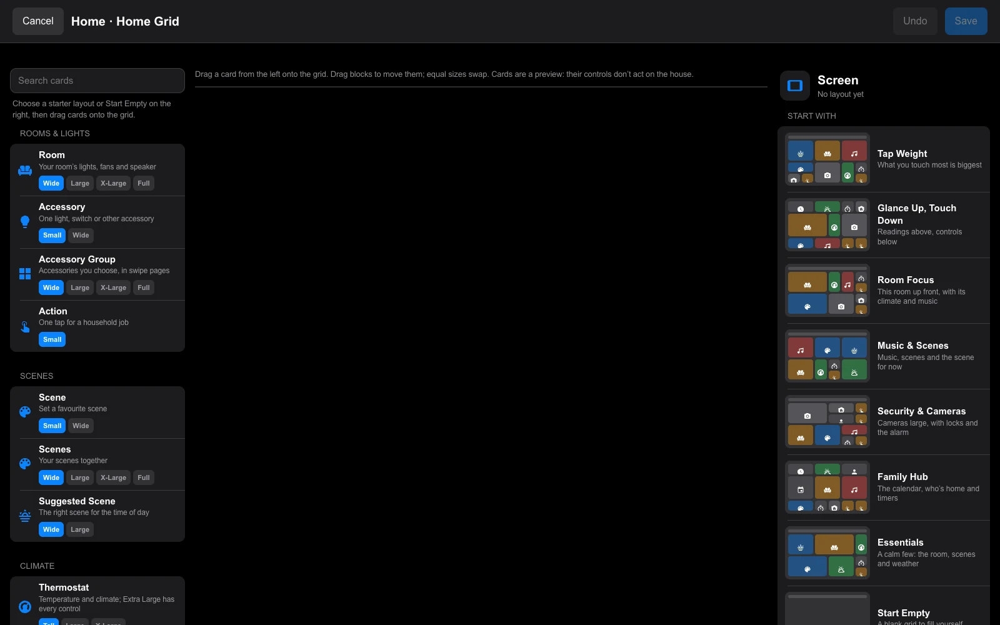
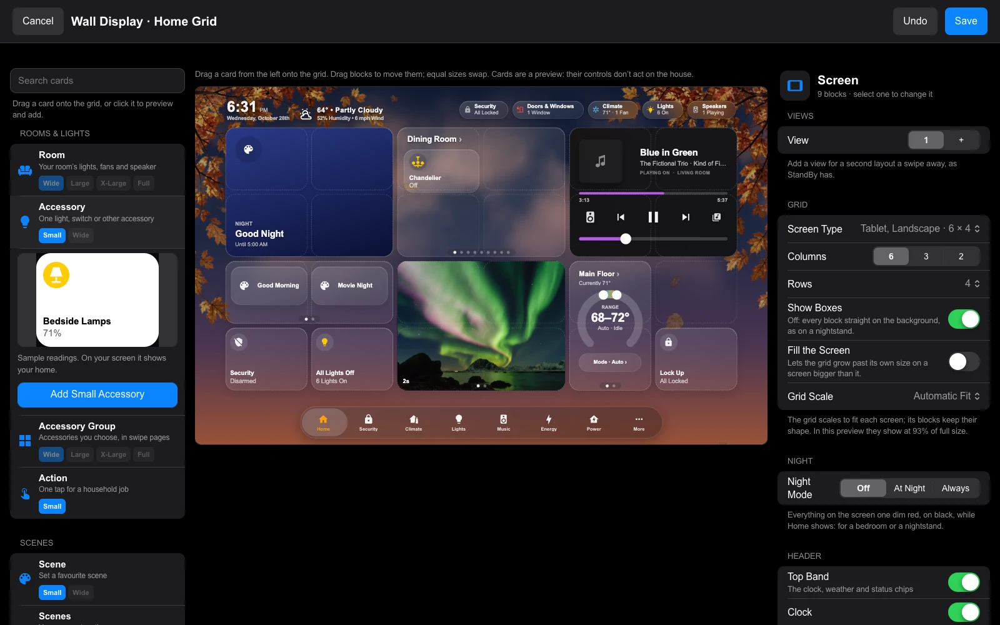
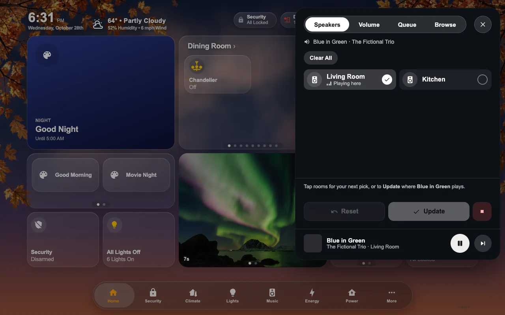
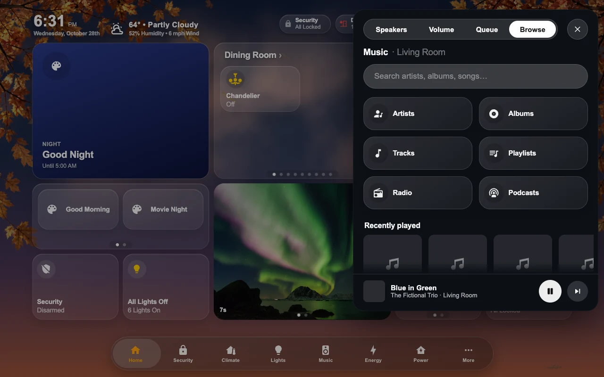
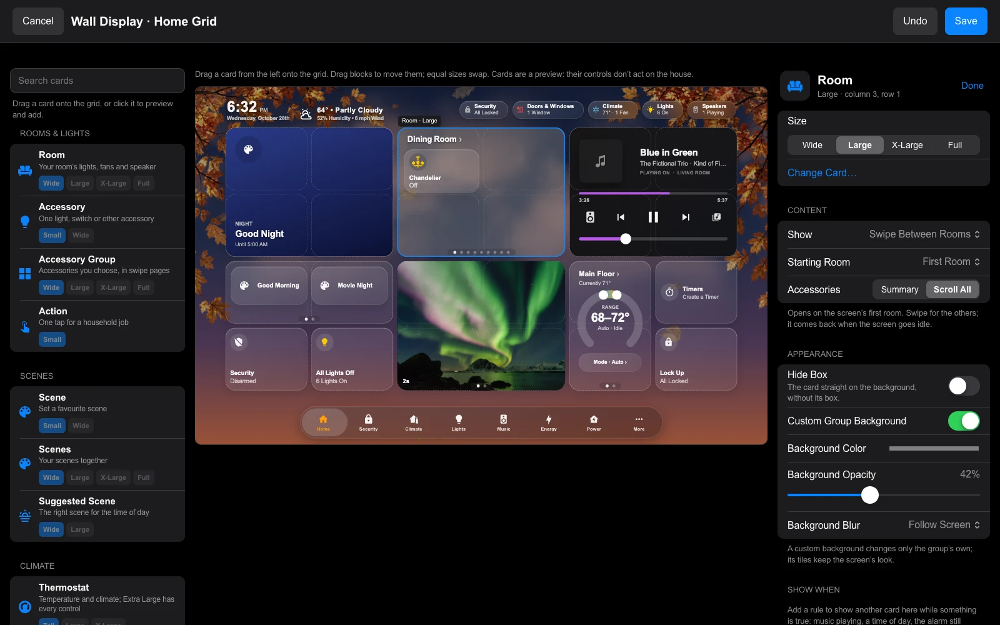

# Home Grid

Home Grid is a tablet Home page arranged in fixed blocks. It fits the screen without scrolling, keeping the same tile proportions at every resolution. Each screen keeps its own layout; the other pages and the menu keep working as usual.

In Mantel Settings, open **Screens → your screen → Arrange Home Grid** on a computer or an iPad. Owners and Admins can arrange a screen. The editor needs a wide window for its three panes; on a narrow one it says so and offers **Open Anyway**. A wall tablet displays the saved layout.

Home Grid is a mode on an existing generated dashboard. You do not need a new dashboard: open its editor, choose a starter, arrange the blocks, and Save. Create a separate screen first only if you want a separate layout. The tab bar keeps your navigation settings: **Rooms** can be its own button or a section inside **More**.

## The editor

The editor has three parts: the cards on the left, the screen in the middle, and settings on the right.

For a new layout, pick a starter. Each shows a small map of the blocks it would put on your screen, built from your home's scenes, rooms, cameras and thermostats:

- **Tap Weight:** what you touch most is biggest.
- **Glance Up, Touch Down:** readings above, controls below.
- **Room Focus:** this room up front, with its climate and music.
- **Music & Scenes:** music, scenes and the scene for the time of day.
- **Security & Cameras:** cameras large, with locks, the alarm and who's home.
- **Family Hub:** the calendar, who's home and timers.
- **Essentials:** a calm few: the room, scenes and weather.
- **Start Empty:** a blank grid to fill yourself.

Everything stays a draft until you press **Save**. Once a layout exists, the starters are under **Preview Size and Starters**; choosing one replaces the draft.

- **Add a card:** drag it from the left onto the grid. While you drag, its outline shows where it will land, red where there's no room. Each card shows its sizes (Small, Wide, Tall, Large, X-Large, Full); pick one before you drag. Click a card instead to see a live preview with sample readings, then **Add** places it in the first free space. On a touch screen, swiping up or down scrolls the card list; drag a card sideways towards the grid, or press and hold it, to pick it up.
- **Move a block:** drag it, with the mouse or a finger. The others make room as you go, as widgets do on an iPad's Home Screen: the blocks it would cover slide into the space it left (keeping their arrangement; a block of the same size simply swaps), or to the nearest free space, and only if there is none does another block step aside. Let go to keep that layout, or press Escape, go back to where you started or let go outside the grid to leave everything as it was. Where there's no way to make room, the outline turns red and the block stays. **Undo** takes back the whole move. Or select a block and use the arrow keys.
- **Change a block:** select it. Its settings open on the right: **Size**, **Change Card…**, then **Content**, **Appearance** and **Show When**, and **Remove Block** at the bottom. **Done**, or a click on empty space, goes back to the screen's settings.
- **Undo** (⌘Z or Ctrl+Z) takes back the last change. Delete or Backspace removes the selected block; Escape lets it go.

The card controls inside the preview are disabled, so arranging a block can't toggle a light or run a scene.

## What a block shows

**Content → Show** chooses one thing or pages that swipe:

- **Room:** **One Room** shows the chosen **Room**. **Swipe Between Rooms** shows the screen's rooms and opens on its **Starting Room**, coming back there when the screen goes idle. **Tablet’s Room** follows the wall tablet's assigned room; an unassigned desktop shows the first room. A specific starting room takes priority over a previously saved tablet-room start.
- **Camera:** **One Camera** (choose it under **Camera**), **Swipe All Cameras**, or **Follow Motion or a Selector**. **Motion** turns to the camera in the room where a motion, occupancy or presence sensor last turned on (within 15 minutes). **A Selector** turns to the camera named by an input select's option, as the camera strip does. A block you've swiped stays put for a minute before it follows again.
- **Thermostat**, **Now Playing** and **Scenes** also have one-thing and swipe-all choices.
- **Choose Each Page**, on any card, repeats the card with different choices per page. A choice left on **Same as the Block** uses the block's. Pages can be moved up or removed, and **Add Page** adds another.

**Now Playing** blocks have **Speakers** and **Browse** buttons either side of play and pause; on a Tall block they're in its top corners. Either one flips the card over, and its back grows out of the block into the screensaver's music panel: **Speakers** (tick the rooms it plays in, then **Update**), **Volume** for each room, the **Queue**, and **Browse** (playlists, search and the library). What's playing stays at its foot. Tap outside it, press its X or Escape to flip it back; it also flips back on its own shortly after something you picked starts playing. With nothing playing, **Speakers** is dimmed and **Browse** still works.

**TV** shows a room's TV and its Apple TV as one: what's on, play and pause, the volume, your apps, and on Extra Large a remote with arrow keys. Its TV is Automatic (the wall tablet's room) or one TV; it shows Recent Apps, Favorite Apps or one app. Tapping it opens the TV's sheet, with the inputs and the remote. Settings → Accessories → TVs pairs each TV with its Apple TV.

**Background** sets what's behind a Now Playing block: **Blurred Album**, the cover blurred behind the player (the default), or **Card**, the same background as every other block in the screen's look.

Room blocks have a surrounding tile containing accessories and the speaker, without status chips. Wide uses the Home app's pills, 70 pixels tall (never stretched or cut); Large uses a 2 × 2 arrangement of taller tiles, Extra Large has two rows of three, and Full Width has two rows of six. Empty cells stay reserved, so a lone accessory never stretches into another row. **Accessories → Scroll All**, where a new room block starts, scrolls vertically through the room's supported controls, including locks, covers and climate controls, at the same tile sizes. **Summary** shows a compact selection of lights, fans and one speaker instead, with **+N more** opening the room; room blocks saved before 0.1.66 stay on Summary until you change them. The room title and page dots stay outside the scroll area. Hidden entities and the room's visibility settings still apply; diagnostic sensors are not added automatically. Tapping a room block opens the room's page. Set **When Tapped** to **Detail Sheet** to open the room in a sheet over the screen instead: the room page's status line, cameras, scenes and sections (Climate, Lights, Speakers & TVs and the rest), with each accessory's tile working as it does on the page. Small's tile, the room's name and **+N more** open the same thing. A screen without a page for the room opens the sheet even on **Automatic**.

An **Accessory Group** or **Scenes** block's **Height** is **Full** or **Half**. Half rows are the Home app's pill, 70 pixels tall from the top, as many as the block holds: never stretched.

To combine accessories from different rooms, drag in an **Accessory Group** and use **Add Accessory** to build an ordered list. **Automatic Pages** fills each page in that order: Wide holds two, Large four, Extra Large six and Full twelve. For precise pages, choose **Choose Each Page**: the list splits into pages you can fill, name, move and remove. This groups controls on the dashboard; it does not create a Home Assistant group.

On an **Accessory**, or each accessory in a group, **Line Under Name** chooses Automatic, State, Brightness, An Attribute or Hidden. **An Attribute** shows a reported value such as battery level, with an optional unit. Missing values show a dash. Standalone accessories and scenes use the same saved glyphs and colors as their room-page pills.

The **Clock** block comes in every size. **Style** is HK's own digital clock, or one of the screensaver's faces that read at a block's size: Analog, Classic, Big Serif, Flip, Retro LCD, Neon, Nixie Tubes, Dot Matrix and Minimal Arc. **Hide Box** draws the clock straight on the wallpaper.

**Blocks from the pages:** some of Mantel's pages put their top panel in a block too, read live from what you set up for that page:

- **Power** (Wide, Large, Extra Large): Wide says how the house is powered in a sentence or two; Large and Extra Large are the Power page's house picture (or its flow chart).
- **Music** (Large, Extra Large): choose speakers, then a playlist, as on the Music page.
- **Doors & Locks** (Large, Extra Large): the house with its locks, doors, windows and garage, and today's activity.
- **Thermostat** at Extra Large: the dial, with the readings (inside, humidity, outside), the modes and the fan beside it.
- **Live TV** (Large, Extra Large): your channels; tap one to watch full screen.
- **Water** (Large, Extra Large): today's water; Extra Large adds the main supply beside it.

A block for something you haven't set up says where to set it up.

The **Music** block's **Show** picks Recently Played, your **Playlists** (as on the Music page) or **One Playlist**. At Small, the cover fills the whole block, with play in the middle. Larger sizes hold every playlist and scroll through them: sideways at Wide and Extra Large, up and down at Tall and Large. A playlist with choices, such as **Decades**, is one tile that asks which one to play, as its pill on the Music page does. A Music block's **When Tapped** also offers **Choose a Playlist**: tapping the block, anywhere but its play buttons, opens every playlist to start one. **Plays On** is **Automatic** (this screen's music, as the Music page has it), one speaker, or one of your presets ("(Group)"), whose rooms play together. If a save is refused, the editor says which blocks to check and selects the first.

**Month View** (Calendar) draws the month as a grid with today circled and a dot under each day with something on it; tapping a day opens it on the Calendar page. **Big Temperature** (Weather) draws the place, the temperature as large as the block holds, the condition and today's high and low; a Tall Weather block is always drawn this way.

The **Calendar** block shows what is still to come over its **Days** (Today Only up to 7 Days; Today and Tomorrow by default), each later day under its own heading. The events scroll inside the block, and tapping one opens its details.

Weather comes in Wide (conditions), Large (also readings, six hours and three days) and Extra Large (also five days). **Sky Background** adds Sky's clouds, sun or moon and precipitation inside the card; it is off by default and respects the screen's animation setting and reduced motion. Timers offer pause, resume and cancel; an empty block opens Create a Timer, and Wide also has quick starts. Security opens the shared alarm sheet, keeping its PIN flow. **Large and Extra Large Security** are the alarm keypad itself: the keys on the left, the alarm's state and the ways to arm on the right; the PIN is checked by the alarm, as on the Security page. **Large and Extra Large Vacuum** are the vacuum's controls, with **Clean Areas** below them when HK Clean Areas is added.

**Appearance → Hide Box** draws any block's card straight on the background, without its box; the pills and controls inside keep theirs. **Screen → Grid → Show Boxes** off hides every block's box at once, and **Fill the Screen** lets the grid grow past its own size on a screen larger than it (on by default for the phone screen types). For a StandBy-style nightstand, set the screen's **Background** to Color → Black, turn Show Boxes off, and put the tab bar on the side with Icons Only.

**Appearance → Custom Group Background** (Room, Scenes and Accessory Group blocks) chooses the group's color, opacity and blur (Follow Screen, None, Light, Medium or Heavy). Only the group's own background changes; its tiles keep the screen's look.

**Show When** switches a block's card in place. A block shows its own card by default; **Add Rule** adds up to ten rules, each with up to three conditions (all must hold) and the card to show while they do. Rules are checked in order, Rule 1 first, and the first that holds wins, so **Move Rule Up** and **Move Rule Down** set priority. Conditions: music playing, a timer running, the alarm armed or disarmed, someone at the door, after sunset, a time of day (a window from one time to another, which can run past midnight), a solar window, or an accessory's state. For example: the calendar by default; Now Playing while music plays; the alarm keypad from 6:00 to 9:00 while the alarm is armed. Every card fills exactly the same space.

**Alert** is a card made for Show When: one thing that needs a look, in the block's own place while its rule holds. It has a **Headline**, **Supporting Text**, **Time Since** (an accessory: "Open for 23 min", counted from when it came into that state), a **Camera Snapshot** (tapping the picture opens the camera) and one **Action**, which does what that accessory's tile does. A garage door or lock opens its own controls, which ask first. It comes in Small, Wide, Tall, Large and Extra Large. Tall stacks the words, the picture and the action; Large gives the picture and the action the block's width. A camera that isn't available drops its picture, and the headline and the action stay. When the rule stops holding, the block's own card comes back. For example, on a House Status block: "Garage Still Open" while the garage's open-too-long sensor is on, with the garage camera and Close; "Laundry Ready, Cycle complete" while the washer says it has finished. More in [ALERT.md](../phase11/ALERT.md).

**Laundry** shows the house's washers and dryers, as **HK Settings → Accessories → Laundry** has them: found on their devices, or each part picked by hand. One machine is drawn large, its drum turning by what it does, with what it is doing, how long, when it's done and the cycle's steps (Wash, Rinse, Spin, Dry). Two machines share the block: Small shows the one most worth a look, Wide and Tall show both, Large and Extra Large give each a column. Pause and Stop show only while the machine allows remote control; Clear shows on a Done Mantel is holding. A tap opens the laundry sheet. More in [LAUNDRY.md](../phase22/LAUNDRY.md).

A **Solar Window** has a **From** and an **Until**. Each is **A Time** (in your home's time zone) or **Sunrise** or **Sunset** with an **Offset** in minutes: a minus number is before, a plus number after, up to six hours either way. The window opens at From and closes the next time Until comes round, so it can run past midnight. Two examples: the outdoor lights' controls from Sunset −15 until 10:00 PM, and from Sunrise −60 until Sunrise +30. Sunrise and sunset come from Home Assistant's own sun (`sun.sun`), and the block changes at each edge without a reload; daylight saving changes are handled. The editor shows when the window is open now or opens next. If Home Assistant's sun isn't available, the rule doesn't hold, and the block shows its next rule that does, or its own card. **Preview** shows Live, the default or any rule's card without changing what is saved. Doorbell events hold their card for one minute. Blocks saved with the earlier **Otherwise Show** keep working and open as one rule.

A block with rules is several cards in one place, and each has its own settings. Select the block and its settings open on the card it's showing. **Settings For**, under **Size**, picks the card you're setting: the block's own card or any rule's. **Content** and **Appearance** are then that card's, with every option it has as a block of its own, and the preview shows it. **Change Card…** changes that card too. Each rule also has a button that opens its card's settings. **Hide Box** and **Tile Style** belong to the block, so they're the same whichever card is showing.

### Security's HomeView presentation

Security's **Presentation** is **Classic** (the block as it always was, keypads included) or **HomeView**: the alarm and your locks and garage doors drawn as the accessory tiles beside them. HomeView comes in **Small** (the shield, Security and one line: Triggered first, then what isn't secured, then anything moving or unavailable, else the alarm's state), **Wide** (the alarm beside a line for the locks and one for the garage), **Compact** (3 × 1, the alarm beside its entries as Home pills, two by two), **Large** (the alarm over a row for each entry) and **Extra Large** (the alarm beside two columns of entry tiles). Compact is HomeView's alone. An entry that isn't secured (unlocked, open or jammed) is a white tile; a secured one rests. What doesn't fit ends in a tile that says how many more, and the alarm's line still counts them. **Entries** is **Automatic** (the house's locks, then its garage doors) or the ones you choose, in your order. **Light Up When Armed** (on by default) turns the alarm's part of the block white while the alarm is armed, the shield in blue, and red if the alarm goes off; the locks and doors beside it stay on the glass, just as they are disarmed (a Small block, all alarm, turns white whole). Off, the alarm stays on the glass too. The alarm's glyph is Apple Home's shield for its state everywhere it shows. Tapping the alarm or "N more" opens the Security overview; tapping an entry opens its own sheet, where it is unlocked or opened by holding, as ever. Nothing on the block operates a lock, a door or the alarm.

### Custom Detail Sheet

Any block can open a sheet of accessories you choose: select it, then **Detail Sheet → When Tapped → Custom Detail Sheet**. The sheet belongs to the block, whichever card its rules or pages show. Give it a **Title** and a **Header Icon** (or leave them automatic), and a **Tile Style**: **Same as Screen**, **Home** or **Tall (HomeView)**. **Add Accessories…** adds several at once. Each entry has **Edit Look** -- a name, an icon, a color, its own tile style and the line under its name (State, Room, Brightness, an attribute, or none) -- that applies in this sheet only; **Reset Look** takes it away. **Duplicate** puts a copy right after it (the same accessory may be in a sheet twice, with different lines); **Move Up** and **Move Down** set the order. **Copy Sheet From** copies another block's sheet, on this screen or another; the copy is its own. **Duplicate Block** copies a block with its sheet. Setting When Tapped back to the block's own keeps the sheet for later; **Remove Sheet** takes it away. A sheet holds up to 24 accessories.

A block that is one button (an accessory, a scene, an action) opens its sheet wherever it is tapped and never toggles. Other blocks open it from anywhere that isn't one of their own controls, and from a small button in their corner. In the sheet, a tile opens its accessory's controls, and Back returns to the sheet where you left it. Someone who may not see an accessory never sees it in a sheet.

## Screen types

**Screen → Grid → Screen Type** sets the columns, rows, top band and preview size for a kind of screen together. The grid's blocks keep their shape and scale to fit, never above full size, so these were chosen for the largest blocks that still fill each screen:

| Screen Type | Grid | Top band | Blocks at about |
| --- | --- | --- | --- |
| Phone, Portrait | 2 × 5 | Off | 80% |
| Phone, Landscape | 3 × 2 | Off | 100% with the tab bar on the side |
| Tablet, Portrait | 3 × 6 | On | 98% |
| Tablet, Landscape | 6 × 4 | On | 91% |
| Large Tablet | 6 × 5 | On | 98% |
| Car | 6 × 3 | On | 94% |

**Screen → Views** gives a screen up to four whole layouts on its grid, a swipe apart, as StandBy has: choose a view's number to arrange it, **+** to add one, **Remove View** to take one away (its blocks with it, asked first). On the screen, swipe sideways anywhere that doesn't swipe itself (a block's own pages, a slider, a dial), or tap the dots under the grid. Phone, Landscape's **StandBy** starter is two views: the time, then the weather and the month.

**Screen → Night → Night Mode** turns the whole screen one dim red on black (the background hidden, the blocks, tab bar and sheets alike), At Night between two times or Always, as StandBy and the screensaver's clock do. It applies only while Home shows.

Blocks are re-packed onto the new grid in reading order. If some can't fit, the editor names them and asks first; nothing is saved until you Save, and Undo brings the old grid back. On a phone the top band starts off (turn it on under Header). For a phone on its side, set the screen's **Tab Bar Position** to Left or Right so the blocks get the height, and **Labels** to Icons Only for the slimmest rail. Phone, Landscape has starters of its own for a nightstand: **Big Clock**, **Clock and Calendar**, **StandBy** (two views) and **Analog and Weather**.

## The screen's settings

With no block selected, the right side shows the screen's settings:

- **Grid:** 6, 3 or 2 **Columns** and 2–6 **Rows**. **Grid Scale** defaults to **Automatic Fit**: the grid uses the design's 196 × 150 tall-tile unit with 10-pixel gaps and scales uniformly to fit beside the navigation bar. Choose 50–90% of Fit for a smaller layout. The narrower column counts work, but their card designs haven't been polished for nightstand displays.
- **Header:** the **Top Band** holds the clock, the weather and the status chips. Under **In the Band**, set each part's place (**Left**, **Center** or **Right**) and its order; take a part out to move it to **Not Shown**.
- **Preview Size** sets only the size the editor previews the screen at. The tablet always fits the grid to its own display.

Mantel also offers **Layout History** and **Copy Layout To…**. History lists saved versions with who saved them and when; choosing one restores its layout into a draft for review. Copy Layout saves the draft to another screen after confirmation and keeps that screen's other settings. **Tablet’s Room** keeps its meaning in a copied layout.

**Save** applies the complete layout in one checked settings change. **Cancel** discards the draft. If someone else saved the screen after you opened the editor (another window or device), nothing is saved and the editor says **This screen changed since you opened it**: **Reload** shows the screen as it is now and discards your draft; **Save Anyway** replaces it with your layout. Copy Layout To… asks the same about the screen you copy to (there, Reload keeps your draft). To return to the generated Home page, choose **Home Style → Generated**; the saved grid is kept.

## On the tablet

The optional top band shows a compact clock, weather and status chips. Chips line up with the right edge of the cards when they fit; longer rows scroll sideways. In a narrow thermostat block the dial fills the block: tap the thermostat's name for its full controls.

A block with more than one page swipes. Swipe anywhere on it, including on its page dots: a fifth of the way across, or a quick flick, turns the page. Tap a dot to jump to its page, or either side of the dots to move one page. On a computer, drag the card, scroll sideways on a trackpad, or use Shift + mouse wheel. Up-and-down scrolling and press-and-hold dimming inside a block still work. The page you choose stays until the normal return-to-home timer brings the block back to its first page.

People cards and person sheets use Home Assistant person portraits through Mantel's authenticated image route; if a picture is missing, initials appear instead. Person sheets size to their contents, and scroll inside the sheet on shorter phone screens.

In HK Frontend, Home Assistant admins use **HK Settings → your screen → Arrange Home Grid**. Its editor and settings checks are shared with Mantel; History and Copy Layout are Mantel features.

The screenshots use fictional devices and Arial. Camera pictures are illustrative landscapes.
