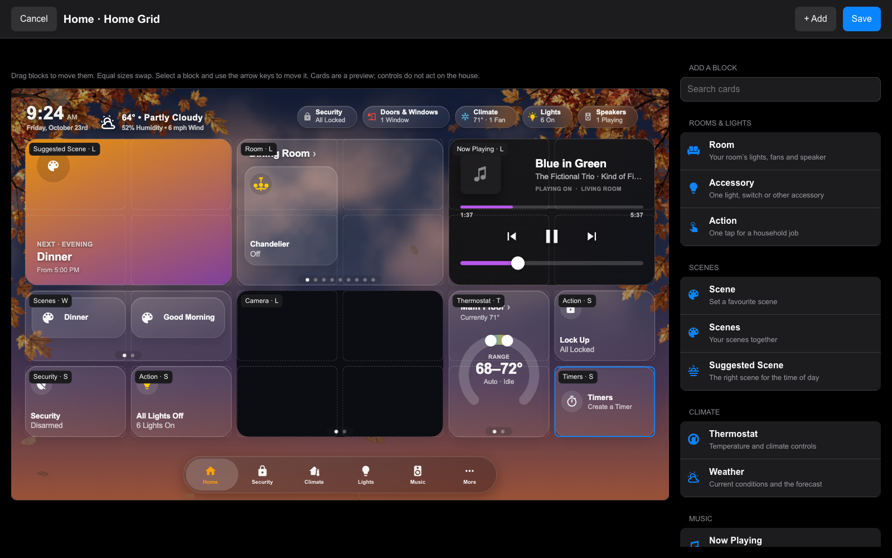

# Home Grid

Home Grid is a tablet Home page arranged in fixed blocks. It fits the screen without scrolling, keeping the same tile proportions at every resolution. Each screen keeps its own layout; the other pages and the menu keep working as usual.

In Mantel Settings, open **Screens → your screen → Arrange Home Grid** on a desktop. Owners and Admins can arrange a screen. A wall tablet displays the saved layout and offers no editor.

For a new layout, start with **Tap Weight** (the largest blocks are the ones you touch most) or **Glance Up, Touch Down** (readings above, controls below). The starter uses your home's scenes, rooms, cameras and thermostats. It stays a draft until you press **Save**. Once a layout exists, starter layouts are inside the collapsed **Screen Settings** section; choosing one replaces the draft.

- Drag a block to move it. Blocks of the same size swap places. A move that overlaps another size or leaves the grid is refused.
- Select a block, then use the arrow keys to move it with the keyboard.
- Select **+ Add**, search or choose a group, then choose a card. Its illustrative preview uses sample readings and named sizes; the saved card uses your home's live data. **Add** uses the first free space; you can also drag the preview onto the grid. Sizes without space say so.
- Select a block to change its size, options or pages, or remove it.
- Choose **Choose Each Page** to add pages of the same card with different options. You can move pages up or remove them. Rooms, cameras, thermostats, speakers and scenes also have automatic page sources.
- **Tablet’s Room** means the room of the tablet displaying the screen. A copied layout keeps that meaning.

To combine accessories from different rooms in one block, choose **+ Add → Rooms & Lights → Accessory Group**. Choose a size and use **Add Accessory** to build an ordered list. **Automatic Swipe Pages** fills each page in that order: Wide holds two, Large four, Extra Large six, and Full Width twelve. Use **Move Accessory Up** to reorder them. A sparse last page keeps the same tile sizes.

Standalone accessories and scenes use the same saved glyphs and colors as their room-page pills, including state-specific accessory icons. Change these in the accessory's configuration; Home Grid follows those choices. The block still controls its size and Line Under Name setting.

For precise page contents, change **Pages → Choose Each Page**. The current list splits into pages; select the accessories under **Page 1**, **Page 2**, and so on. **Add Page** creates an empty page to fill. Pages can have their own name, and you can move or remove them. This groups controls on the dashboard; it does not create a Home Assistant group or combine their actions.

On an **Accessory** card, or each accessory inside an **Accessory Group**, **Line Under Name** chooses Automatic, State, Brightness, An Attribute, or Hidden. Choose **An Attribute** to select a reported scalar value such as battery level or current temperature, with an optional unit. Missing values show a dash. These choices belong to this block/page and follow live updates.

**Screen Settings → Grid Scale** defaults to **Automatic Fit**. The grid uses the design’s 196 × 150 tall-tile unit with 10-pixel gaps, then scales uniformly to fit beside the navigation bar. Larger screens keep the original size; different ratios leave space around the grid. Choose 50–90% of Fit for a smaller layout. Frame Width and Height only set the editor’s preview display.

Home Grid is a mode on an existing generated dashboard. You do not need a new dashboard: open its editor, choose a starter, arrange the blocks, and Save. Create a separate screen first only if you want a separate layout. The tab bar keeps your navigation settings: **Rooms** can be its own button or a section inside **More**.

For room blocks, **Room Display → One Room** shows the selected **Room**. **Swipe Between Rooms** shows the screen’s rooms and uses **Starting Room** for its opening page and idle return. Choose **Tablet’s Room** to follow the wall tablet’s assigned room; an unassigned desktop previews the first room. A specific starting room takes priority over a previously saved tablet-room start.

Room blocks have a surrounding tile containing accessories and the speaker, without status chips. Wide uses regular pills; Large uses a 2 × 2 arrangement of taller tiles, Extra Large has two rows of three, and Full Width has two rows of six. Empty cells stay reserved, so a lone accessory never stretches into another row. The tiles fill the available height. Extra accessories appear behind **+N more**, which opens the room. Scene groups also have a surrounding tile, with a centred page-control pill for the scenes that swipe together. The pill grows with the page count and reduces dot spacing when needed to fit a narrow card. Camera blocks default to one camera: select **Camera** to choose which. Choosing a camera turns automatic paging off. Choose **Camera Display → Swipe All Cameras** to restore the carousel.

For a room block, **Accessory Display → Summary** keeps the compact selection of lights, fans and one speaker, with **+N more** opening the room. Choose **Scroll All Accessories** to scroll vertically through the room's supported controls, including locks, covers and climate controls. Tile sizes stay fixed. The room title and page dots stay outside the scroll area; swipe sideways to change rooms. Hidden entities and the room's normal visibility settings still apply; diagnostic sensors are not automatically added.

Select a Room or Scenes block and enable **Custom Group Background** to choose its color, opacity and blur (Follow Screen, None, Light, Medium or Heavy). Opacity changes the background tint, not the pills or labels. Turn the custom background off to restore the screen’s appearance. These settings also work on paged groups and conditional fallbacks.

Weather comes in Wide (conditions), Large (also readings, six hours and three days), and Extra Large (also five days, beside the current conditions). Forecast details depend on what your weather provider offers. Enable **Weather Sky Background** in the block's options for Sky's clouds, sun/moon and precipitation inside the card. It is off by default, follows the chosen weather entity, and respects the screen's animation setting and reduced motion. Timers offer pause/resume and cancel; an empty block opens Create a Timer, and Wide also has quick starts. Security opens the shared alarm sheet, keeping its PIN flow.

Choose **Show When** and a fallback card for a conditional block. Conditions include music playing, a timer running, an armed alarm, a doorbell event, after sunset, and an entity state. While false, the fallback fills the same cells. **Preview** switches between Live, Primary and Fallback in the editor without changing the saved condition. Doorbell events hold their card for one minute. **Change Card** and the fallback chooser reuse the gallery and offer cards that fit the block’s size.

The picker and settings scroll within the right-hand panel. The dashboard preview and Save/Cancel toolbar stay visible, and the preview scales to fit shorter desktop windows.

Expand **Screen Settings** for columns, rows, frame dimensions and header controls. The frame is the tablet's dimensions in pixels, used to scale the desktop preview. The tablet itself fills its actual display. The editor includes the screen's tab bar and leaves its space clear. There are 6, 3 or 2 columns and 2–6 rows. The narrower column counts are supported, but their card designs have not been polished for nightstand displays.

**Header Clock** and **Header Weather** can be turned off independently while retaining the status chips. This lets you use clock and weather cards without repeating the same information in the header.

The optional top band keeps the clock, weather and status chips together. Chips line up with the right edge of the cards when they fit; longer rows scroll horizontally. In a narrow thermostat block the dial fills the block: tap the thermostat's name for its full controls and modes. Wider thermostat blocks show mode choices directly. A large Now Playing block shows the song's progress above the controls and the volume below them, over a blur of the album cover. Under a block that has more than one page, the dots work like an iPhone's: swipe the block, tap a dot, or tap either side of the dots to move one page. On a computer, drag the card left or right, scroll horizontally on a trackpad, or use Shift + mouse wheel. The page you choose stays selected through live updates until the normal return-to-home timer runs.

**Save** applies the complete layout in one checked settings change. **Cancel** discards the draft. The card controls inside the preview are disabled, so arranging a block cannot toggle a light or run a scene. To return to the generated Home page, choose **Home Style → Generated**; the saved grid is retained.

Mantel also offers **History** and **Copy Layout To…**. History lists the saved screen versions with their actor and time. Choosing one restores its layout into a draft for review; press Save to apply it. Other screen settings are preserved. Copy Layout saves the draft to the selected screen after confirmation and preserves that screen's other settings.

In HK Frontend, Home Assistant admins use **HK Settings → your screen → Arrange Home Grid**. Its editor and settings checks are shared with Mantel; History and Copy Layout are Mantel features.

The desktop editor has passed browser checks in Mantel and a scratch Home Assistant with fictional devices. Publication, a release and a physical tablet check are still required before this phase is considered shipped.

The screenshots use fictional devices and Arial. Camera pictures are illustrative landscapes.

People cards and person sheets use Home Assistant person portraits through Mantel’s authenticated image route. If a picture is missing or fails to load, initials appear instead.

Person detail sheets size to their contents, keeping the map, history, phone battery and other members together. On shorter phone screens the content scrolls inside the sheet.
