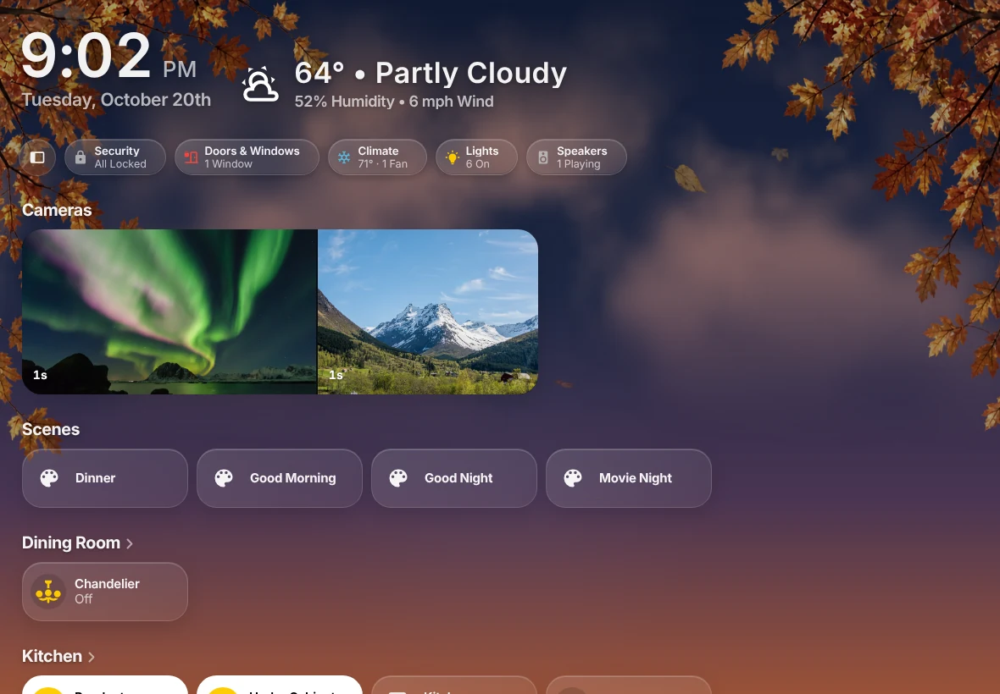

# Mantel

Mantel serves [HK Frontend](https://github.com/jazzphone/hk-frontend)’s screens from a server of its own, beside Home Assistant, and adds people and roles, wall tablets that sign themselves in, and an audit log of every command. This guide covers installing it, setting it up and living with it.

## Get started

1. **[Install](Install.md)** Mantel: as a Home Assistant App, [with Docker](Install-Docker.md), or [on Proxmox](Install-Proxmox-LXC.md).
2. **[First Run](First-Run.md)**: create the Owner account, connect Home Assistant, and open your first screen.
3. **[People and Roles](People-and-Roles.md)**: add the rest of the household.
4. **[Wall Tablets](Wall-Tablets.md)**: enroll the tablets on your walls.
5. **[Commands and Audit](Commands-and-Audit.md)**: turn commands on when you’re ready.

Coming from HK Frontend inside Home Assistant? Read **[Moving from HK Frontend](Moving-from-HK-Frontend.md)** first.

## People and access

- [People and Roles](People-and-Roles.md): roles, grants, and rooms for a person or a tablet
- [Signing In](Signing-In.md): passwords, passkeys, authenticator codes and Home Assistant sign-in
- [Wall Tablets](Wall-Tablets.md)
- [Commands and Audit](Commands-and-Audit.md)
- [Security Model](Security-Model.md)

## Features

- [Music and Cameras](Music-and-Cameras.md)
- [Photos](Photos.md)
- [iPhone and Mac Apps](iPhone-and-Mac-Apps.md)
- [Push Notifications](Push-Notifications.md)
- The screens themselves are HK Frontend’s: see its [wiki](https://github.com/jazzphone/hk-frontend/wiki) for pages, rooms, the sky, the screensaver and HK Settings.

## Home Assistant

- [Mantel Link](Mantel-Link.md): the Home Assistant integration that links Home Assistant to Mantel
- [Mantel Connect](Mantel-Connect.md): Mantel in Home Assistant’s sidebar when it runs elsewhere
- [Moving from HK Frontend](Moving-from-HK-Frontend.md)

## Looking after it

- [Updating](Updating.md)
- [Backups](Backups.md)
- [Troubleshooting](Troubleshooting.md)

Something not covered here? [Open an issue](https://github.com/jazzphone/mantel/issues).
