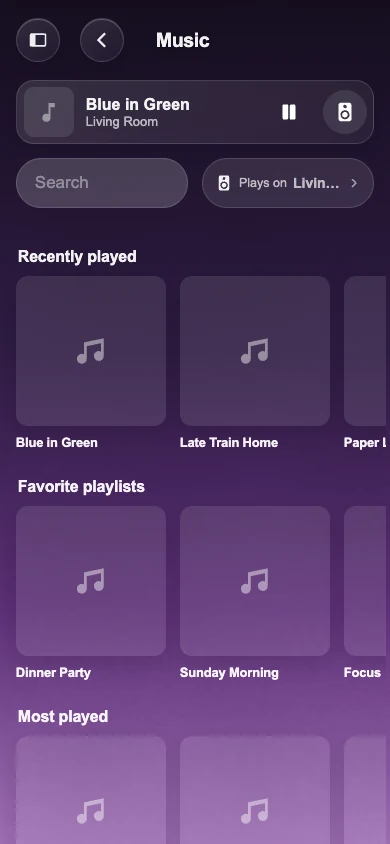
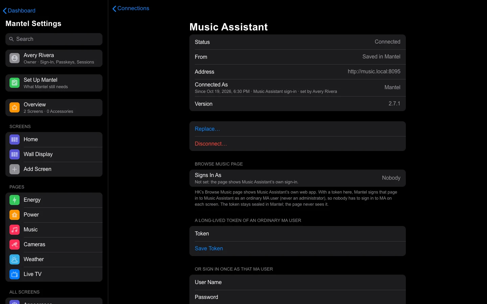
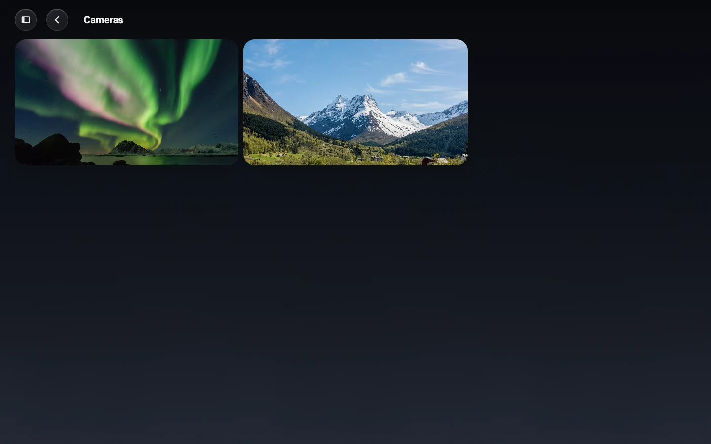

# Music and Cameras

Mantel runs HK's Music page itself, talking to Music Assistant directly, and
shows your cameras through its own sign-in and roles. Each person and each
wall tablet hears and sees only what their role allows. This page covers
connecting Music Assistant, which speakers each screen plays on, and what
passes through Mantel when a screen shows a camera.

*The Music page on a phone.*

## Music

### What you need

- **Music Assistant**, version 2.7 or later for the sign-in below (or any
  version with a long-lived token).
- Home Assistant's **Music Assistant** integration, with its players in Home
  Assistant. Mantel takes each speaker's name and room from Home Assistant.
  Everything else (what plays, the volume, the groups, the covers, the queue,
  Browse, search and every command) comes from Music Assistant itself, so the
  music keeps working while Home Assistant restarts.
- Each speaker in a Home Assistant **area**, as HK Frontend's
  [Music](https://github.com/jazzphone/hk-frontend/wiki/Music) page needs.

### Connect Music Assistant

Only an Owner can change a connection.

1. Open **Mantel Settings → Connections → Music Assistant**.
2. Under **Address**, enter its address, for example
   `http://192.0.2.20:8095`. If Mantel runs as the Home Assistant App and
   Music Assistant is an App too, the box is filled in for you ("Found Music
   Assistant's App: press Test").
3. Either **Sign In with a Music Assistant User** (a user name and password,
   used once to make a long-lived token and not kept), or paste a long-lived
   token you made in Music Assistant (**Settings → your profile**).
4. Select **Test**, then **Save**.

Nothing restarts. Open screens switch to Mantel's music at once. Music
Assistant's tokens last a year; the page shows when this one ends.

To stop, select **Disconnect…**. The Music page goes back to Home Assistant's
music, as before.

> Prefer a file? An installation can also give Mantel Music Assistant's
> address and token (`MANTEL_MA_URL` and the `ma_token` secret in Docker). The
> page shows them as "set by the installation". The App's old **Music
> Assistant address** and **Music Assistant token** options were copied into
> Mantel's own saved connection once, when 0.1.52 started. A connection
> saved on the page wins over them.

### Bring the music settings over

If you used HK Frontend's Music feature, its speakers, house volume, Home
Rooms, presets and playlists come over with the one-time import (see
[Moving from HK Frontend](Moving-from-HK-Frontend.md)). Otherwise, set them up
on **Mantel Settings → Pages → Music**. It is the same page as HK Frontend's
**HK Settings → Pages → Music** and works the same way: see HK Frontend's
[Music](https://github.com/jazzphone/hk-frontend/wiki/Music) for every
setting.

Mantel answers the Music page only when **both** are there: Music Assistant
connected, and the music settings in Mantel. Until then the page keeps
reading Home Assistant's music, if HK Frontend has it.

### Which speakers each screen plays on

| Who | The Music page starts on | May play on |
|---|---|---|
| A person | Their **Home Room**, chosen for them on the Music settings page (for a person linked to Home Assistant, the one HK Frontend had, until you choose one) | The speakers in rooms their role lets them see |
| A wall tablet | The first speaker in the tablet's own room, in the order the speakers were picked | Its room's speakers |

Each speaker is named by its area, so a room's pill says "Kitchen", not the
speaker's model.

By role, with the starting roles (see [People and Roles](People-and-Roles.md)):

| Role | Music page | Speakers |
|---|---|---|
| Owner, Admin, Adult | Yes | Every speaker |
| Child | Yes | Only in the rooms they are given |
| Guest | No | (Guests can still use a speaker in their rooms as an accessory) |
| Wall tablet | Yes, on every tablet | Its own room's |

An Owner can narrow any of these with an ordinary deny grant, for example to
keep a Child off the Music page. Playing never moves a room that isn't yours:
if a room you may use is playing together with one you may not, Mantel says so
and changes nothing, rather than taking that room out of its group.

**Playlists' covers:** each playlist on the Music page, the Music block and the
playlists sheet shows the picture of the first of its Music Assistant items that
has one (the playlist's or album's own, else its first song's album), looked up
in the background and kept for six hours; a playlist with none keeps its color
and glyph. (HK Frontend, inside Home Assistant, shows the color and glyph.)

**Presets** (a name for rooms that often play together, set in Mantel
Settings) are offered when the person may see every room in them. A preset
plays on its rooms, joined under one of them, so it pauses like any room. A
**stereo pair** (a Music Assistant group of two speakers, picked as one
room's speaker) plays on its own; see HK Frontend's
[Music](https://github.com/jazzphone/hk-frontend/wiki/Music#stereo-pairs). Up Next for a speaker you may not see answers
as if it did not exist.

### Speaker pairs

Two speakers in one room, such as two HomePods, can be **paired in Mantel**:
Mantel Settings → Music → Speakers → Pair Two Speakers. Give the pair a name
(or leave it to be named by its area) and choose its two speakers. The pair is
then one speaker everywhere: the Music page, the Speakers panel, the Side Pane,
the Music and Now Playing blocks, home rooms and Plays on.

The two are grouped in Music Assistant each time they play, not kept in a
Music Assistant group, so each stays free to join other rooms. Volume goes to
both together; play and pause go to the first, which leads the pair. If Music
Assistant also has a group of exactly those two speakers, the pair plays
through it when it plays on its own; with other rooms its two speakers join
them instead. (A preset is only a name for rooms: no Music Assistant group
plays it.) Unpair it on the same page to have two speakers again.

### Playing needs house commands on

With house commands off, the Music page reads everything (what is playing,
the queue, the library) but every button is refused before anything reaches
Music Assistant. With them on, each play, move, stop and volume change is
checked against the rooms it names and written to the
[Audit Log](Commands-and-Audit.md) before it is sent.

### The Music Assistant page

HK's **Browse Music** page shows Music Assistant's own web app. On Mantel it
is served under Mantel's address (`/ma/`), so it works on an `https` page, and
only for people who may control music.

To skip Music Assistant's own sign-in on every screen, give Mantel a token for
an ordinary Music Assistant user:

1. In Music Assistant, **Settings → Users**, add a user (for example
   `mantel-page`) with the **User** role, not Admin.
2. In Mantel, **Mantel Settings → Connections → Music Assistant**, under
   **Browse Music Page**: sign in as that user once, or paste a long-lived token
   made for it.

An administrator's token is refused. The token stays in Mantel; the page
never sees it. If Music Assistant later refuses it, the page shows Music
Assistant's own sign-in again.

What the signed-in page sends goes to Music Assistant directly, not through
Mantel's checks, so Mantel signs it in only when house commands are on and
for someone who may play, group and set the volume of **every** speaker:
usually Owners, Admins and Adults. Everyone else, a Child kept to their rooms
or a wall tablet, sees Music Assistant's own sign-in on that page, as without a
token. Each signed-in page is written to the Audit Log when it opens.

### What is different from HK Frontend

- **Announcements** are not spotted. During a spoken announcement on a speaker,
  the Music page may briefly show it as what is playing.
- **Failure notices** (a group that would not form, a playlist that did not
  start) are logged by Mantel, not raised as Home Assistant notifications.

### While Home Assistant restarts

With Music Assistant connected, the Music page, the Now Playing card, the Side
Pane and the screensaver keep showing what plays and its cover, and every
button keeps working, while Home Assistant is restarting or away. Mantel reads
each speaker's state from Music Assistant directly, in the same form Home
Assistant gives it.

If Music Assistant itself is away for more than a minute, its speakers show as
unavailable until it is back. A speaker added to Music Assistant appears once
Home Assistant has it too (its name and room come from there).

## Cameras

*The Cameras page.*

HK's Cameras page, the camera strip and the doorbell pop-up work on Mantel as
in HK Frontend; see HK Frontend's
[Cameras](https://github.com/jazzphone/hk-frontend/wiki/Cameras). Mantel needs
nothing set up for them: it uses its own Home Assistant connection.

### Who sees which camera

| Role | Cameras |
|---|---|
| Owner, Admin, Adult | Every camera, at home and away |
| Child, Guest | None |
| Wall tablet | Every camera, so the doorbell pop-up shows on every tablet. Tablets work on the home network only. |

Away from home, a role sees cameras only while its **Cameras from Outside**
switch is on (**Mantel Settings → Roles & Grants**). Through Home Assistant's
sidebar the same switch applies when the sidebar is set to Mantel's away
rules. A refused camera stays on its still, or shows nothing, and is not
retried.

### Stills

The pictures on tiles come from Mantel, never from Home Assistant directly:

- A screen asks Mantel for `/api/camera/<camera>/still`.
- Mantel checks that the person or tablet may view that camera live, then
  fetches the picture from Home Assistant with Mantel's own credential and
  passes it on.
- Home Assistant's camera token is removed from every state Mantel sends, so
  no page ever holds one. The same goes for speakers' album art.

### Live view

Live video uses Home Assistant's own WebRTC, as it does inside Home Assistant:

1. The screen sends the WebRTC setup messages to Mantel.
2. Mantel checks each one (may this person view this camera live?) and
   relays it to Home Assistant unchanged. A refused camera gets nothing
   forwarded.
3. **The video itself flows directly between the screen and Home Assistant's
   go2rtc**, never through Mantel. Mantel passes on Home Assistant's own
   connection settings, unchanged, so it works away from home exactly as it
   does in Home Assistant.

One screen can't join another screen's video session, and closing the page
ends its session.

| Passes through Mantel | Never passes through Mantel |
|---|---|
| The setup messages (offer, answer, connection candidates) | The video and audio |
| Stills and album art, fetched by Mantel | Home Assistant's camera tokens |
| | Home Assistant's own address or credential |

### Talking at the door

The doorbell pop-up has a **Hold to talk** button when its camera has a
speaker. Hold it and speak, and let go when you're done.

- **Ready before you press.** The doorbell's talk session opens with the
  pop-up, so your first word isn't lost. Nothing reaches the doorbell until
  you hold the button.
- **A conversation, not a walkie-talkie.** The visitor stays heard while you
  talk, turned down, and the tablet's echo cancellation keeps the door from
  hearing itself. (On an iPad the door's sound stays at its volume; Safari
  doesn't let a page turn a video down.)
- **What the button says:**

  | Button | Meaning |
  |---|---|
  | Hold to talk | Ready. |
  | Connecting… | The microphone or the doorbell isn't ready yet (the first press on a pop-up opens the microphone). |
  | Talking — release to stop | Your words are heard at the door as you speak. |
  | Talk — release to send | The doorbell couldn't take live talk, so your words are recorded and played at the door when you let go. |
  | *Kitchen* is talking | Someone else is talking at the door. One person talks at a time. |
  | Can't reach the doorbell | The talk session couldn't open. A press still tries, and records the message if it must. |
  | Needs HTTPS | The page isn't secure, so the browser gives it no microphone. See **Mantel Settings → About → Secure Connection**. |

- **Who may talk** is set by roles, as before (**camera.talk**): every wall
  tablet may talk on the doorbell named in HK's pop-up settings.
- Live talk works with UniFi Protect doorbells. Other speakers get the
  recorded message. In the Home Assistant App it goes through Mantel Link
  (0.1.11 or later keeps the session open between holds). In Docker or the
  Proxmox container, with **UniFi Protect** connected (below), Mantel talks
  to the doorbell itself, with no Home Assistant in between.
- Your first hold on a pop-up reaches the door a little later than the next
  ones (about 0.9 s against 0.45 s, measured at a G4 Doorbell Pro): the
  doorbell needs a moment to pick up a new audio stream, so Mantel keeps the
  stream going between holds while the pop-up is open.

### UniFi Protect (Docker and the LXC)

On Docker and the Proxmox container, Mantel can talk to your UniFi Protect
console itself: its cameras, their stills, the doorbell and its speaker, and
what each camera detects, with no Home Assistant in the middle. In the Home
Assistant App there is nothing to set up: cameras come from Home Assistant's
[UniFi Protect integration](https://www.home-assistant.io/integrations/unifiprotect/),
and **Mantel Settings → Connections → UniFi Protect** says so.

**Connect.** In UniFi OS, make a local user named Mantel (Admins & Users),
sign in to UniFi OS as that user, and make an API key there: **Settings →
Control Plane → Integrations → Create API Key**. Your own account then never
signs in for Mantel. Then, in **Mantel Settings → Connections → UniFi
Protect**, type the console's address (for example `unifi.local`) and paste
the key. **Test** checks without saving; **Connect** checks and saves. The
checks run in order, and the first that fails says what to fix:

1. the address answers as a UniFi OS console running Protect (asked without
   the key, so the key goes nowhere else);
2. its certificate (see Trust, below);
3. the key works;
4. UniFi Protect is 7.2.105 or later.

The key is kept sealed in Mantel's data and is never shown again. Whether a
key stops working when its UniFi OS user is removed isn't confirmed yet, so
**to cut Mantel off, delete the key** in UniFi OS (and press Disconnect here).
Only an Owner connects, replaces or disconnects; Admins see the status.

**Advanced: a local user.** Off by default. It takes a local UniFi OS user
and password (a UI.com cloud account or an account with MFA can't be used),
keeps them sealed beside the key, and uses them for nothing yet: the API key
is all Mantel needs today.

**Trust.** The console's certificate is its own, so Mantel trusts it the first
time you connect and shows its fingerprint. From then on every connection is
held to it. If the certificate changes (a replaced or reset console, or
something else answering at that address), Mantel stops talking to the
console and the page shows the new fingerprint. Compare it with the one UniFi
OS shows; an Owner may then **Trust This Certificate**, which is recorded in
the Audit Log. If you didn't replace the console, don't.

**The status** shows the console's name, the Protect version, how Mantel
signs in, the events connection and when the console last spoke.

**Picking cameras.** **Cameras** lists the console's cameras with their
stills. Open one and turn on **Use in Mantel**: Mantel asks the console for
its streams and the camera plays through Mantel's own go2rtc, its stills
coming from the console. A camera renamed in Protect follows; one removed
from Protect leaves Mantel. Mantel reads the console's list every five
minutes and when you connect.

**A camera Home Assistant has too** shows once, as Home Assistant's camera,
with its name and room. Its page has **Video From**:

| Video From | Where its video and stills come from |
|---|---|
| Direct (the default) | The console, through Mantel's go2rtc |
| Home Assistant | Home Assistant, as before |

Who may see it doesn't change either way: it is Home Assistant's camera, and
its rooms, grants and denies decide, as for every camera. A camera Home
Assistant doesn't have becomes `camera.mantel_<name>`; pick its room on its
page.

**Notify For.** Each camera lists what it detects itself: the doorbell's
ring, and its person, vehicle, animal or package detection, or **Motion** for
a camera without smart detection. Mantel detects nothing of its own. Turn
off what shouldn't notify; what does becomes notifications and the doorbell
pop-up by **Notifications** (Doorbells, Packages, Cameras), exactly as Home
Assistant's sensors do. A type the camera can do but that is off in Protect
shows **Turn On in Protect**, which turns on only that camera's own setting
(Owner or Admin, in the Audit Log). Zones, sensitivity and privacy masks stay
in UniFi Protect's app.

For a camera Home Assistant has too, each event notifies once: while Video
From is Direct and the console's events connection is up, the console's
event stands in for Home Assistant's sensor and Home Assistant's copy is held
back; otherwise Home Assistant's sensors notify, as before.

**Talking at the door.** Mantel talks to a Protect doorbell itself. Its
speaker is Home Assistant's (for a camera Home Assistant has) or Mantel's own
`media_player.mantel_<name>_speaker`, shown on the camera's page. Name it as
the speaker in HK's doorbell pop-up settings; who may talk is decided as
before (**camera.talk**). Talking needs HTTPS.

### Live TV

In the Home Assistant App, Mantel serves the channels and Mantel Link
transcodes them inside Home Assistant, whose go2rtc plays them (Mantel Link
0.1.3 or later, with the rest of the house moved to Mantel). In Docker or the
Proxmox container, Mantel can serve Live TV through its own go2rtc instead. Its streams are then reachable only through
Mantel (`/go2rtc/`), for people with the Live TV feature who may view that
channel's camera. See HK Frontend's
[Live TV](https://github.com/jazzphone/hk-frontend/wiki/Live-TV) for the page
itself.

### RTSP cameras

In Docker and the Proxmox container, Mantel can play a camera that speaks RTSP
(most IP cameras, a Frigate restream) itself, with no Home Assistant in the
middle. It uses the same go2rtc as Live TV. Open **Mantel Settings → Cameras**
and press **Add Camera**.

| Box | What to type |
|---|---|
| **Name** | What the camera is called. Its id is `camera.mantel_` and the name, in lowercase (`camera.mantel_driveway`). If Home Assistant already has that id, Mantel says so and names Home Assistant's entity: give the camera another name. |
| **Area** | One of Home Assistant's areas, or none. People see the camera the way they see any camera in that area (Roles & Grants), so give it the area its people already have. |
| **RTSP Address** | The camera's address, `rtsp://192.0.2.50:554/stream1`; the camera's manual gives the path. `rtsps://` works too. |
| **Sub-Stream (Optional)** | A second, smaller stream some cameras offer. Mantel draws the stills from it. |
| **User Name** and **Password** | The camera's RTSP login. Type them here, not in the address (Mantel refuses an address with a login in it). |

Press **Test** before you add the camera. Mantel connects to the camera for a
few seconds and shows a picture from it, or says what it could not do:

| Mantel says | What to check |
|---|---|
| It could not reach the camera | The address and port, that the camera is on, and that Mantel's machine can reach it (the camera on another network or VLAN needs a route). |
| The camera refused the user name or password | Both boxes. Many cameras have a separate RTSP login in their own settings. |
| The camera's video is H.265 (or another codec a browser cannot play) | In the camera's own settings, set the video to **H.264**, or use its second stream if it has one in H.264. |
| The camera has no stream at that address | The end of the address (the path). |
| No picture came in time | The camera answers but sends nothing: try its other stream, or restart it. |

**Who can.** An Owner or an Admin. Away from the home network they are asked to
confirm it is them first, as for a change to a connection.

**Where the login goes.** The user name and password are sealed in Mantel's data
folder beside the Connections credentials, and are included in an encrypted
backup. Mantel never shows them again: a saved camera's boxes say **Saved**, and
a box left blank when you change a camera keeps what is saved (**Remove the Saved
Sign-In** drops it). They are never in the Audit Log, which records who added,
changed or removed a camera and the address's host, never the path or the login.

**Notify For.** A camera has no Home Assistant device, so Mantel cannot tell
which sensors belong to it. You can say: **Motion**, **Person** and **Doorbell**
each take any binary sensor or event from Home Assistant, such as Frigate's
`binary_sensor.driveway_person_occupancy`. Names that begin with the camera's
are suggested, and a sensor you cannot see is not on the list. A linked sensor
counts as that camera's in the notifications you set up in HK's Notifications:

- the notification carries this camera's picture, and opens its live view;
- a **Doorbell** link rings the **Doorbells** notification, with the doorbell
  pop-up;
- a **Person** or **Motion** link is the camera's trigger in **Cameras**.

The notifications themselves are still turned on in Notifications. Mantel has no
motion detection of its own, so **without Home Assistant there is nothing to
link**, and the page says so; the camera still plays.

**In the Home Assistant App** there is no go2rtc of Mantel's own, so **Cameras**
has no Add Camera. It says that cameras come from Home Assistant and links to
Home Assistant's
[Generic Camera](https://www.home-assistant.io/integrations/generic/)
integration, which adds an RTSP camera there; it then appears in Mantel by itself.

## Troubleshooting

**The Music page shows no rooms.** Check **Mantel Settings → Connections**:
Music Assistant connected, and the music settings imported or set up. A person
with no rooms they may see gets an empty page.

**The Browse Music page is blank, or says Music Assistant is on your local
network.** Mantel can't reach Music Assistant's web app, or the person may not
control music. If you run your own proxy, make sure it does not add its own
Content-Security-Policy header. See [Troubleshooting](Troubleshooting.md).

**Add Camera is missing.** Mantel runs as a Home Assistant App (add RTSP cameras
in Home Assistant, with Generic Camera), or was started without its go2rtc
(`--go2rtc-url`; Docker and the container set it).

**A camera stays on its still.** The person's role may not view it live, or
they are away and **Cameras from Outside** is off. Mantel's log names a
refused camera (once every five minutes).
