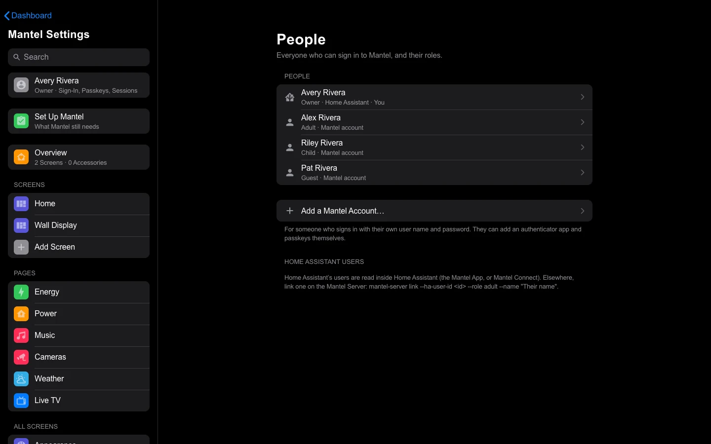
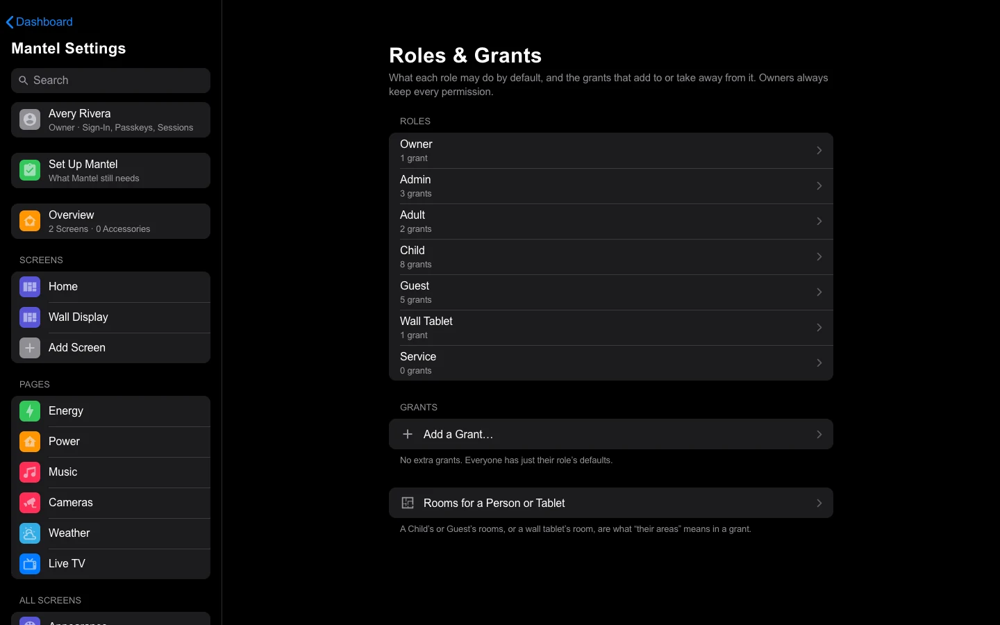

# People and Roles

Everyone who uses Mantel has a **role**: Owner, Admin, Adult, Child or Guest. A wall tablet has a role of its own too. The role decides what each person or tablet can see and control, and **grants** add to it or take things away. This page explains the roles, how to add people, how to give a Child, a Guest or a tablet its rooms, and how grants work.



## The roles

| Role | Sees and controls | Settings | From outside the home |
|---|---|---|---|
| **Owner** | Everything | Everything: people, roles and grants, devices, connections, the audit log | Everything |
| **Admin** | Everything | Everything except managing Owners and the Home Assistant and Music Assistant credentials | Everything |
| **Adult** | The whole house, including locks, the garage, the alarm, cameras and history | Only their own (their sign-in, default screen) | Everything they have at home |
| **Child** | Lights, media players, remotes, climate and fans **in their rooms**, and the Music page | Only their own | No locks, cameras or location history (they have none at home either) |
| **Guest** | Lights, switches, fans, climate, media players, remotes, covers and scenes **in their rooms** | None | No sensitive actions, cameras or location history |
| **Wall Tablet** | What is in **its room**, every camera (for the doorbell pop-up), the Music page and Live TV | None | Never: a tablet works only on the home network |
| **Service** | Only the endpoints it is given | None | Depends on the endpoint |

A few more details:

- **Children** never get cameras, locks, the alarm or the garage, even in their own rooms. They can't change vacuum schedules.
- **Guests** never see cameras, the garage, people's locations, or any history.
- **Sensitive actions** are unlocking, opening the garage, disarming the alarm, water valves, automations, stopping a script, and camera live view. A role needs a separate permission for them (`control.sensitive`). Adults, Owners, Admins and wall tablets have it by default; Children and Guests don't.
- **The Owner role can't be changed.** Its own grants are fixed at "everything". A deny grant that names an Owner (or the Owner role) still applies, so be careful with those, and an Owner at a wall tablet is still limited to what the tablet may do.<!-- CHECK: Mantel Settings → Roles & Grants says "Owners always keep every permission", but rbac.Grant.applies_to does not exempt the owner role from stored deny grants, and add_grant does not refuse them. -->
- **Service** is for machine accounts, such as the one [Mantel Link](Mantel-Link.md) uses. You can't give a person this role. See [Service accounts](#service-accounts).

The last column is the role's **From Outside the Home** switches: Sensitive Actions, Cameras and Location History. See [Signing In](Signing-In.md#home-and-away) for what "outside the home" means.

## Mantel accounts and Home Assistant users

A person signs in to Mantel in one of two ways:

| | A Mantel account | A Home Assistant user |
|---|---|---|
| Signs in with | A user name and password, and optionally an authenticator app and passkeys | **Sign in with Home Assistant**, or Home Assistant's sidebar |
| Made by | An Owner or Admin, in **People** | Linking their Home Assistant user to a role |
| Shown in People as | **Mantel account** | **Home Assistant** |

Home Assistant proves who someone is; Mantel's role decides what they can do. A Home Assistant user who isn't linked gets nothing: their sign-in page says **Not linked yet** and shows their Home Assistant user id, so you can link them.

Neither kind is an administrator in Home Assistant because of their Mantel role, and a Home Assistant administrator gets no extra rights in Mantel. Mantel talks to Home Assistant with its own credential, not the person's (see [Security Model](Security-Model.md)).

## Add a person

### A Mantel account

1. Open **Mantel Settings** → **People**.
2. Select **Add a Mantel Account…**.
3. Enter a **User Name** (letters, digits, dots, dashes or underscores), their **Name**, a **Role** and a **Password** of 12 characters or more.
4. Select **Create Account**.

Give them the password in person. They can then add an authenticator app and passkeys themselves in **Me** (see [Signing In](Signing-In.md)). They need one of those to sign in from outside the home.

An Admin can't create an Owner.

<!-- CHECK: there is no way in Mantel Settings, the CLI or the REST API for an Owner or Admin to set or reset someone else's password, and no "change my password" row in Me (POST /api/account/password exists but nothing in the UI calls it). A person who forgets their password has to be given a new account, or sign in another way. -->

### A Home Assistant user

Use the command line on the Mantel server:

```bash
mantel-server links                                              # who is linked already
mantel-server link --ha-user-id <id> --role adult --name "Alex"
mantel-server unlink --ha-user-id <id>
```

In Docker, run the same commands inside the server, for example `docker compose exec mantel-server mantel link --ha-user-id <id> --role adult --name "Alex"`.

The Home Assistant user id is on the person's **Not linked yet** page. It is also the `user_id` attribute of their `person.*` entity in Home Assistant.

When Mantel runs inside Home Assistant (the [Mantel App](Install.md), or [Mantel Connect](Mantel-Connect.md)), an Owner or Admin can also link people from Mantel's own **People** page in the sidebar, which **Link the rest of the household** on the first-Owner page opens ([First Run](First-Run.md#link-the-household)). It lists Home Assistant's users: choose a role and select **Link**, or **Unlink**.

<!-- CHECK: that Ingress page (<sidebar>/ingress/people, ingress.py people_get) is linked only from the first-Owner page; Mantel Settings → People has no link to it. Confirm how an Owner gets back to it later. -->

**People** lists linked users under **Home Assistant Users**.

## Change a role, or disable someone

1. Open **Mantel Settings** → **People** and select the person.
2. Choose a new **Role**. It applies at their next command, and to what their open screens show within a minute.
3. To lock someone out, select **Disable…**. Their sessions end at once and they can't sign in until you select **Enable**.

Some limits:

- Only an Owner can change an Owner. An Admin sees an Owner's page read-only.
- Mantel never lets you demote or disable the last enabled Owner.
- You can't disable yourself.
- There is no delete. Disable a person instead.

A person's page also has their **Default Screen** (**Opens On**), where Mantel opens for them. It sets only where they land, not what they may open. A wall tablet always opens on its own screen, whoever is signed in at it.

## Rooms for a person or tablet

A Child or a Guest sees only their rooms, and a wall tablet only its room. Until you give a Child or Guest rooms, they see none of the home's devices.

1. Open **Mantel Settings** → **Roles & Grants**.
2. Select **Rooms for a Person or Tablet**.
3. Under **Who**, choose **A Person** or **A Wall Tablet**, then which one.
4. Tick **Their Rooms**. The rooms are your Home Assistant areas.
5. Select **Save Rooms**.

A wall tablet that has no rooms saved here uses the room it was enrolled with (see [Wall Tablets](Wall-Tablets.md)). Saving rooms here widens or narrows that.

Only an Owner can change rooms.

## Roles & Grants



**Mantel Settings** → **Roles & Grants** (Owner only) shows each role's own grants and its **From Outside the Home** switches, and every extra grant you have added.

A **grant** allows or denies some actions on some things, for a role, a person or a wall tablet. Mantel decides like this:

- Nothing is allowed unless a grant allows it.
- Grants add up: a person has their role's grants plus any that name them.
- **A deny always wins** over an allow.
- At a wall tablet with a person signed in, both must allow it. A person can never do more at a tablet than the tablet can.

### Add a grant

1. In **Roles & Grants**, select **Add a Grant…**.
2. **Who**: **A Role**, **A Person** or **A Wall Tablet**, and which one.
3. **Effect**: **Allow** or **Deny**.
4. **Actions**: one or more of these.

   | Action | Means |
   |---|---|
   | `view` | See it on the screens |
   | `control` | Turn it on and off, change it |
   | `control.sensitive` | The sensitive actions: unlock, open the garage, disarm, valves, automations, camera live view |
   | `history` | Its history and logbook, and people's exact locations |
   | `configure` | Change its settings |
   | Everything (`*`) | All of the above |

5. **On What**: a **Kind**, and which one:

   | Kind | Which One |
   |---|---|
   | `entity` | An entity id, such as `light.kitchen`. `*` works as a wildcard: `light.kitchen_*` |
   | `domain` | A domain, such as `lock` |
   | `area` | A Home Assistant area, by id or name |
   | `floor` | A Home Assistant floor, by id or name |
   | `feature` | A part of Mantel, such as `cameras`, `music`, `garage`, `locations`, `live_tv` or `audit` |
   | `all` | Everything |

   **Only These Domains** narrows it further, for example `light` on an area for "the lights in the den".
6. Optional: **When**. A time window (**From** and **Until**, in the home's time zone; a window can cross midnight), the **Days** it starts on, and **Starting** and **Ending** dates. An allow counts only inside its window; a deny applies only inside its window.
7. Optional: a **Note**, to remember why.
8. Select **Add Grant**.

A grant change reaches everyone's open screens at once. To undo one, select **Remove:** and the grant in the list.

### Examples

| You want | Grant |
|---|---|
| Riley (Child) can't use the TV after 21:00 | Person: Riley · Deny · `control` · `domain` `media_player` · From 21:00 Until 06:00 |
| A Guest can use the guest room's scene | Person: the guest · Allow · `view`, `control` · `entity` `scene.guest_room_evening` |
| A Guest's access ends on Sunday | Person: the guest · Deny · Everything · `all` · Starting: Sunday's date |
| The kitchen tablet can't unlock the back door | Wall Tablet: Kitchen · Deny · `control.sensitive` · `entity` `lock.back_door` |
| No child sees the Music page | Role: Child · Deny · Everything · `feature` `music` |

### Changing a role itself

**Roles & Grants** shows a role's own grants and switches but doesn't edit them. An Owner can replace a role's defaults through the API (`PUT /api/rbac/roles/<role>`; `DELETE` puts the defaults back). For most needs, a grant on the role is simpler and easier to undo.

## Service accounts

A **service account** is a credential for a machine, not a person: no password, no session, no role, only the endpoints ticked for it. [Mantel Link](Mantel-Link.md) uses one to link Home Assistant to Mantel.

**Mantel Settings** → **Service Accounts** (Owner only, on the home network) lists them and makes new ones. A new credential is shown once; Mantel keeps only a hash of it. **Revoke** cuts off whatever uses it at once.

## Who sees which settings

| Section of Mantel Settings | Owner | Admin | Adult, Child, Guest |
|---|---|---|---|
| **Me** | Yes | Yes | Yes |
| HK's own settings (Screens, Pages, All Screens, Library, System) | Yes | Yes | No |
| **People**, **Devices**, **Your Files** | Yes | Yes | No |
| **Roles & Grants** | Yes | No | No |
| **Service Accounts**, **Mantel Connect** (when Connect is on) | Yes, on the home network | No | No |
| **Audit Log** | Yes | Yes | No |
| **Connections** | Yes | Read only | No |
| **About** | Yes | Yes | Yes |

A person signed in at a wall tablet gets **Me** only, and a wall tablet on its own gets no settings at all. Every page is checked again by the server, so hiding a section is never the only protection.

## See also

- [Signing In](Signing-In.md)
- [Wall Tablets](Wall-Tablets.md)
- [Commands and Audit](Commands-and-Audit.md)
- [Security Model](Security-Model.md)
