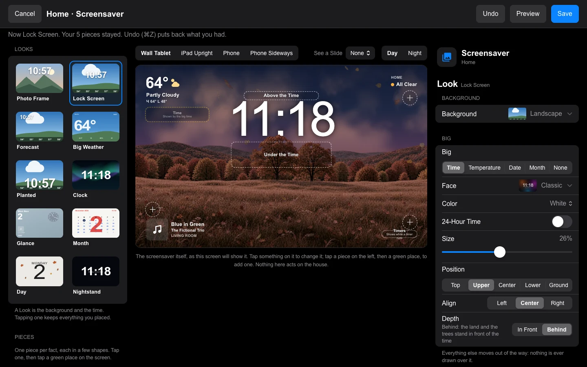
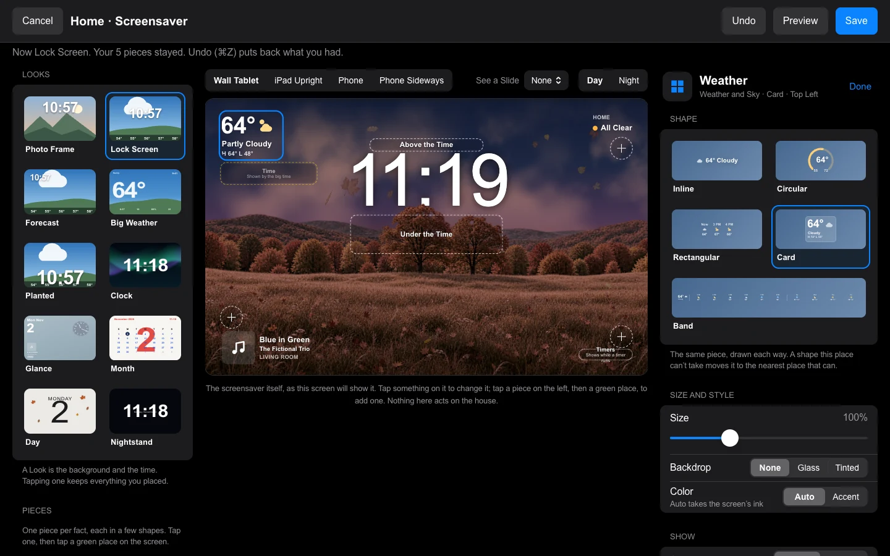

# Screensaver

The screensaver on a wall tablet is HK Frontend's, and its photos, timing and the rest work as HK Frontend's [Screensaver and Idle](https://github.com/jazzphone/hk-frontend/wiki/Screensaver-and-Idle) page describes. This page covers the editor Mantel Settings adds for how it looks: where the time goes, what sits around it, and what is behind it. Photos and albums are on the [Photos](Photos.md) page.

## Edit Screensaver

**Edit Screensaver** lays the screensaver out on the screen itself, as the [Home Grid](Home-Grid.md) editor does for the Home page. Owners and Admins can use it, on a computer or an iPad. The editor needs a wide window for its three panes; on a narrow one it says so and offers **Open Anyway**. The **Clock Style** pages in Settings open it too.

The top bar has **Cancel**, **Undo**, **Preview** and **Save**. On the left are the **Looks** and the **Pieces**. In the middle is the screensaver itself, drawn by the same code the tablet draws with. On the right are the settings for whatever you have tapped. Nothing you do here acts on the house.

A screensaver is a **Look** (a background and the time) and the **Info** around it: the pieces you place. Every screen draws this way, including one that has never saved anything: its corners are pieces too.

### Looks

The Looks are **Photo Frame**, **Lock Screen**, **Forecast**, **Big Weather**, **Planted**, **Clock**, **Glance**, **Month**, **Day** and **Nightstand**, each shown as its picture. Tapping a Look changes the Look only: the background, the face, and how large the time is and where it stands. What you placed stays. A piece the new Look has no place for (Month has no row and no line) waits: it stays in your layout, the screen leaves it out, and the Info list marks it "Waits: Month has no row". Tap the Look you are on to open its page; **Start Over from** that Look, at its foot, puts back the Look's own pieces in their places.

### The four sections

With nothing tapped, the right side has four sections, always in this order.

- **Look:** the **Background** (**Photos**, **Landscape**, **Sky Only**, **Moving Color**, **Wallpaper**, **HK Landscapes**, **Soft Photos**, **The Day's Art**, **Calm Color**, **Paper** or **Black**) and its own options, such as how much to darken photos or a Moving Color pattern and its **Motion**. Then the **Big** element (**Time**, **Temperature**, **Date**, **Month** or **None**), its **Face**, **Color**, **24-Hour Time**, **Size**, **Position** and **Align**. **Depth** is **In Front** or **Behind**: on photos the subject stands in front of the time, as on the iPhone's Lock Screen, with any face; on the Landscape the hills do. Where the background can't put anything in front, Depth says why instead. The **Planted** face (solid figures standing in the meadow) is on the Landscape. Over busy backgrounds, **Legibility** adds a soft shadow and an outline.
- **Info:** what is placed, a list with each piece's picture, shape and place; tap one to open it. **Ink** is **Auto**, **White** or **Black**: one ink for every piece on the screen, never some white and some black; Auto picks it from what is behind them. **Color Accents** adds a little color where it means something: rings, glyphs and status dots. **The Row** has one **Size** for every piece in it (60 to 200 %) and where it goes: **Under the Big Element**, or **Along the Bottom**, which keeps the middle of a photo, where faces usually are, clear. **Upright Screens** is **Same as Sideways** or **Its Own**.
- **Slides:** the screens that come now and then over the screensaver, each on or off: the forecast among the photos (**Classic** or **Big**), **Music Full Screen**, **Weather** and **Home Energy**, and **How Often**. Each says what its corner adds (the time, the date and Home Status, in the Look's own face and color) and has a **See It** button.
- **Timing:** **Starts After, Night Mode and More** opens the Screensaver page.

At the foot, **Reset…** puts the screensaver back to how it looked before you opened the editor.

### Pieces

The pieces are listed by group: **Time and Calendar**, **Weather and Sky**, **Home**, **People and Travel**, **Energy**, **Media and Photos**, **Cameras** and **Any Sensor**, with a search field. Each shows its picture and its shapes. Some say when they show ("Shows while music plays"), and a few are **Off Until Placed**.

- **Add:** drag a piece onto a green place with the mouse, as in the Home Grid editor, or tap it and then a green place, which works the same on an iPad. It goes in the first of its shapes that place takes. Drag one on the screen to another place to move it.
- **Shapes:** **Circular** and **Rectangular** pieces go in the row, four units to a line and two lines at most (a circular piece is one unit, a rectangular two), as on the iPhone; **Inline** pieces are a line of words above the big element or in a top corner; **Cards** go in the corners; **Along the Bottom** are bands such as the forecast's days.

Tap a piece on the screen to open its page:

- **Shape:** its shapes, each drawn. A shape its place can't take moves it to the nearest place that can, and the editor says so.
- **Size and Style:** **Size** (60 to 200 %; in the row, **Its Own Size** off follows the row's size), **Backdrop** (**None**, **Glass** or **Tinted**) and **Color** (**Auto**, in the screen's ink, or **Accent**).
- **Options:** what it shows, such as which city's time or which sensor. A piece that reads an entity suggests one ("Use the Suggestion").
- **Show:** **Always**, or **When…** an entity **is**, **is not**, **is above** or **is below** a value: a mailbox piece that shows only when the mail has come, or the house battery only while it charges. Until then the others close up as if it weren't there.
- **Place:** **Where**, the Move buttons, and **Remove**. Delete does the same from a keyboard.

A piece with nothing to show right now, such as Now Playing with no music, keeps its place in the editor, drawn dotted with its name and when it shows. A piece whose fact is already on the screen, such as the time when the face shows it, is drawn faded with what shows it, and the screen leaves it out.

Things line up by what you see, not by their boxes: the top of the time is level with the first words in the top corners, a card with no backdrop puts its art on the margin, and the bottom corners' last lines sit on one baseline.

### Above the screen

**Wall Tablet**, **iPad Upright**, **Phone** and the phone on its side show the same screensaver at each shape, so you can check that it fits. Pieces that would meet something move out of the way or are left out, and the editor says which.

**See a Slide** shows a slide (Music, the forecast, Weather, Home Energy) over the screen with its corner, and **Day** / **Night** shows Night Mode. Both are for the preview only: they are off each time the editor opens and change nothing that is saved. **Preview** hides the green places and shows the screensaver alone; **Edit** brings them back.

### Save and Undo

**Save** stores the screensaver for the screen. Everything stays a draft until then, and **Cancel** asks before it throws a draft away. **Undo** (⌘Z or Ctrl+Z) takes back the last change, one at a time.

The editor is the only place to change what the screensaver shows and how it looks: the background, the time and its face, the pieces, the legibility over photos, and which slides come now and then, and how often. **Screensaver Options** keeps what cannot be laid out on the screen: where the photos come from (a folder, or Mantel Photos), how they show (one at a time or a mosaic, their order, **Each Photo For**, **Slow Zoom**, and how portrait and landscape photos fit), the wallpaper when the background is Wallpaper, **Night Mode**, the **Side Pane** (each screen's own, even when the rest follows All Screens; All Screens' page names the screens that have their own), **Starts After** and the other timing, and the entities for automations. The editor's **Starts After, Night Mode and More** row opens it (**Choose the Wallpaper**, when the background is Wallpaper). A screen with a saved layout can go back to its old look with **Remove the Layout…** there.
