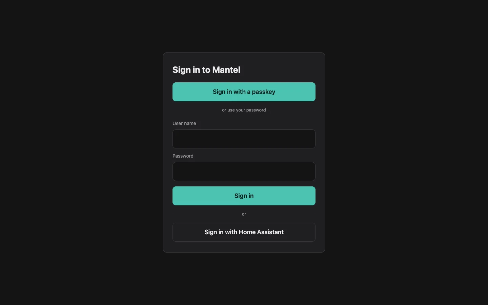
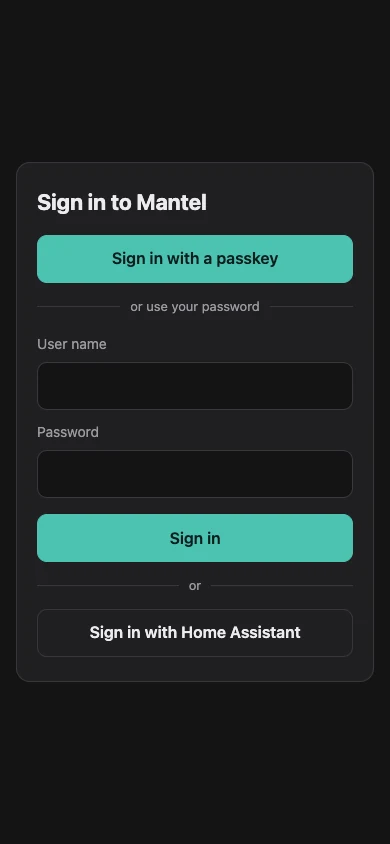
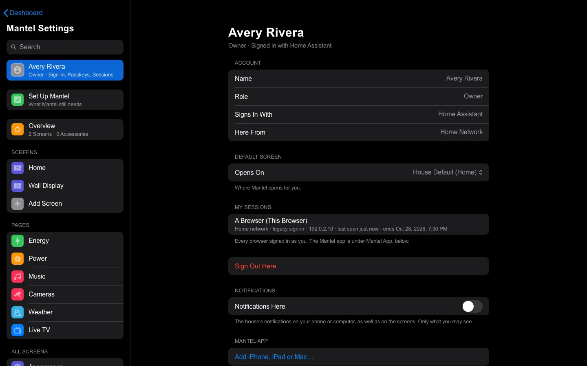

# Signing In

Mantel has its own sign-in page. You can sign in with a passkey, with a user name and password (plus a code from an authenticator app, if you set one up), or with your Home Assistant account. This page covers each way, how long you stay signed in, how to sign out, and why signing in from outside the home asks for more.

## The sign-in page

Open Mantel's address, for example `https://mantel.example.com/`. If you aren't signed in, you land on the sign-in page, and after signing in you go back to the page you asked for.

The page offers, top to bottom:

1. **Sign in with a passkey**, when the browser supports passkeys. You don't type a user name: the browser offers the passkeys it has for Mantel.
2. **User name** and **Password**, then **Sign in**. If you have an authenticator app set up, the next step asks for its 6-digit **Code**. **Back** returns to the password.
3. **Sign in with Home Assistant**. Home Assistant's own sign-in opens, then brings you back.

Passkeys and passwords need JavaScript. **Sign in with Home Assistant** works without it.

When Mantel has no Owner yet, the page shows **First start** instead, with fields for a one-time setup code. See [First Run](First-Run.md).

Inside Home Assistant's sidebar there is no sign-in page: Home Assistant has already signed you in. See [Inside Home Assistant](#inside-home-assistant).

### When sign-in doesn't work

| The page says | What it means |
|---|---|
| That user name and password did not match. | The user name, the password or both are wrong, or the account is disabled. Mantel never says which, or whether the user name exists. |
| Too many tries. Try again in … | Too many wrong passwords. Wait, then try again. |
| Away from home, a password alone is not enough… | You're outside the home network. Use a passkey, or set up an authenticator app first ([below](#home-and-away)). |
| That code was not accepted. | The authenticator code is wrong or already used. Wait for the next one. |
| That took too long. Enter your password again. | The code step expired (after 5 minutes or 5 wrong codes). |
| That passkey was not accepted. | The passkey isn't registered with this Mantel, or the browser cancelled. |
| Passkeys need the name you use to reach Mantel, not an IP address. | You opened Mantel by an IP address, such as `https://192.0.2.10/`. Use its name. |
| Not linked yet | (After **Sign in with Home Assistant**) Your Home Assistant user isn't linked to a Mantel role. The page shows your Home Assistant user id; give it to an Owner. See [People and Roles](People-and-Roles.md#a-home-assistant-user). |

## Passwords

A Mantel account's password is 12 characters or more. It can't contain the user name, and it needs at least four different characters.

To slow down guessing:

- **5 wrong passwords in a row lock the account for 15 minutes.** The lock survives a restart. Passkeys and **Sign in with Home Assistant** still work while it lasts.
- Each address may get 20 passwords wrong in 15 minutes, and each user name 5, whether the user name exists or not.

Anyone who knows a user name can lock that account for 15 minutes this way. That's the price of the lockout.

Passwords are stored only as Argon2id hashes.

### Change your password

1. Open **Mantel Settings** → **Me**.
2. Select **Change Password…**.
3. Type your **Current Password**, then the **New Password** twice (**Repeat**). The same rules apply as above.
4. Select **Change Password**.

A wrong current password counts toward the lockout like a wrong sign-in. Once it's changed, every other browser signed in as you is signed out; this one stays. The change is recorded in the [audit log](Commands-and-Audit.md#the-audit-log), without the password.

**Change Password…** is only for a Mantel account. A Home Assistant user's password is Home Assistant's.

If you've forgotten your password, ask an Owner or Admin to set a new one for you ([People and Roles](People-and-Roles.md#set-a-new-password-for-someone)).

## Authenticator app (two-step sign-in)

An authenticator app (any app that shows 6-digit codes, such as the one built into your phone's password manager) adds a code to your password.

1. Open **Mantel Settings** → **Me** (your name at the top).
2. Under **Two-Step Sign-In**, select **Set Up…**.
3. Add the secret to your authenticator app: type it in, or on your phone select **Open in an Authenticator App**.
4. Type the 6-digit **Code** the app shows, then select **Confirm**.

From then on, signing in with your password always asks for a code too, at home and away. Each code works once.

To move to a new phone, select **Replace…**. The old app stops working once the new code is confirmed. **Remove** turns two-step sign-in off. Both ask you to [confirm it is you](#confirm-it-is-you).

## Passkeys

A passkey signs you in with your fingerprint, face or your device's PIN, with no password to type. It's the easiest way to sign in from outside the home.

1. Open **Mantel Settings** → **Me**.
2. Under **Passkeys**, give it a **Name** (for example "My Phone").
3. Select **Add a Passkey…** and follow your browser.

A passkey that syncs (for example through iCloud Keychain or Google Password Manager) shows **Synced**. To remove one, select **Remove** and its name; that asks you to [confirm it is you](#confirm-it-is-you).

Passkeys need two things:

- You open Mantel by its **name** (`https://mantel.example.com`), not an IP address.
- Mantel knows that name. It's set for you: in the Mantel App with direct access it's `public_url`'s name, and with Docker or the LXC it's `MANTEL_HOSTNAME` ([Install with Docker → Passkeys](Install-Docker.md#passkeys)). Keep that name: a passkey made for one name doesn't work at another.

Mantel keeps only each passkey's public key.

## Sign in with Home Assistant

**Sign in with Home Assistant** sends you to Home Assistant's own sign-in page and back. It works for a Home Assistant user that an Owner has linked to a Mantel role ([People and Roles](People-and-Roles.md#a-home-assistant-user)).

- Mantel uses the sign-in only to learn who you are. It revokes the Home Assistant token it was given straight away and keeps nothing of it.
- What you can do in Mantel is your Mantel role's, not your Home Assistant permissions.
- A linked user who is disabled in Mantel can't sign in this way.
- It works at Mantel's own address by itself. Mantel sends people to Home Assistant's own address (Home Assistant's **Settings** → **System** → **Network**: external, else internal). If that is wrong for your home, an Owner sets **Sign-In Address** in **Mantel Settings** → **Connections** → **Home Assistant**.

From outside the home, Mantel accepts Home Assistant's sign-in as it is: it doesn't ask for its own second factor on top. If people sign in this way from away, turn on multi-factor authentication for them in Home Assistant.

## Confirm it is you

A few account changes ask for a recent sign-in, within the last five minutes: adding, replacing or removing your authenticator app, adding or removing a passkey, setting a PIN, setting a new password for someone else, changing the Alarm PIN's settings, and changing connections from outside the home. Mantel shows **Confirm It Is You**: type your authenticator code, or select **Use Passkey**. With neither set up, sign out, sign in again and make the change within five minutes.

House commands never ask for this. See [Commands and Audit](Commands-and-Audit.md).

## Sessions and signing out

Each sign-in is a **session** in one browser. You stay signed in:

| Where you signed in | How long |
|---|---|
| On the home network | 30 days |
| From outside the home | 12 hours (an Owner can change this: **Mantel Settings** → **General** → **Sign-Ins from Away Last**, from 1 hour to 30 days) |

Then you sign in again. A session belongs to the door it started on: a session from home doesn't carry on outside the home.

**Mantel Settings** → **Me** → **My Sessions** lists the browsers signed in as you, one row per kind of browser (for example **Safari on Mac**, at home or remote), with how many sessions it has and when one was last used. This browser is first.

A browser that signs in again replaces its own last session rather than adding another, so the list stays short. Mantel recognizes the browser by a random id cookie that holds nothing else.

- Tap a row to see its sessions (how each signed in, its address, since when and until when), each with **Sign Out**, and **Sign Out All** for the lot. Use it for a lost phone.
- **Sign Out Everywhere Else** signs out every other browser at once. This one stays signed in, and so does the Mantel app.
- **Sign Out** at the bottom of **Me** ends this browser's session.

The Mantel app isn't listed there: each iPhone, iPad or Mac is one row under **Mantel App**, and signing it out there also signs out the pages it shows.

Your sessions also end at once when an Owner or Admin disables you or sets a new password for you, or when your Home Assistant link is removed. Changing your own password ends all your sessions except the one you changed it from.

The iPhone, iPad and Mac apps have their own sign-in; see [iPhone and Mac Apps](iPhone-and-Mac-Apps.md).

## Home and away

Every request reaches Mantel by a **door**, and some rules depend on it. **Me** → **Here From** shows yours: **Home Network** or **Outside the Home**.

| Door | What it is | What changes |
|---|---|---|
| **Home** (`lan`) | Your home network | A password alone is enough (unless you set up an authenticator app). Sessions last 30 days. Wall tablets work. |
| **Away** (`tunnel`) | Anything from outside, for example through a Cloudflare tunnel | A password alone is refused: you need a passkey, or a password and an authenticator code. Sessions last 12 hours. Wall tablets are refused. Some roles lose sensitive actions, cameras and location history ([People and Roles](People-and-Roles.md#the-roles)). Owners are notified of every unlock and disarm. |
| **Inside Home Assistant** (`ha`) | Home Assistant's sidebar or Companion app, with the Mantel App or [Mantel Connect](Mantel-Connect.md) | Home Assistant signs you in. By default the home rules apply. |

Mantel decides the door itself, and it fails closed: a request that can't be shown to come from your home network counts as away. Your reverse proxy has to be set up to tell Mantel, which [Install](Install.md) covers. [Security Model](Security-Model.md#home-and-away) explains how the door is worked out.

To use Mantel from outside the home, set up a passkey or an authenticator app **while you're at home**.

### Inside Home Assistant

With the Mantel App, or a Mantel running elsewhere with [Mantel Connect](Mantel-Connect.md), Mantel appears in Home Assistant's sidebar. Home Assistant signs you in, and Mantel uses your linked role. There's no sign-in page and no **Sign Out** there.

The **Coming Through Home Assistant** setting decides which rules apply in the sidebar. An Owner finds it in **Mantel Settings** → **Connections** → **Home Assistant**:

| Setting | Rules in the sidebar |
|---|---|
| **Trusted** (the default) | Home rules. Owners get no "remote access" notices for the sidebar. |
| **Home Network Rules** | Home rules, but remote unlocks and disarms still notify the Owners. |
| **Away Rules** | Away rules. Wall tablets linked through Home Assistant are refused. |

Home Assistant's own remote access (Nabu Casa, or your own address) reaches the sidebar from outside the home, so **Trusted** means you trust Home Assistant's sign-in wherever it comes from.

## See also

- [People and Roles](People-and-Roles.md)
- [Wall Tablets](Wall-Tablets.md)
- [Security Model](Security-Model.md)
- [Troubleshooting](Troubleshooting.md)
