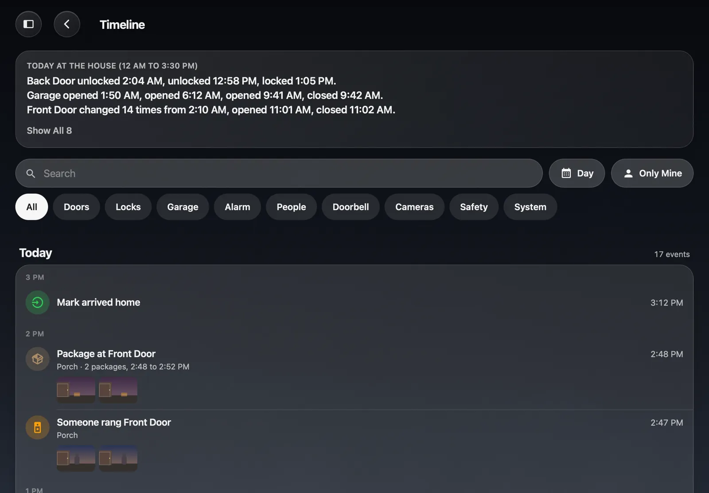

# Timeline

The **Timeline** answers "what happened at the house?" It is one scrolling, searchable record of what matters: doors and locks, arrivals and departures, the alarm, the garage, the doorbell, what the cameras saw (with a picture from that moment), leaks and smoke, and Mantel's own alerts. It says who did what, and from where: "Back Door unlocked · Emma · Hallway tablet".

It answers questions like "Did the garage get closed?", "When did the package come?" and "Who unlocked the back door at 2 AM?". Each morning it can send a short **summary of the night**.

## Opening it

Open **Timeline** from the Home menu, or tap a **Recent** block on a Home Grid. It works the same in a browser, on a wall tablet and in the iPhone, iPad and Mac apps.

- **Newest first**, grouped by day ("Today", "Yesterday", a date) and by hour on a busy day.
- **Filters** along the top: Doors, Locks, Garage, Alarm, People, Doorbell, Cameras, System. Tap one or more.
- **Search**: type words from a row ("back door", "package", "driveway").
- **Only Mine**: what you did yourself.
- **A day**: jump to a date.
- **Tap a row** for its pictures (swipe between them), the exact time, where it was done from, and **Show All** for that camera or door.

The Timeline starts empty on the day you install this version. It doesn't fill in the past from Home Assistant.

## What it records

| What | A row says | On for a new house |
|---|---|---|
| **Doors** | "Back Door opened", "closed" | Yes |
| **Windows** | "Loft Window opened" | No (a house with many window sensors would drown the rest) |
| **Locks** (and a water shutoff valve) | "Back Door unlocked", "locked", "is jammed" | Yes |
| **Garage** (and gates) | "Garage opened", "closed" | Yes |
| **Alarm** | "Alarm armed away", "disarmed", "triggered" | Yes |
| **Arrivals and departures** | "Emma arrived home", "left home" | Yes |
| **Doorbell** | "Someone rang Front Door", with two pictures | Yes |
| **Camera detections** | "Person at Driveway", "Package at Front Door", with pictures | Yes |
| **Motion** | "Motion at Garden Cam (14 times, 2:10 to 2:40 AM)", only for a camera that has no person or vehicle detection | Yes |
| **Safety** | "Leak at Kitchen Sink", "Kitchen Sink is clear" | Yes |
| **System** | Mantel's own [alerts](Alerts.md): "Home Assistant disconnected", "Backup finished" | Yes (Owners and Admins see them) |
| **Refused commands** | "Hallway tablet tried to unlock Back Door; refused" | Yes (Owners and Admins see them) |

It doesn't record temperatures, lights, power, media players or plain motion on a camera with smart detection: those are Home Assistant's history.

**Noise is rolled up.** A person detection is one row from start to end. Motion on a camera is one row per 10 minutes, with a count. A sensor that changes more than six times in five minutes becomes one "keeps changing" row until it settles. Packages at one camera within 30 minutes are one row.

**While Mantel was off.** When Mantel starts again it compares each door, lock and sensor with what it last recorded. Anything that changed meanwhile gets its row at the real time, marked "while Mantel was off".

### Who did it

When a lock, the garage or the alarm changes, the Timeline looks for the command that caused it (Mantel's [audit](Commands-and-Audit.md)) and shows the person, the tablet and where it came from: "Emma · Hallway tablet", "Mark · away", "Through an assistant for Emma". A change with no Mantel command behind it (a key, a keypad, a schedule) says **By hand or an automation**. A lock that reports its keypad slot shows that too.

### Pictures

A doorbell ring gets a picture at once and another four seconds later, as the visitor steps up. A person, vehicle, animal or package gets one a moment after it's seen and another six seconds later if it's still there. You can choose 1 to 3 pictures in Settings.

Pictures are small (about 50 KB each) and kept on Mantel's own disk, with a **budget** of 500 MB by default. Past it, the oldest pictures go first and their rows stay ("Picture not kept"). Mantel stops taking pictures while the disk is low.

There are no video clips. UniFi Protect's public API, the one Mantel uses with an API key, has no way to export a clip.

## Who sees what

The Timeline uses the same [roles](People-and-Roles.md) as the rest of Mantel. It adds no rules of its own.

- **Owners, Admins and Adults** can open it. **Children and Guests** can't, unless an Owner gives a Child the Timeline in People and Roles. Even then, a Child sees only what their role shows them elsewhere: no locks, alarm, garage or cameras.
- **Each row** needs the person to be able to see that door, lock or person. A camera's row also needs them to be allowed that camera's pictures, so turning off cameras through your tunnel hides those rows there too.
- **Names** ("Emma · Hallway tablet") are shown to signed-in Owners, Admins and Adults only.
- **System and Refused rows** are for Owners and Admins only.
- **A wall tablet with nobody signed in** shows a limited view: the last 12 hours of doors, locks, the garage, the alarm, the doorbell and camera detections, with **no names, no pictures, no search and no arrivals**. You choose its families and turn pictures on per tablet in Settings.

### Keep My Arrivals Private

In **Me**, an adult can turn on **Keep My Arrivals Private**. Their arrivals and departures are then **not recorded at all** (not just hidden), the ones already recorded are deleted (Mantel asks first), and the morning summary never mentions them. Doors, locks and cameras are about the house and are still recorded. **Clear My Arrivals** deletes your recorded arrivals without turning recording off.

Children don't have the switch: the Owner decides.

When a person is removed from Mantel, their rows lose their name ("A former member") and their arrivals are deleted.

## The morning summary

Each morning at 7:00 (a setting), Mantel writes a short summary of the night, from 9 PM (also a setting):

> Overnight at the house (9 PM to 7 AM)
> - Front Door and Back Door locked all night.
> - Garage opened 6:12 AM, closed 6:20 AM.
> - 2 package deliveries at Front Door.
> - Alarm armed 10:02 PM, disarmed 6:30 AM.
> - Right now: all locks locked, garage closed.

A lock or the garage left open leads the list. A quiet night is one line, so silence never means something broke.

- **Alert channels** (Discord, Telegram, email...) get the **house version**: house facts only, no names, no arrivals, no pictures. Turn on **Morning Summary** in the **House** group of each channel in [Alerts](Alerts.md). It's off for a new channel, and each channel's quiet hours apply.
- **The Mantel apps** get a **personal version**, built for what you may see, if you turn on **Morning Summary** in Me. It's off by default. Tapping it opens the Timeline.
- **Wall tablets** show it in a **Recent** block until 11 AM.

## Settings → Timeline

Owners and Admins find **Timeline** in Mantel Settings, next to Alerts. The Owner changes it; Admins can look.

- **What's Recorded**: a switch per kind, the entities recorded, and a **Not Recorded** list of plain sensors you can add by hand (a contact sensor with no type set, say).
- **Retention**: 7 days, 30 days (the default), 90 days or 1 year.
- **Pictures**: the budget, pictures per detection, and how much is used.
- **Wall Tablets**: what the limited view shows, and pictures per tablet.
- **Morning Summary**: when, from when, and **Send Test**.
- **Clear Timeline**: deletes every row and picture. You type CLEAR to confirm, and Mantel asks you to sign in again first.

Every change is written to the [audit](Commands-and-Audit.md) before it's made. Reading the Timeline isn't.

## Assistants

An [assistant](Assistants.md) connected to Mantel can search the Timeline (`timeline_find`) and read the morning summary (`timeline_digest`), as you: it sees exactly what you see, never pictures.

## Backups

The Timeline's rows are in Mantel's database, so every [backup](Backups.md) has them. Pictures aren't, by default: turn on **Include Timeline Pictures** in Settings → Backups to add them.

## Where it runs

On every Mantel: the Home Assistant App, Docker and the LXC. Where Mantel talks to UniFi Protect itself (Docker and the LXC), camera events come straight from Protect. Under the Home Assistant App they come from Home Assistant's own detection sensors, and pictures from Home Assistant's cameras. HK Frontend inside Home Assistant doesn't have the Timeline.
