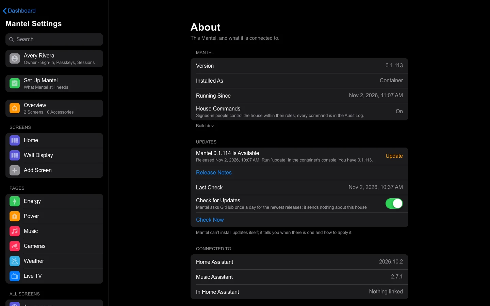

# Updating

Each way of running Mantel updates its own way: the Home Assistant App through Home Assistant, Docker with `./update.sh`, and the Proxmox LXC with `update` (one-command install) or `mantel-update` (made from a checkout). The Docker and LXC updates check that the new version starts healthy and go back to the previous images by themselves if it doesn't. Whichever you use, **make a backup first**: Mantel updates its database when a new version starts, and the database only moves forward.

## Before every update

1. **Make a backup.** In the App, a Home Assistant backup (the update dialog can make it for you). With Docker or the LXC, a Mantel backup: `docker compose exec mantel-server mantel backup --target /backups`. See [Backups](Backups.md). (`./update.sh`, `update` and `mantel-update` make this backup themselves, see below; by hand it is for a build from source.)
2. **Read the release notes** for anything you need to do: [CHANGELOG.md](https://github.com/jazzphone/mantel/blob/main/CHANGELOG.md) has a section for each version. In the App, Home Assistant shows the same notes in the update dialog.
3. **Pick a quiet moment.** Open screens reconnect by themselves after the restart, which takes up to a minute or so.

You can see which version you run on **Mantel Settings** → **About**.

## The update check

Mantel can't install its own updates, but it can notice that a new release is out and tell you how to apply it. It never installs, restarts or changes anything by itself.



**What it checks.** Ten minutes after it starts, and then once a day, Mantel asks GitHub for the latest release of:

- **Mantel** (`jazzphone/mantel`), compared with the version you run;
- **Mantel Link** (`jazzphone/mantel-link`) and **HK Frontend** (`jazzphone/hk-frontend`), when you have them installed.

That is three short questions a day, with no account, no token and nothing about your house in them. GitHub sees your address, as any website you visit does. Drafts and pre-releases are ignored.

**What you see.** **Mantel Settings** → **About** has an **Updates** section for Owners and Admins:

- When a newer version is out, **Mantel 0.1.115 Is Available** (for example), with the date it was released and how to update **this** install: *In Home Assistant: Settings → Add-ons → Mantel → Update* for the App, *Run `update` in the container's console* for the LXC, *Run `docker compose pull && docker compose up -d`* for Docker. **Release Notes** opens the release on GitHub. Mantel Link and HK Frontend are updated in HACS.
- When you are up to date, each product says **Up to Date**.
- **Last Check** says when Mantel last asked. If it couldn't get an answer, it says **Couldn't check** and when. An offline house isn't an emergency, so that is not an alert.
- **Check Now** (Owner) asks right away.

**Check for Updates** is the switch. It is on by default. Turn it off, and Mantel never contacts GitHub; About then says nothing about new versions. Only an Owner can change it, and from outside the home network Mantel asks the Owner to [confirm it is you](Signing-In.md#confirm-it-is-you) first.

**The alert.** A new release also raises one **Info** alert, once for each new version, to the [alert channels](Alerts.md#the-update-alert) that have the **Updates** events on. It clears when the new version is installed.

**Mantel Link** tells Mantel its version, and HK Frontend's, when it connects. That needs **Mantel Link 0.1.11 or newer**: an older one shows as unknown in About, and Mantel doesn't check it until you update it in HACS.

**Not covered:** the iPhone and Mac apps. They update through TestFlight or the App Store, which tell you themselves ([iPhone, iPad and Mac Apps](iPhone-and-Mac-Apps.md)).

## Home Assistant App

If you installed the App from Mantel's repository ([Install](Install.md#add-the-repository-and-install)), Home Assistant offers each new release:

1. Home Assistant shows an update for **Mantel** under **Settings** → **Updates** (and on the App's page). It checks the repository by itself every few hours; to look now, **Settings** → **Apps** → **App store** → **⋮** → **Check for updates**.
2. Open it, read the release notes it shows, leave **Create backup** on, then select **Update**. Home Assistant downloads the new version's ready-made image and restarts the App.
3. Open the App's **Log** tab and check that it ends with the `read-only; commands disabled` line (or `COMMANDS ENABLED`, if you turned commands on) and no error.

Your options, people, settings and audit log stay as they were. To go back, restore the backup the update made (**Settings** → **System** → **Backups**), which brings back the previous version together with its data.

### Built from source

If you [built the App from source](Install.md#build-the-app-from-source):

1. Make a Home Assistant backup (**Settings** → **System** → **Backups**).
2. Get the new source, and copy it over the App you staged before:

   ```bash
   cd mantel
   git pull
   python3 tools/stage_ha_app.py /path/to/addons/mantel --replace
   ```

   `--replace` only replaces a folder the tool staged itself.
3. In Home Assistant, **Settings** → **Apps** → **App store** → **⋮** → **Check for updates**.
4. Open **Mantel** and select **Update**: a restaged App with a newer version is offered as an update once the store is checked. The Supervisor builds the new version, which takes a few minutes. (**Rebuild** is only for a restaged App whose version didn't change.)


## Docker

### Published images

Each release publishes `ghcr.io/jazzphone/mantel-server`, `ghcr.io/jazzphone/mantel-transcode` and `ghcr.io/jazzphone/mantel-caddy`, tagged with its version (for example `:0.1.112`, the same number as the Home Assistant App's) and `:latest` ([Install with Docker → Get the images](Install-Docker.md#5-get-the-images)). How you update depends on what `.env` names:

- **A version** (recommended): put the new version in all three `MANTEL_*_IMAGE` lines in `.env`, then run `./update.sh`.
- **`:latest`**: just run `./update.sh`; it pulls whatever the newest release is.
- **A digest** (`@sha256:...`): put the new digests in `.env` first.

From `packaging/compose`:

```bash
./update.sh
```

It:

1. remembers the images that run now (tagged `mantel-rollback/<service>:previous`),
2. pulls the new ones: every image `.env` names from a registry (`MANTEL_SERVER_IMAGE`, `MANTEL_TRANSCODE_IMAGE`, `MANTEL_CADDY_IMAGE`). Images left at their `:local` defaults are built on this machine and aren't pulled ([Built from source](#built-from-source)). If an image can't be pulled, it stops there and changes nothing,
3. makes a Mantel backup with the running server (`mantel backup --target /backups`) **before anything is restarted**, and stops there, changing nothing, if the backup fails. A new version migrates the database as it starts and the old version then refuses it, so the automatic rollback in step 5 can't undo that: this backup is the way back ([Backups → Restore](Backups.md#restore-with-docker-or-the-lxc)). Make sure `MANTEL_BACKUP_DIR` is a folder the server can write (the LXC install sets it up),
4. starts the new images and waits until every service is healthy,
5. and if one doesn't become healthy, starts the remembered images again.

After a rollback, fix the image references in `.env` before the next update; `docker compose logs --tail 100` says what went wrong.

### Built from source

From the repository:

```bash
git pull
cd packaging/compose
docker compose build --pull
docker compose up -d --wait
```

`up --wait` fails if a service doesn't become healthy. To go back, check out the previous version (`git checkout <previous commit or tag>`), build and start again, and restore the backup you made if the new version had already updated the database ([Backups → Restore](Backups.md#restore-with-docker-or-the-lxc)).

### Roll back by hand

`update.sh` keeps the previous images. To start them again without pulling:

```bash
MANTEL_SERVER_IMAGE=mantel-rollback/mantel-server:previous \
MANTEL_TRANSCODE_IMAGE=mantel-rollback/go2rtc:previous \
docker compose up -d --wait --pull never
```

An older Mantel can't open a database a newer one has already updated. If the new version ran for a while, restore the backup you made before the update too.

## Proxmox LXC

**A container made by the one-command install** ([Install in a Proxmox LXC](Install-Proxmox-LXC.md)): inside it (`pct enter <id>`), run

```bash
update
```

It follows the newest release tag (or what `var_mantel_ref` named), skips a release whose images aren't published yet, makes a backup, starts the new version, waits until it is healthy, and goes back to the previous version by itself if it isn't. With nothing new, it says so and changes nothing.

Once the new version is healthy, `update` (and `mantel-update` with published images) removes older versions' images, which take about 1.2 GB a release, and says in one line what that freed. It keeps the images the containers use, the version just before them and the `mantel-rollback/*` images, and removes only `ghcr.io/jazzphone/mantel-server`, `mantel-transcode` and `mantel-caddy` tags by name. A removal that fails never fails the update.

**A container made from a checkout:** inside it, run

```bash
mantel-update
```

With published images in `.env`, it runs `./update.sh` (above). In **build mode**, the new source comes from the Proxmox host. On the host, from an updated copy of the repository you have read:

```bash
cd mantel
git pull
bash packaging/lxc/mantel.sh push <id>
```

This copies the new source into the container, then runs `mantel-update` there: it keeps the running images for rollback, rebuilds, starts the new version and waits until it is healthy, and goes back to the previous images if it isn't. A push never overwrites your `.env` or your secret files.

## After an update

- **Screens.** Reload open screens and wall tablets. Mantel's pages check for new files every time they load, so one reload is enough.
- **Check it.** Open **Mantel Settings** → **About** for the new version, and the Setup Check for Home Assistant's connection.
- **HK Frontend** in Home Assistant is a separate thing with its own updates (HACS). Updating Mantel doesn't change it.
