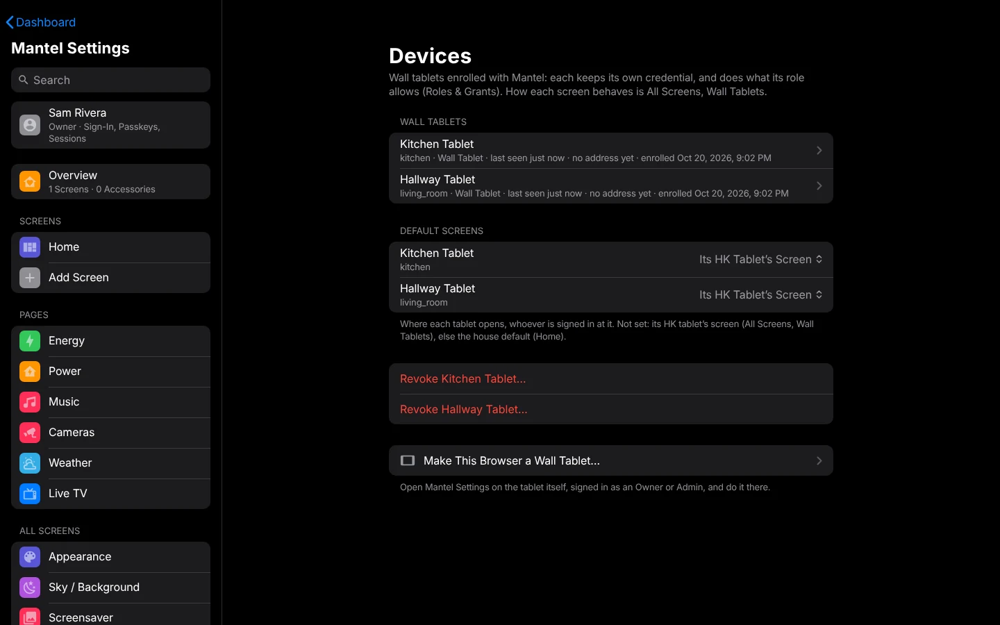

# Wall Tablets

A wall tablet in Mantel is a **device**, not a person. You enroll its browser once, and from then on it signs itself in with a credential of its own, opens its room's screen and can do what its role allows: nobody's password stays on the tablet. This page covers enrolling a tablet, its screen, the kiosk app, what a tablet may do, and revoking one.

How a tablet's screen behaves (the screensaver, returning to Home when idle, Sleep Screen) is HK Frontend's, and works as in HK Frontend's [Wall Tablets](https://github.com/jazzphone/hk-frontend/wiki/Wall-Tablets) and [Screensaver and Idle](https://github.com/jazzphone/hk-frontend/wiki/Screensaver-and-Idle) pages. In Mantel those settings are in **Mantel Settings** → **All Screens** → **Wall Tablets**.



## Two lists of tablets

Mantel Settings has two places for tablets:

| **All Screens** → **Wall Tablets** (HK's) | **Devices** (Mantel's) |
|---|---|
| Each tablet's screen, room, idle and screensaver settings, Sleep Screen, kiosk app | Each enrolled browser: its credential, its room, its role, its default screen |
| What the tablet **shows and does by itself** | Who the tablet **is**, and what it **may** do |

Enrolling a browser links the two by room: you pick one of HK's tablets, and the device takes its room. That's how the tablet's touches and screen reports reach the right HK tablet, and how `/home` opens that tablet's screen.

## Before you start

- Add the tablet in **Mantel Settings** → **All Screens** → **Wall Tablets** first, with its screen and room. (You can enroll a tablet with only a Home Assistant area, but HK's idle and screensaver features then don't reach it.)
- The tablet must be **on your home network**. Enrolling from outside the home is refused, and a tablet's credential never works from outside.
- You need someone who can enroll: an **Owner** or **Admin**, or a **Wall Tablet** account made for this tablet ([below](#with-a-wall-tablet-account)).
- A kiosk app on the tablet, such as **Fully Kiosk Browser** or **Kiosk Satellite**, or any browser.

## 1. Set up the kiosk app

Point the kiosk app at Mantel's Home page:

```
https://mantel.example.com/home
```

Every tablet uses the same address: once enrolled, `/home` opens each tablet's own screen.

### Fully Kiosk Browser

In Fully Kiosk Browser's settings on the tablet:

- **Start URL**: `https://mantel.example.com/home`.
- **Keep the screen on** while the app runs, unless your own automation turns it off.
- **Autoplay** audio and video, so camera and Live TV sound can start without a tap.
- **Microphone access**, to talk on the doorbell pop-up. Browsers allow the microphone only on an `https://` page.
- Leave cookies on, and don't set the app to clear cookies or data on start. The tablet's credential is a cookie.
- Kiosk mode (Fully's own lock), if you don't want anyone leaving the page.

### Kiosk Satellite

- Set its dashboard URL to `https://mantel.example.com/home`.
- Set its screensaver, **Pause dashboard during screensaver**, **Filter dashboard updates** and **Return to home dashboard view** as HK Frontend's [Wall Tablets](https://github.com/jazzphone/hk-frontend/wiki/Wall-Tablets#or-kiosk-satellite) page describes: HK's own screensaver and idle handling run in Mantel too.

Mantel draws no Home Assistant header or sidebar, so there's nothing to hide.

## 2. Enroll the tablet

Do this **on the tablet itself**, in the kiosk app's own browser. The credential is a cookie in that browser, so enrolling from a computer would make the computer the tablet.

1. On the tablet, sign in to Mantel as an Owner or Admin. Use a passkey or a password; you're signed out again in step 6.
2. Open **Mantel Settings** → **Devices**.
3. Select **Make This Browser a Wall Tablet…**.
4. Under **Which HK Tablet**, pick the tablet. **In Use** means another enrolled device is already in its room. For a room with no HK tablet, choose **Not One of These**, then the **Room** (one of your Home Assistant areas).
5. Check the **Name** (it follows the HK tablet you picked) and leave **Role** on **Wall Tablet**.
6. Select **Make This a Wall Tablet**, then **Make It a Tablet**.

You're signed out of that browser at once, and the browser is now the tablet. Select **Open the Dashboard**. The tablet stays enrolled across reloads, reboots and app restarts.

### With a Wall Tablet account

If you'd rather not type an Owner's password on a tablet:

1. On a computer, in **People** → **Add a Mantel Account…**, make an account with the role **Wall Tablet**, for example user name `kitchen`, name "Kitchen".
2. On the tablet, sign in as that account. In **Mantel Settings** it sees only **Me** and **About**.
3. In **Me**, select **Make This Browser a Wall Tablet…**. It starts from the HK tablet whose name matches the account's. Then follow steps 4 to 6.

A Wall Tablet account can only make its own tablet, always with the Wall Tablet role, and one at a time: enrolling again (after the tablet was reset, say) replaces the tablet it made before, and the Audit Log says so. Anyone who knows the account's password can choose the tablet's room, so keep it as private as an Owner's.

## What a tablet may do

A tablet on its own (nobody signed in at it) has the **Wall Tablet** role:

- The devices **in its room**: see, control, sensitive actions included (it can unlock its room's door), and their history.
- **Every camera**, its picture and live view, so the doorbell pop-up shows on every tablet. Only those: switching a camera off, recording or sending it to a speaker or TV follow the tablet's room, like any other device.
- The **Music** page (its speakers are still its room's) and **Live TV**.
- **Talk-back** on the doorbell pop-up's speaker.
- The alarm keypad, with the home's **Alarm PIN** (below).

That's the default. Change it with grants in **Roles & Grants**: a deny on one tablet, or on the Wall Tablet role, always wins. To give a tablet more rooms, or fewer, use **Roles & Grants** → **Rooms for a Person or Tablet**. See [People and Roles](People-and-Roles.md).

Anyone standing at a tablet can do what the tablet may do. If that's too much for a tablet in a public spot (for example unlocking a door), add a deny grant for it.

### No PIN at the tablet

A tablet never asks for a person's PIN. Unlocking a door, opening the garage or turning off an automation goes through on the tablet's role and grants, and every command is written to the [audit log](Commands-and-Audit.md).

The only code is the home's **Alarm PIN**, for the alarm keypad, as in HK Frontend. Set it in Mantel Settings (search for **Alarm PIN**). Five wrong codes in a row lock that tablet's keypad for 15 minutes. See [Commands and Audit](Commands-and-Audit.md#the-alarm-pin).

### A person at a tablet

A person can sign in at an enrolled tablet (open `/login` on it). They then get what **both** they and the tablet may do, never more than the tablet: an Adult at the kitchen tablet still controls only the kitchen. A Child signed in at a tablet loses what a Child may not do.

The tablet still opens its own screen, and the person gets only **Me** in Mantel Settings.

**Sign out when you're done.** A sign-in on the home network lasts 30 days. Signing out ends only the person's session; the tablet stays enrolled.

## The tablet's screen

`/home` on a tablet opens, in this order:

1. The tablet's own **Default Screen**, if you set one: **Devices** → **Default Screens**.
2. Otherwise its HK tablet's screen (**All Screens** → **Wall Tablets** → the tablet → **Screen**).
3. Otherwise the installation's default screen.

This is only where it lands. What it may open and see is still its role's.

## Reload and Clear Cache from Mantel

An Owner can let Mantel reach a tablet's kiosk app directly (Kiosk Satellite, or Fully Kiosk Browser with its Remote Administration on):

1. Open **Mantel Settings** → **All Screens** → **Wall Tablets** → the tablet.
2. Under **Direct Connection**, select **Pair**, and enter the tablet's **Address** and its kiosk app's remote administration **Password**. **Test** tries it without saving.

The tablet's page then shows its state, brightness and battery, and its **Reload** and **Clear Cache & Reload** buttons work, as do **Reload All** and **Clear Cache & Reload All**. **Connections** → **Wall Tablets** lists every paired tablet.

- Pairing shows status only. Reload and Clear Cache are house commands: they need [commands turned on](Commands-and-Audit.md), an Owner or Admin, and each one is audited.
- Kiosk Satellite gives Mantel a long-lived token for the password; Mantel keeps the token, sealed, and not the password. Fully Kiosk has no tokens, so Mantel keeps its password, sealed.
- Fully Kiosk takes its password in plain text over your home network. That's Fully's design, the same as Home Assistant's Fully Kiosk integration.
- **Disconnect…** forgets Mantel's copy. A Kiosk Satellite token stays valid until it expires or you reset it in the app.
- Restart App and Restart Tablet aren't available from Mantel.

## Move a tablet to another room

1. Open **Mantel Settings** → **Devices** and select the tablet.
2. Pick its new HK tablet, or **Not One of These** and a room.
3. Select **Save**.

Nothing to do at the tablet: it keeps its credential, and its open screens follow within a minute. The move is in the audit log.

**Devices** warns about a tablet in a room with no HK tablet: its touches and screen reports don't reach Mantel. Open it and choose its HK tablet.

## Revoke a tablet

For a tablet that's lost, sold or replaced:

1. Open **Mantel Settings** → **Devices**.
2. Select **Revoke** and the tablet's name, then **Revoke**.

It's refused at once. To use it again, enroll it again. Revoked tablets stay listed under **Revoked**, with the reason.

## How the tablet's credential works

- It's a random secret in a cookie that pages' scripts can't read. Mantel keeps only a hash of it.
- It changes by itself every 24 hours. If someone copies it and the old one turns up again after it was replaced, Mantel revokes the tablet (shown as **credential reuse**) and you enroll it again.
- It only works on the home network. From outside the home it's ignored.
- A tablet unused for 90 days is refused; enroll it again.
- Clearing the kiosk app's cookies or data removes it. Enroll the tablet again.

## Tablets inside Home Assistant

With the Mantel App, a tablet can also show Mantel through Home Assistant's own panel, signed in to Home Assistant as its own Home Assistant user (as HK Frontend's tablets usually are). Such a tablet isn't enrolled. Instead, an Owner links its Home Assistant user to a Mantel device with **Link as a wall tablet** on Mantel's **People** page in the sidebar (**Mantel Settings** → **People** → **Link Home Assistant Users…**; [First Run](First-Run.md#link-the-household)), choosing a new device and a room. The tablet then gets the Wall Tablet role in that room, as an enrolled one does.

- It works only while the sidebar has the home rules (`ha_door_rules` `trusted` or `lan`; see [Signing In](Signing-In.md#inside-home-assistant)).
- **Unlink** ends it. A device made for the link is revoked too.
- An enrolled tablet's credential is never accepted through Home Assistant's sidebar.


The simpler setup for most homes is the one above: enroll the tablet at Mantel's own address.

## See also

- [People and Roles](People-and-Roles.md)
- [Commands and Audit](Commands-and-Audit.md)
- [Security Model](Security-Model.md)
- [Troubleshooting](Troubleshooting.md)
