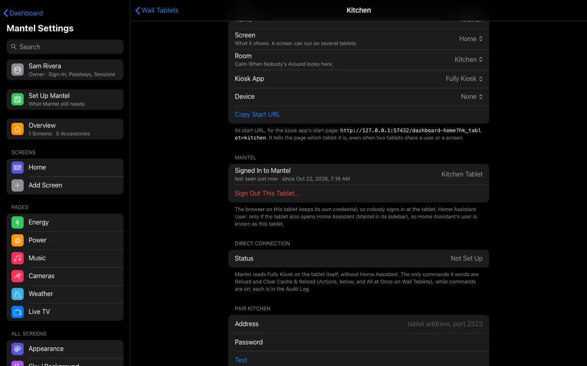

# Wall Tablets

A wall tablet in Mantel is a **device**, not a person. You enroll its browser once, and from then on it signs itself in with a credential of its own, opens its room's screen and can do what its role allows: nobody's password stays on the tablet. This page covers enrolling a tablet, its screen, the kiosk app, what a tablet may do, and revoking one.

How a tablet's screen behaves (the screensaver, returning to Home when idle, Sleep Screen) is HK Frontend's, and works as in HK Frontend's [Wall Tablets](https://github.com/jazzphone/hk-frontend/wiki/Wall-Tablets) and [Screensaver and Idle](https://github.com/jazzphone/hk-frontend/wiki/Screensaver-and-Idle) pages. In Mantel those settings are in **Mantel Settings** → **All Screens** → **Wall Tablets**.



## One place for each tablet

Everything about a tablet is on its own page: **Mantel Settings** → **All Screens** → **Wall Tablets** → the tablet.

| On the tablet's page | What it is |
|---|---|
| **When It's Left Alone**, **When Idle**, **Setup** (screen, room, kiosk app), **Actions** | What the tablet **shows and does by itself** |
| **Mantel** | Who the tablet **is**: the browser signed in to Mantel as it (enrolled), last seen, its Home Assistant user, **Sign Out** |
| **Direct Connection** | Mantel reading the tablet's kiosk app itself ([below](#reload-and-clear-cache-from-mantel)) |

Enrolling a browser links it to the tablet by room: you pick the tablet, and the browser takes its room. That's how the tablet's touches and screen reports reach the right tablet, and how `/home` opens that tablet's screen. What a tablet **may** do is its role's ([below](#what-a-tablet-may-do)).

## Before you start

- Nothing to add first. When you enroll, pick one of HK's wall tablets, or **A New Tablet** and its Home Assistant area: Mantel adds that HK tablet for you (Owners and Admins), so its idle return, screensaver and black screen work at once. Its screen and behaviour are in **Mantel Settings** → **All Screens** → **Wall Tablets** afterwards.
- The tablet must be **on your home network**. Enrolling from outside the home is refused, and a tablet's credential never works from outside.
- You need someone who can enroll: an **Owner** or **Admin**, or a **Wall Tablet** account made for this tablet ([below](#with-a-wall-tablet-account)).
- A kiosk app on the tablet, such as **Fully Kiosk Browser** or **Kiosk Satellite**, or any browser.

## 1. Set up the kiosk app

Point the kiosk app at Mantel's Home page:

```
https://mantel.example.com/home
```

Every tablet uses the same address: once enrolled, `/home` opens each tablet's own screen.

### Fully Kiosk Browser

In Fully Kiosk Browser's settings on the tablet:

- **Start URL**: `https://mantel.example.com/home`.
- **Keep the screen on** while the app runs, unless your own automation turns it off.
- **Autoplay** audio and video, so camera and Live TV sound can start without a tap.
- **Microphone access**, to talk on the doorbell pop-up. Browsers allow the microphone only on an `https://` page.
- Leave cookies on, and don't set the app to clear cookies or data on start. The tablet's credential is a cookie.
- Kiosk mode (Fully's own lock), if you don't want anyone leaving the page.

### Kiosk Satellite

- Set its dashboard URL to `https://mantel.example.com/home`.
- Set its screensaver, **Pause dashboard during screensaver**, **Filter dashboard updates** and **Return to home dashboard view** as HK Frontend's [Wall Tablets](https://github.com/jazzphone/hk-frontend/wiki/Wall-Tablets#or-kiosk-satellite) page describes: HK's own screensaver and idle handling run in Mantel too.

Mantel draws no Home Assistant header or sidebar, so there's nothing to hide.

## 2. Enroll the tablet

Do this **on the tablet itself**, in the kiosk app's own browser. The credential is a cookie in that browser, so enrolling from a computer would make the computer the tablet.

1. On the tablet, sign in to Mantel as an Owner or Admin. Use a passkey or a password; you're signed out again in step 6.
2. Open **Mantel Settings** → **All Screens** → **Wall Tablets** → the tablet.
3. Under **Mantel**, select **Sign In This Browser as** *the tablet*…. (For a tablet that isn't listed yet: **Sign In This Browser as a Wall Tablet…** at the bottom of **Wall Tablets**.)
4. Under **Which HK Tablet**, the tablet is already picked. **In Use** means another enrolled device is already in its room. For a room with no HK tablet, choose **A New Tablet**, then the **Room** (one of your Home Assistant areas): Mantel adds the HK tablet, named as the device. (A Wall Tablet account sees **Not One of These** instead and adds no HK tablet.)
5. Check the **Name** (it follows the HK tablet you picked) and leave **Role** on **Wall Tablet**.
6. Select **Make This a Wall Tablet**, then **Make It a Tablet**.

You're signed out of that browser at once, and the browser is now the tablet. Select **Open the Dashboard**. The tablet stays enrolled across reloads, reboots and app restarts.

### With a Wall Tablet account

If you'd rather not type an Owner's password on a tablet:

1. On a computer, in **People** → **Add a Mantel Account…**, make an account with the role **Wall Tablet**, for example user name `kitchen`, name "Kitchen".
2. On the tablet, sign in as that account. In **Mantel Settings** it sees only **Me** and **About**.
3. In **Me**, select **Make This Browser a Wall Tablet…**. It starts from the HK tablet whose name matches the account's. Then follow steps 4 to 6.

A Wall Tablet account can only make its own tablet, always with the Wall Tablet role, and one at a time: enrolling again (after the tablet was reset, say) replaces the tablet it made before, and the Audit Log says so. Anyone who knows the account's password can choose the tablet's room, so keep it as private as an Owner's.

## What a tablet may do

A tablet on its own (nobody signed in at it) has the **Wall Tablet** role:

- The devices **in its room**: see, control, sensitive actions included (it can unlock its room's door), and their history.
- **Every camera**, its picture and live view, so the doorbell pop-up shows on every tablet. Only those: switching a camera off, recording or sending it to a speaker or TV follow the tablet's room, like any other device.
- The **Music** page (its speakers are still its room's) and **Live TV**.
- **Talk-back** on the doorbell pop-up's speaker.
- The alarm keypad, with the home's **Alarm PIN** (below).

That's the default. Change it with grants in **Roles & Grants**: a deny on one tablet, or on the Wall Tablet role, always wins. To give a tablet more rooms, or fewer, use **Roles & Grants** → **Rooms for a Person or Tablet**. See [People and Roles](People-and-Roles.md).

Anyone standing at a tablet can do what the tablet may do. If that's too much for a tablet in a public spot (for example unlocking a door), add a deny grant for it.

### No PIN at the tablet

A tablet never asks for a person's PIN. Unlocking a door, opening the garage or turning off an automation goes through on the tablet's role and grants, and every command is written to the [audit log](Commands-and-Audit.md).

The only code is the home's **Alarm PIN**, for the alarm keypad, as in HK Frontend. Set it in Mantel Settings (search for **Alarm PIN**). Five wrong codes in a row lock that tablet's keypad for 15 minutes. See [Commands and Audit](Commands-and-Audit.md#the-alarm-pin).

### A person at a tablet

A person can sign in at an enrolled tablet (open `/login` on it). They then get what **both** they and the tablet may do, never more than the tablet: an Adult at the kitchen tablet still controls only the kitchen. A Child signed in at a tablet loses what a Child may not do.

The tablet still opens its own screen, and the person gets only **Me** in Mantel Settings.

**Sign out when you're done.** A sign-in on the home network lasts 30 days. Signing out ends only the person's session; the tablet stays enrolled.

## The tablet's screen

`/home` on a tablet opens, in this order:

1. **Opens On**, if the browser was given a screen of its own (set on the tablet's own page, under All Screens → Wall Tablets). It shows under **Mantel** on the tablet's page only when set; choose **Its Screen** to follow the tablet's again.
2. Otherwise the tablet's **Screen** (**All Screens** → **Wall Tablets** → the tablet → **Setup**).
3. Otherwise the house's default screen (**General** → **House Default Screen**).

This is only where it lands. What it may open and see is still its role's.

### After the tablet sleeps

A tablet that slept, or lost its Wi-Fi, can wake with a connection that looks open but carries nothing. The page checks: when it's shown again or back on the network, and every 45 seconds while it's on screen, it asks Mantel for an answer. With none in 3 seconds it reconnects by itself, a few seconds later, and asks again for everything it shows. You don't need to reload it.

If Mantel is restarting when the page first opens (or the tablet woke before its Wi-Fi), the page starts again by itself, after 2 seconds, then 4, up to every 30 seconds. Mantel Settings does the same, and says when it'll try again.

A kiosk app's own watchdog (Kiosk Satellite reloads a page whose connection is down for 15 minutes) sees Mantel's connection as it really is, so it doesn't reload a working page. A reconnect after a wake takes seconds, far less than its 15 minutes.

### How each tablet is doing

An Owner or Admin can see how each tablet's page is doing: **Mantel Settings** → **About** → **Performance**. There is one row per wall tablet (and per browser that has Mantel Settings open), from what its page reported over the last 24 hours:

- **Up**: how long the page has been open. A tablet that reloads often shows a short time here.
- **Memory**: the page's JavaScript heap, where the browser reports it (Chrome-based kiosk apps do; others show nothing).
- **Reconnects**: how many times the page had to open its connection to Mantel again since it loaded.
- **Slowest start**: the longest time from the page opening to its first screen drawn, in the last 24 hours.

The top of the page has Mantel's own numbers: how long it takes to build and send one screen's changes (the middle one, and the slowest 5 in 100, over the last hour), how many state changes Home Assistant sends a minute, and how many screens are connected now. Nothing is stored beyond a day, and nothing outlives a Mantel restart. Wall tablets themselves, and members, can't open this page.

**A lighter screen for a slow tablet.** Each tablet also measures how many frames a second it draws (5 seconds, while nobody is touching it and the screen is lit). When one draws fewer than 45 on a screen, that screen's **Appearance** suggests one change, for example *"Kitchen Tablet draws 38 frames a second with Blur. Glass looks almost the same and is lighter."* The button changes that screen only, and **Use Flat** is beside it. The suggestions go in order of what costs the most: the style (**Blur**, **Frosted** or **Tinted** to **Glass**), then **Rain & Snow**, **Moving Things** in front of the cards, **Animations**, and a camera playing live. After you take one, nothing more is suggested until the tablet has measured again (up to an hour later) and is still under 45. **All Screens** → **Appearance** lists each screen with a suggestion. Nothing changes until you tap one.

## Reload and Clear Cache from Mantel

An Owner can let Mantel reach a tablet's kiosk app directly (Kiosk Satellite, or Fully Kiosk Browser with its Remote Administration on):

1. Open **Mantel Settings** → **All Screens** → **Wall Tablets** → the tablet.
2. Under **Direct Connection**, select **Pair**, and enter the tablet's **Address** and its kiosk app's remote administration **Password**. **Test** tries it without saving.

The tablet's page then shows its state, brightness and battery, and its **Reload** and **Clear Cache & Reload** buttons work, as do **Reload All** and **Clear Cache & Reload All**.

- Pairing shows status only. Reload and Clear Cache are house commands: they need [commands turned on](Commands-and-Audit.md), an Owner or Admin, and each one is audited.
- Kiosk Satellite gives Mantel a long-lived token for the password; Mantel keeps the token, sealed, and not the password. Fully Kiosk has no tokens, so Mantel keeps its password, sealed.
- Fully Kiosk takes its password in plain text over your home network. That's Fully's design, the same as Home Assistant's Fully Kiosk integration.
- **Disconnect…** forgets Mantel's copy. A Kiosk Satellite token stays valid until it expires or you reset it in the app.
- Restart App and Restart Tablet aren't available from Mantel.

## Move a tablet to another room

Change the tablet's **Room** on its page (**Setup**): the browser signed in as it follows. Nothing to do at the tablet: it keeps its credential, and its open screens follow within a minute. The move is in the audit log.

A browser signed in to Mantel in a room no tablet has is listed on **Wall Tablets** under **Signed In to Mantel, Not on a Tablet**: its touches and screen reports don't reach Mantel. Open it and choose its tablet, then **Save**.

## Revoke a tablet

For a tablet that's lost, sold or replaced:

1. Open **Mantel Settings** → **All Screens** → **Wall Tablets** → the tablet.
2. Under **Mantel**, select **Sign Out This Tablet…**, then **Sign Out**.

It's refused at once. To use it again, enroll it again. Signed-out tablets are listed on **Wall Tablets** under **Signed Out**, with the reason, for 30 days; **Clear List** removes them sooner. The Audit Log keeps them either way.

## How the tablet's credential works

- It's a random secret in a cookie that pages' scripts can't read. Mantel keeps only a hash of it.
- It changes by itself every 24 hours. If someone copies it and the old one turns up again after it was replaced, Mantel revokes the tablet (shown as **credential reuse**) and you enroll it again.
- It only works on the home network. From outside the home it's ignored.
- A tablet unused for 90 days is refused; enroll it again.
- Clearing the kiosk app's cookies or data removes it. Enroll the tablet again.

## Tablets inside Home Assistant

With the Mantel App, a tablet can also show Mantel through Home Assistant's own panel, signed in to Home Assistant as its own Home Assistant user (as HK Frontend's tablets usually are). An Owner sets which Home Assistant user a tablet is on the tablet's page: **Mantel** → **Home Assistant User**. Mantel then knows that Home Assistant user as the tablet, with the Wall Tablet role in its room. (Mantel's **People** page in the sidebar has **Link as a wall tablet** too: [First Run](First-Run.md#link-the-household).)

A Home Assistant user that was linked to a **Wall Tablet account** as if it were a person (before its tablet was enrolled) is listed on **People** under **Wall Tablets Signed In as People**. **Move Them to Their Tablets…** makes each one its tablet's (by name), and removes the Wall Tablet accounts. The tablets keep signing in to Mantel as before.

- It works only while the sidebar has the home rules (**Coming Through Home Assistant** set to **Trusted** or **Home Network Rules**; see [Signing In](Signing-In.md#inside-home-assistant)).
- **Unlink** ends it. A device made for the link is revoked too.
- An enrolled tablet's credential is never accepted through Home Assistant's sidebar.


The simpler setup for most homes is the one above: enroll the tablet at Mantel's own address.

## See also

- [People and Roles](People-and-Roles.md)
- [Commands and Audit](Commands-and-Audit.md)
- [Security Model](Security-Model.md)
- [Troubleshooting](Troubleshooting.md)
