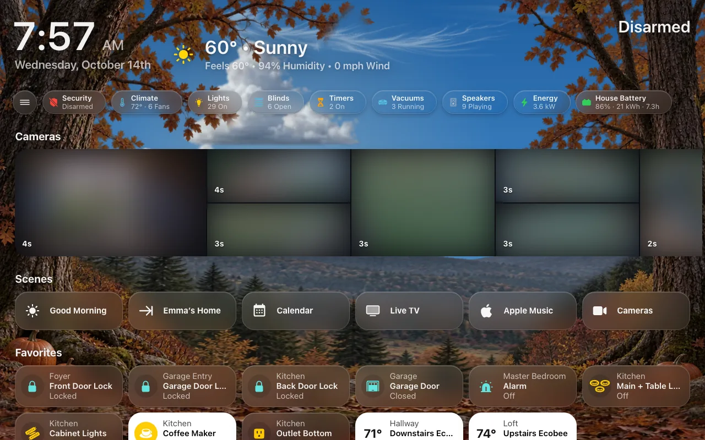
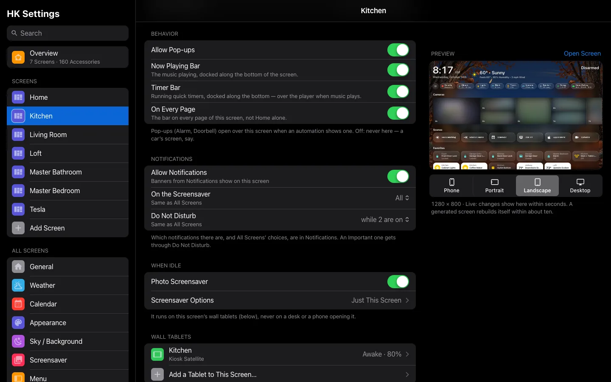

# Screens

A **screen** is a Home Assistant dashboard that HK Frontend draws and keeps
settings for: the dashboard on a wall tablet, on your phone, on your computer,
in your car. This page is what a screen is and how to make one; the pages
under **Screens** in the sidebar take each part in turn.



## Two kinds of screen

| | Generated screen | Your own YAML dashboard |
|---|---|---|
| What it is | A dashboard whose whole configuration is `strategy: type: custom:hk-dashboard` | A dashboard you write yourself, view by view, with HK Frontend’s [cards](Card-Library.md) |
| Where its content comes from | Your floors, areas, devices and entities, read every time it opens: a light you add appears by itself | Your YAML |
| How you shape it | HK Settings: its menu, Home page, pages, appearance and behavior | Your YAML, plus the HK settings its cards read |

Start with a generated screen. You can have as many as you like: one per wall
tablet, one for phones, one for a computer. They all share the
[All Screens](HK-Settings.md#general) settings and the [Library](Accessories.md#accessories-settings),
and each has its own page in HK Settings.

## Make a screen

The usual way is **HK Settings → Screens → Add Screen**:
[Your First Screen](Your-First-Screen.md#make-your-first-screen) walks through
it. What each **Shown On** choice starts with is under
[Add Screen](#add-screen) below. There are two other ways.

### Make a generated dashboard by hand

You can also make one yourself: **Settings → Dashboards → Add dashboard → New
dashboard from scratch**, then in its raw configuration editor:

```yaml
strategy:
  type: custom:hk-dashboard
```

Every option is optional:

```yaml
strategy:
  type: custom:hk-dashboard
  areas: [kitchen, living_room]        # only these areas, in this order
  exclude_areas: [garage]
  exclude_devices: [<device id>]
  exclude_entities: [switch.car_seat_heater]
  include_entities: [scene.movie_night]
  theme: HK Kiosk                      # default: HK Kiosk, when it is loaded
  sky: false                           # no live sky
  music: false                         # no Music page
  chips: false                         # no status chips
  pages: false                         # no Lights, Climate, Doors & Windows, Timers, Vacuums or Water pages
  rooms: false                         # no room pages
```

The lists add to **HK Settings → Accessories → Hidden Accessories** and
**Added Accessories**, which apply to every generated screen. Then give the dashboard
its settings as described next.

### Give an existing dashboard HK settings

1. Open **HK Settings → Screens → Add Screen**.
2. Under **Existing Dashboards**, pick the dashboard.
3. Pick what it is **Shown On**.
4. Select **Set Up Screen**.

A YAML dashboard draws its own Home page and pages, so its page in HK Settings
shows only what it can use:

| Setting | Reaches a YAML dashboard through |
|---|---|
| Menu | Every view (see [The menu on your own dashboard](Menu.md#the-menu-on-your-own-dashboard)) |
| Status Chips | `custom:hk-chips-card` |
| Scenes | `custom:hk-scenes-card` (the list you pick replaces the card’s own) |
| Cameras | `custom:hk-camera-mosaic-card` (the cameras you pick replace the card’s own) |
| Rooms (room order) | Room sections in a `custom:hk-grid-view` view: a card whose first card is an `hk-heading-card` with `area:` |
| Glass, Sky / Background | Every view. The Background (Live Sky, Color, Photo or Landscapes) shows wherever the YAML puts the sky. |
| Allow Pop-ups, Car Browser | The whole dashboard |
| Home Assistant Header & Sidebar | The whole dashboard, unless its YAML has `hk_kiosk:` or `kiosk_mode:` |
| Photo Screensaver and its options | The whole dashboard, on the [wall tablets](Wall-Tablets.md) that run it (with their switches and In Use sensors), unless its YAML has `hk_screensaver:` |

A wall tablet running it returns to Home and sleeps by its own settings, as
on any screen.

Favorites, the camera strip switch, Header on Phones, Pages, the now-playing
bar and WallPanel are for generated screens only. A YAML dashboard says those things in its own
YAML: [Your Own Dashboard](Your-Own-Dashboard.md) has everything it can write,
and so does **HK Settings → Advanced → Your Own Dashboards**.

## Add Screen

**Screens → Add Screen.**

**New Screen** makes a new generated dashboard:

| Setting | Default | What it does |
|---|---|---|
| Name | — | Its title in the sidebar. Its address is made from the name (`hk-kitchen` for Kitchen). |
| Shown On | Wall Tablet | The preset it starts from (below). |
| Shows | Everything | **Everything**: a whole screen, with Home, rooms and every page. **Only Some Pages**: a page screen with no Home page, where you pick its pages next. **Only the Energy Page**: an energy display (with the Energy feature). See [Whole screens and page screens](Pages.md#whole-screens-and-page-screens). |
| Copy Settings From | Nothing | Another screen to start from: after the preset, the parts you tick are copied from it (see [Copy settings from another screen](#copy-settings-from-another-screen)). |
| Only Admins Can Open It | Off | Only administrators see it in the sidebar. |

**Existing Dashboards** lists your other dashboards. Pick one, choose what it is
**Shown On** (and, for a generated one, what it **Shows**), and select **Set Up
Screen** to give it HK settings.

What each preset starts with (everything else is the default, and every value
can be changed afterwards; nothing remembers the preset):

| Shown On | Starts with |
|---|---|
| Wall Tablet | Menu Always Open, Time & Weather in Menu, Home Assistant’s header and sidebar hidden (returning to Home when idle is the [tablet’s](Wall-Tablets.md)) |
| Phone or iPad | Menu as a button (Automatic), the time and weather in the header |
| Computer | Menu Always Open |
| Car | No menu, Car Browser on, Home Assistant’s header and sidebar hidden |
| Energy Display | Home Page off and only the [Energy](Energy.md) page, no menu, Home Assistant’s header and sidebar hidden (needs the Energy feature) |
| Something Else | The defaults: a generated screen gets the menu as a button, a YAML one no menu |

Hiding Home Assistant’s header and sidebar and the photo screensaver are part
of HK Frontend: nothing else to install. A screen is what is drawn; the
tablet on the wall that runs it is its own item, in **All Screens → Wall
Tablets**. Setting up a wall tablet end to end: [Wall Tablets](Wall-Tablets.md).

## A screen’s page in HK Settings

**Screens → (a screen).** The settings of one dashboard. A screen written in
YAML (not generated) only shows the settings its cards can read; the rows
marked *generated* are left out for it. The pages under **Screens** in the sidebar explain what
each part of a screen is.

The first line under the title says the screen’s address and whether it is
*Generated from your home* or *Written in YAML*.

**Rename a screen** with the pencil beside its name: type the new name, then
**Save** (or Return); **Cancel** (or Escape) leaves it. It renames the
dashboard itself, so the new name is the one in Home Assistant’s sidebar
too. Its address doesn’t change, so every link, tablet and automation that
opens it keeps working. A dashboard written in YAML is named in its YAML, so it has no
pencil.

Its settings come in groups, each explained on its own page:

| Group | Page |
|---|---|
| Menu | [Menu](Menu.md#menu-settings) |
| Home Page: Status Chips, Cameras, Scenes, Favorites and Rooms | [Home Page](Home-Page.md), [Status Chips](Status-Chips.md), [Cameras](Cameras.md) |
| Header | [below](#header) |
| Pages | [Pages](Pages.md#pages-settings) |
| Appearance | [Appearance](Appearance.md#one-screen) |
| Behavior | [below](#behavior) |
| Notifications | [below](#notifications) |
| When Idle | [below](#when-idle) |
| Wall Tablets | [below](#wall-tablets) |
| This Device | [below](#this-device) |

### Header

| Setting | Default | What it does |
|---|---|---|
| Header on Phones | Clock & Weather | *Generated.* What the top of Home shows on a phone held upright (narrower than 640 px): **Clock & Weather** (the header) or **Weather Strip** (one line of weather). See [Home Page](Home-Page.md). |
| Home Assistant Header & Sidebar | Off (Wall Tablet, Car and Energy Display presets: Both Hidden) | Whether Home Assistant’s own header and sidebar show around this screen. It reads **Off**, **Both Hidden**, **Header Hidden**, **Sidebar Hidden** or **Kiosk Mode Plugin**, and opens its own page ([Header & Sidebar](Appearance.md#home-assistant-header--sidebar)). |

### Behavior


*A screen’s Behavior: the docked bar’s three switches under Allow Pop-ups.*

| Setting | Default | What it does |
|---|---|---|
| Allow Pop-ups | On | Your [pop-ups](Detail-Sheets-and-Popups.md#pop-ups-settings) may open over this screen. Off: never here (a car’s screen, say). |
| Now Playing Bar | Off | *Generated.* The music playing, docked along the bottom of the screen, full width (the page ends above it; a tab bar along the bottom rides over it). Needs the Music feature. What it does: [Music → The Now Playing bar](Music.md#the-now-playing-bar). |
| Timer Bar | Off | *Generated.* Running quick timers, a slim row docked along the bottom, over the player when music plays: soonest first, Restart, +1 min and Finish (swiped one at a time on a phone). Needs the quick timers, not Music. A screen that had the Now Playing Bar before has it on. |
| On Every Page | Off | *With the Now Playing Bar or the Timer Bar.* The bar on every page of the screen, not Home alone; it stays in place as you change pages. A tablet’s Music page is its own player, so the bar leaves it out there. |

### Notifications

Shown once the [Notifications](Notifications.md) feature is added, right
after Behavior.

| Setting | Default | What it does |
|---|---|---|
| Allow Notifications | On | Banners show on this screen. Off: never here. |
| On the Screensaver | Same as All Screens | *With Allow Notifications on.* Which banners show over this screen’s photo screensaver: **All**, **Important Only** or **Off**. |
| Do Not Disturb | Same as All Screens | *With Allow Notifications on.* **Off on This Screen**, or **Its Own Hours**: its own schedule (From, To) and **Do Not Disturb While This Is On** list. An Important notification still gets through. |

### When Idle

| Setting | Default | What it does |
|---|---|---|
| Photo Screensaver | Off | A photo screensaver on the wall tablets that run this screen, never on a desk or a phone opening it (how it works: [Screensaver and Idle](Screensaver-and-Idle.md#5-add-the-photo-screensaver)). The live sky and the cards hold still behind it. |
| Screensaver Options | Same as All Screens | *With Photo Screensaver on.* Opens the screen's [Screensaver page](#the-screensaver-page). |

Returning to Home when idle, and Sleep Screen, are each wall tablet’s own:
[Wall Tablets](Wall-Tablets.md#a-tablets-page).

#### The screensaver page

A screen's **Screensaver** page opens with its switch: **Screensaver**, on this screen's wall tablets. While it is off the page shows only the switch. On, it has the groups, rows and order of [All Screens → Screensaver](Screensaver-and-Idle.md#screensaver-settings), and follows it **row by row**: each row says **Same as All Screens** or **Just This Screen**, a menu's first choice is **Same as All Screens** with its value, and changing one row (Starts After, say) makes only that row this screen's own. Editing the design makes the whole design its own. **Use All Screens’ Screensaver…** puts every row back. A screen that had its own screensaver settings before 1.62 keeps all of them.

| Setting | Default | What it does |
|---|---|---|
| Screensaver | Off | A photo screensaver on the wall tablets that run this screen, never on a desk or a phone opening it (how it works: [Screensaver and Idle](Screensaver-and-Idle.md#5-add-the-photo-screensaver)). The live sky and the cards hold still behind it. |
| What It Shows → Design | Photos | Opens [the editor](Screensaver-and-Idle.md#edit-screensaver): the background, the time and its face, the widgets and the corners, laid out on the screen itself. |
| What It Shows → Photos | All Screens’ | The photos: All Screens’ folder, or an album for this screen, and **Forecast When There Are No Photos** (off: the screen stays dark when the folder has none). |
| What It Shows → Slides | — | Other screens now and then, whatever the screensaver shows: **Forecast** (among the photos, or over a clock), **Forecast Look** (**Classic** or **Big**), **Music Full Screen**, **Weather**, **Home Energy**, **Holidays** and **Timers**, each with its options; then **How Often** (every 1 to 30 minutes) and **Show For** (15 seconds to 2 minutes). They take turns; none while Night Mode is on ([more](Screensaver-and-Idle.md#home-energy-and-additional-screens)). Before 1.62 slides among photos came every few photos: a house's "every 3 photos" of 20 seconds is now **Every Minute**, for 20 seconds. |
| When → Starts After | 3 Minutes | 1 to 30 minutes untouched. **The one timer:** the screen’s In Use sensor stays on for a minute less after each touch, so it is always off before the photos come up ([more](Screensaver-and-Idle.md#one-timer-starts-after)). |
| When → Night Mode | Off | *Where the design shows the time large: the Clock, a big time, Glance and Month.* **Off**, **At Night** (**From** and **Until**, 22:00 to 07:00 to begin with) or **Always**: the clock and everything over it turn a dim red on black ([more](Screensaver-and-Idle.md#a-clock)). |
| Photos → How Photos Show | One at a Time | *Where photos show.* **Layout** (**One at a Time** or **Mosaic**, with its Spacing, Line Thickness and Color, Changes and Up To), **Order** (**Random** or **In Order**), **Each Photo For** (10 seconds to 5 minutes), **Slow Zoom**, and **Portrait Photos** and **Landscape Photos**: each shape's **Show As**, **Background Blur** and **Dim**, **Zoom** and **Focus**, with **Reset to Default** ([more](Screensaver-and-Idle.md#how-it-behaves)). |
| Side Pane | Off | Set on the Side Pane page. Each screen's own, even while the rest of its screensaver follows All Screens ([more](Screensaver-and-Idle.md#the-side-pane-calendar-and-music)). |
| Advanced | — | **Fade Back** (from the screensaver to the dashboard: **Instant**, **0.5 Seconds**, **1 Second** or **2 Seconds**), **Remove the Layout…** once the editor has saved one, and, on a generated screen with [WallPanel](https://github.com/j-a-n/lovelace-wallpanel) installed, **Use WallPanel Instead**. |
| For Automations | — | Each of its wall tablets’ `switch.<tablet>_photo_screensaver` and `binary_sensor.<tablet>_screen_in_use`, made by HK Frontend for every tablet. Tap one to open it. What they do: [Screensaver and Idle](Screensaver-and-Idle.md#its-switch-and-in-use-sensor). |

The Wallpaper, when the editor's Background is Wallpaper, is chosen on its own page (the editor's **Choose the Wallpaper**).
The photos come from **Screensaver Photos**, at the top of [All Screens → Screensaver](Screensaver-and-Idle.md#screensaver-settings).
A clock as the screensaver (its fifteen faces, its background, and your photos
behind it if you like) is set in Edit Screensaver; see
[A clock](Screensaver-and-Idle.md#a-clock).

### Wall Tablets

The [wall tablets](Wall-Tablets.md) that run this screen, each with its
kiosk app and its state and battery; tap one to open its page. **Add a Tablet
to This Screen…** adds one. Each tablet’s user, room, idle time and Sleep
Screen are its own, in **All Screens → Wall Tablets**.

### This Device

| Setting | Default | What it does |
|---|---|---|
| Car Browser | Off (Car preset: on) | Fits a car’s narrow browser to a desktop layout. Add `?vw=1000` to the address to change the width it lays out (a bigger number makes everything smaller), or `?vw=off` to turn it off in that browser. |

### Copy settings from another screen

A screen’s page ends with **Copy Settings From…**: pick another screen, tick
what to copy, and select **Copy**. Only this screen changes.

| Part | Ticked | What it copies |
|---|---|---|
| Menu | Yes | Whether it has a menu (a button, or always open), its Menu Settings (Same as All Screens, or Just This Screen: the highlight, the button or edge tab and its size and position, the tab bar, and the rest) for Tablets & Computers and for Phones |
| Home Page | Yes | The status chips and their order |
| Rooms | Yes | Same as All Screens, or Just This Screen: its room order, Rooms in Menu and Rooms on Pages |
| Cameras | Yes | The camera strip and which cameras, and the live camera |
| Scenes | No | The scenes row and its pills |
| Favorites | No | The favorites |
| Header | Yes | Header on Phones, and Home Assistant Header & Sidebar |
| Pages | Yes | Which pages and custom pages, the Home page, Only These Pages, and each page’s place in the menu |
| Appearance | Yes | Glass, frost, blur, Sky / Background (its Background, the live sky’s settings and each page’s background) |
| Behavior | Yes | Pop-ups, the Now Playing Bar, the Timer Bar, On Every Page, and the Notifications group (Allow Notifications, On the Screensaver, Do Not Disturb) |
| When Idle | Yes | Photo Screensaver, its options (or Same as All Screens), WallPanel instead |
| This Device | No | Car Browser |

A wall tablet’s settings (its user, room, idle time and Sleep Screen) are
never copied: they are the tablet’s, not the screen’s. **Add Screen → Copy
Settings From** does the same for a new screen.

### Removing a screen’s settings

| Button | Shown for | What it does |
|---|---|---|
| Delete Screen… | A generated screen | Deletes the dashboard and its settings. A tablet showing it will need another screen. |
| Remove HK Settings… | A YAML screen | The dashboard stays. Its menu, Home page, pages and appearance go back to the defaults. |

A dashboard with no HK settings has no menu and uses the defaults for
everything else. Its page offers **Set Up This Screen**.
